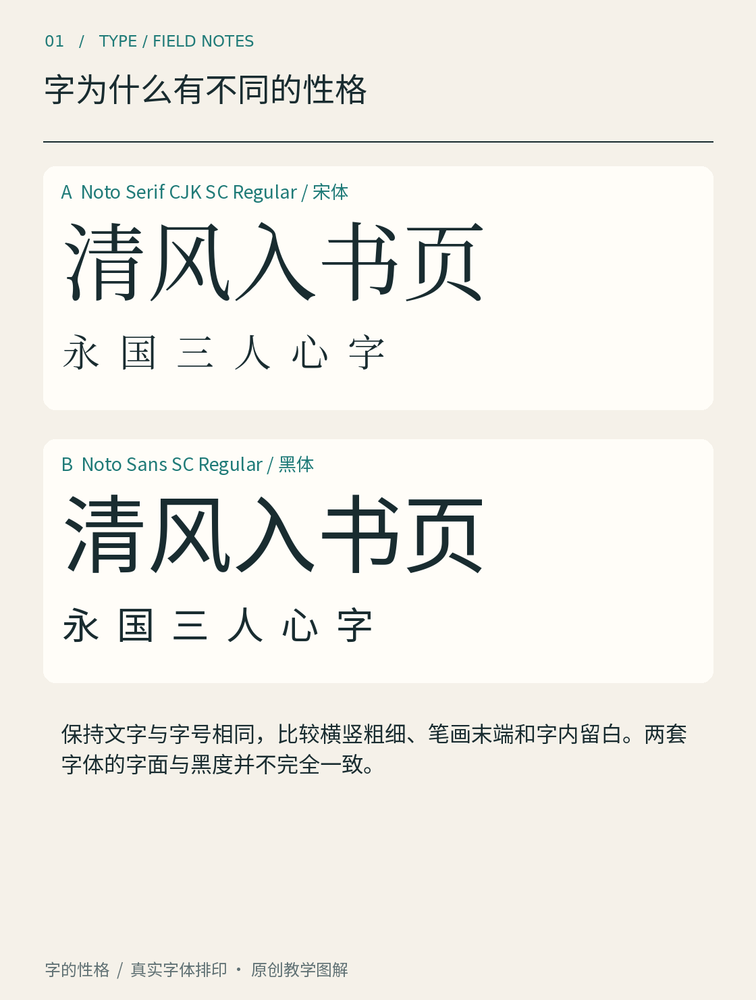

# 第01章　字为什么有不同的性格

走到一家店门口，菜单还没读完，招牌上的字已经给了你一点印象。细长、克制的字可能显得轻盈；厚重、紧凑的字可能显得有力。我们经常先注意到这种感受，随后才读清具体内容。不过，字体的性格并没有一张固定的情绪对照表。同一种字放在儿童图书、银行账单和乐队海报上，会与文案、颜色、尺寸和使用经验共同发生作用。

*图 01｜真实字体排印的同文对照。请先比较笔画与空间，再描述感受；样本只代表图中具体字体。*

## 从“感觉不同”走向“哪里不同”

图中的同文比较，刻意保留相同内容，让字形成为主要变量。先看单字：宋体横画和竖画之间通常有较明显的粗细关系，末端也常有小的形状变化；黑体则把更多注意力放在相对均匀的笔画和简化的末端上。再退远一点看整行：那些细部汇成不同的黑白纹理。此时你看的已经不只是一个字，而是许多字共同组成的“文字表面”。

可以沿三个尺度观察。近看笔画的起止和转角；中距离看一个字的宽窄、内部空隙与重心；退远看一行或一段的浓淡、疏密和节奏。有些字体在大标题里很有魅力，缩成正文后细笔画却难以辨认。有些字体单看没有特别醒目的特征，排成一页时却能提供稳定的阅读感。两个判断都可能成立，因为使用尺寸已经改变。

这里的“浓淡”不是实际墨色一定不同。同样的黑色，笔画占据的面积更大，整段往往就显得更深；留白较多，整段可能更轻。这种远看文字形成的整体明暗，排版讨论中也常称为文字的灰度。它有助于比较页面，但不能直接代替可读性测试。

## 性格来自形状，也来自经验

把宋体理解成“古典”、黑体理解成“现代”，适合当最初的记忆线索，却不能当作选字规则。今天的宋体可以用于科技品牌，黑体也能出现在讲述历史的出版物里。我们对字体的联想，一部分来自形状，一部分来自过去见过的使用情境。读者的语言、地区、年龄和阅读习惯不同，联想也会改变。

更可靠的说法应当落到具体关系上。例如：“这套字体的竖画厚、字面大，放在小卡片上有些挤”“这套字体的细节丰富，适合让标题停留得久一点”。这些描述能指向下一步修改。只说“高级”“有温度”，很难判断到底该换字体、改字号，还是增加留白。

Adobe 为思源宋体提供设计指南，并把它作为与思源黑体相对应的泛中日韩字体项目来介绍。这样的成套项目也提醒我们：即使同属一套设计计划，宋体与黑体仍然通过不同的形状组织保持各自特点。阅读项目说明可以认识设计目标，真正使用时仍要查看具体字样。[资料：Adobe《Source Han Serif》项目](https://github.com/adobe-fonts/source-han-serif)

## 做一张有用的比较纸

选一句你熟悉的话，包含笔画少和笔画多的字，再加一个日期与标点。先用两套字体排成相同字号和行长，不加插图，也不换颜色。分别圈出三个差异：某一笔的粗细、某个字的内部空间，以及整行的密度。接着把两行缩小到手机正文的实际阅读大小，看看最初的判断是否仍然成立。

这一步也有一个小陷阱：相同字号不保证视觉大小相同。字形在其设计空间中占据的比例可能不同。因此先记录“同字号”下的状态，再做一次视觉大小接近的比较，能帮助你区分尺寸影响与风格影响。后文会详细拆解字面和字号的关系。

最后给两套字体各写一句用途说明，而不是打一个总分。例如，一套适合需要安静阅读的短文；另一套适合需要迅速扫到的活动信息。你的依据应来自刚才看到的差异。等书读完，再回来看这张比较纸，你大概会发现自己能指出更多原因。学习字体的第一步，正是让含糊的喜好逐渐成为可以讨论、可以验证的观察。

本章资料：

- [Adobe：Source Han Serif 官方项目与设计指南入口](https://github.com/adobe-fonts/source-han-serif)，用于了解真实字体项目的设计范围；本章观察方法及练习为原创教学组织。
