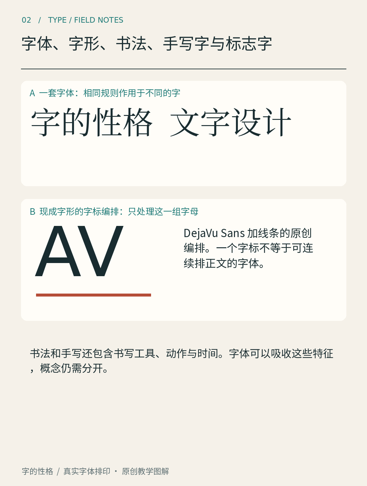

# 第02章　字体、字形、书法、手写字与标志字

在设计软件里选一种字体，写一张生日卡，或者给店铺画一个名字，看起来都在“做字”，实际解决的问题却不同。分清这些工作，有助于给自己设定合适的目标：设计四个店名字，不必先完成几千个汉字；做好一套字体，也不能只让几个最漂亮的字互相搭配。

*图 02｜一组字样可以作为普通排印，也可以通过尺寸、位置与间距形成字标编排。图中 DejaVu Sans 编排使用现成字形，不是原创字形轮廓。*

## 先区分文字与它的样子

“字”在日常语言里承担了很多意思。本书需要时会作更细的区分：字符是文本所表达的抽象单位；字形是它在具体字体与排版环境中的可见形态。你把同一个汉字换成宋体、黑体，文本内容通常没有变，可见轮廓却改变了。字体文件提供的不只是图片，还包括供软件选择、排列和处理字形的数据。

字符与字形不总是一对一。字体可以为同一字符准备不同字形；有些文字排版中，多个字符也可能形成一个连字字形。这里先记住“文本内容”和“可见形态”属于两个层面即可，不必一开始就记住全部技术细节。[资料：FontForge《Typographical glossary》中 Character、Glyph 相关条目](https://fontforge.org/docs/glossary.html)

日常中文所说的“字体”既可能指某一套视觉设计，也可能指安装在电脑上的具体文件。本书谈观察与风格时，通常指一套具有共同特征的设计；谈安装、版本和授权时，会明确写“字体文件”。英文中的 typeface 与 font 也常依语境使用。理解当前在谈哪一层，比机械纠正别人的叫法更有帮助。

## 字体需要面对没有见过的句子

字体设计面对的是一个系统。使用者会输入设计师事先不知道的标题、姓名和段落，所有字形都需要在这些组合中保持可用。假设你画好了“春日来信”，其中四个字各有特色，但一输入“营业时间”，笔画厚度、视觉大小与字距便互不协调，那么你目前拥有的是一组完成度不一的字样，还没有稳定的字体系统。

这也是为什么完整字库的工作远超过“把字画好看”。它需要确定覆盖哪些字符，怎样处理标点、数字、拉丁字母，怎样保持大量部件的一致性，以及怎样在不同字号下测试。某一处漂亮的细节，必须能够推广到许多相关字形，或者有清楚的例外理由。

## 书写是动作，排印是重复使用

手写字留下了一次书写行为的结果，速度、力度、工具和纸面都会进入痕迹。书法在具体传统中进一步组织笔法、结构、章法与表达，不能只用“写得随意”来概括。把书写痕迹制成字体，则需要把一次性的形态转化为能重复组合的资源。字体可以保留手写气息，但同一个字反复出现时若完全相同，读者也可能注意到这种重复。

所以“像手写”与“真是手写”不同，“有书法风格”也不等于展示了一件书法原作。图像来源需要分别说明。用数字字体排出的毛笔风格标题，应该标为字体排印，不宜写成某位书家的手迹。反过来，历史手稿也不能直接当作现代字体的全套使用样张。

## 标志字可以专门为一个名字服务

标志字通常服务于固定名称，可能重新绘制轮廓，也可能在现成字体基础上调整间距、比例或组合关系。图 02 展示的是后一类思路中的编排练习：现成字形通过位置和间距形成一个整体。即使结果看起来独特，也不意味着已经设计了新的字体轮廓，更不意味着获得了一套可输入任意文本的新字体。

这样的边界并不会降低编排工作的价值。固定名称的字与字之间，可以建立特别紧密的形状关系；某一笔可以呼应另一字，某个空隙可以针对这几个字单独修正。只是这种解法未必适用于其他文本。拿到成果时，应检查自己得到的是图片、可编辑矢量字标，还是可安装字体文件。

试着给一间虚构书店设计名字。第一稿只用现成字体，调整字号与间距；第二稿手写一次；第三稿只挑一个字改轮廓。把三稿放在一起，分别标明“排印”“手写”“改绘”。你会更清楚地看到每一步改变了什么，也更容易决定下一步需要学习排版、书写，还是字体制作。

本章资料：

- [FontForge：Typographical glossary](https://fontforge.org/docs/glossary.html)，字符、字形及字体技术术语入口。
- [Adobe：Fonts by Adobe FAQ](https://www.adobe.com/products/type/fonts-by-adobe.html)，数字字体相关基础说明。
