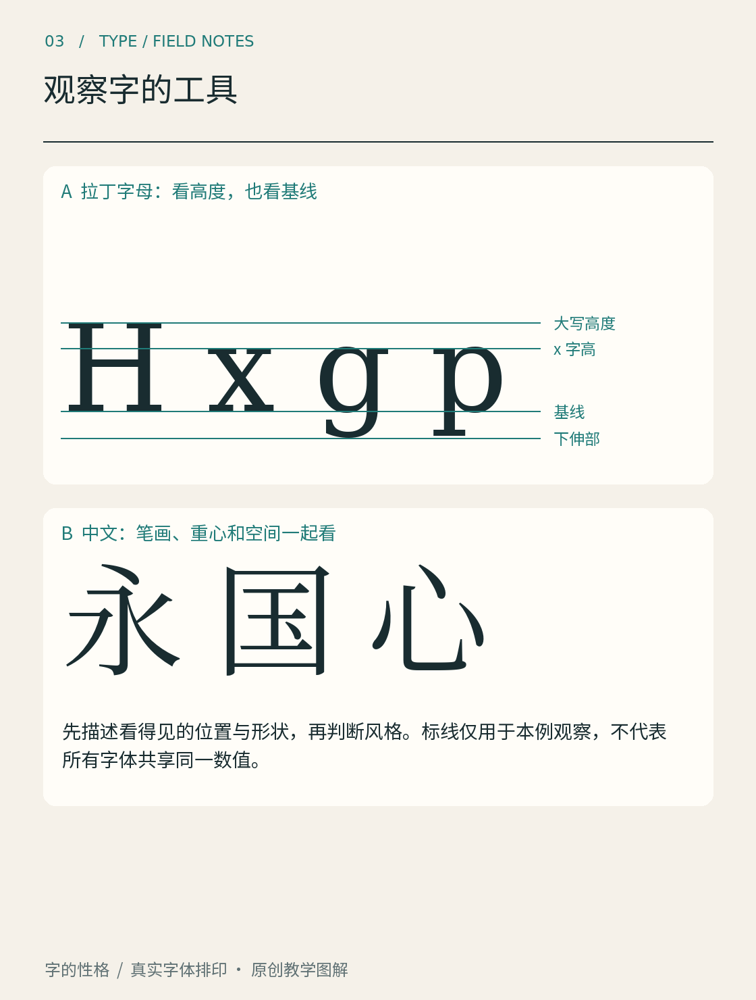

# 第03章　观察字的工具

你觉得两种字体差不多，往往只是还没有找到比较的位置。像认识叶子时先看叶缘、叶脉和形状一样，认识字体也可以先准备几把观察工具。它们不是要求你把字拆得失去整体，而是让“有点不一样”能够变成具体描述。

*图 03｜DejaVu Serif 的真实字样与教学标线。H、x、g 分别帮助观察大写高度、x 高度及下伸部分；标线针对本图样本，不能直接套作所有字体的尺寸表。*

## 一条基线，几种高度

拉丁字母中，基线是排列字形的重要参照。小写 x 从基线向上的高度称为 x 高度；H 这类平顶大写字母帮助观察大写高度；g 或 p 等字母则可能有伸到基线下方的部分。FontForge 的术语表对基线、x 高度、上伸与下伸部分都有定义。这些参照帮助我们解释，同一字号的两套字体为什么会显得大小不同。[资料：FontForge《Typographical glossary》](https://fontforge.org/docs/glossary.html)

看图时先把注意力放在 x 上，再看 H：小写字母相对大写字母有多高？接着看 g 向下占了多少空间。不要只用最外面的包围框判断字号。包围框记录轮廓边界，字号则与字体的设计尺度有关；一个字形的可见高度没有必要正好等于软件中填写的字号。

圆形与尖形还可能略微越过理论参照线，以协调视觉上的大小，这类处理常被称为视觉越界（overshoot，也称视觉溢出）。现在不必追求测量出一个通用比例，重要的是发现：设计中的几何齐平与人眼感到齐平，有时需要分别处理。第 16 章会通过轮廓修改进一步说明。

## 看笔画：粗细、方向与末端

挑出图中的一根竖画、一处曲线和一个末端，分别比较。竖画是否比横画更厚？曲线的最厚处在哪里？末端是平切、斜切、圆收，还是带有突出的衬线？“粗细对比”说的是同一字形中较粗和较细部分的关系，不是整套字体有多黑。两套字体都可以很粗，却具有不同的粗细对比。

接着看转角。外角尖锐不等于内角也尖锐；曲线从粗到细的过渡可以突然，也可以缓慢。把这些局部放大后，再缩回正常阅读尺寸，观察哪些细节仍然影响整体。只在极大倍率下才能看到的差别，未必是当前用途最重要的选择依据。

## 看空白：字里面与字之间

字形的白色区域与黑色笔画同样值得看。o 的内部空间，e 的开口，中文“国”的内白，都会影响识别和视觉密度。不要只数黑线有多厚，还要看这些线把空间切成了什么形状。两个笔画数相同的汉字，也可能因部件分布而呈现不同的疏密。

字与字之间的空白又是另一层。轮廓间的最近距离不一定相同，整行却可能显得均匀；反之，机械等距也可能留下忽大忽小的空洞。原因在于直边、斜边和圆边围出的空间不同。判断节奏时，应看相邻字形共同形成的白色区域，而不是只盯两点之间的一条距离。

## 中文观察需要自己的参照

拉丁字母的基线和 x 高度很有用，但汉字不能简单照搬这套观察法。中文可以从字面、重心、部件关系和内部空间入手。看“口”和“国”，可以比较外框与内部安排；看“人”和“木”，可以比较左右伸展与支撑；看“一”和“鬱”一类疏密差异很大的字，更容易理解为什么不能让每个字都机械占满同一方框。

这些说法是观察工具，不是给所有汉字规定一个固定中心。一个字是否稳定，要放回同一套字体和连续文本里判断。单独放大的字可能显得偏向一边，排成句子后却与相邻字保持了很好的节奏。

找一张书封，先用一句话写下整体印象，再圈出支持这句话的三个位置。第二次只看反白空间，第三次把图片缩小。若你能说出“开口较窄、字面较满、整段偏深”，已经比只说“好像很厚”多了几条可操作的信息。后面的类别图鉴，会不断使用这些观察工具。

本章资料：

- [FontForge：Typographical glossary](https://fontforge.org/docs/glossary.html)，Baseline、X-height、Ascender、Descender、Overshoot 等术语。
- 本章中文观察步骤及练习为原创教学组织，图中采用真实字体排印与辅助标线。
