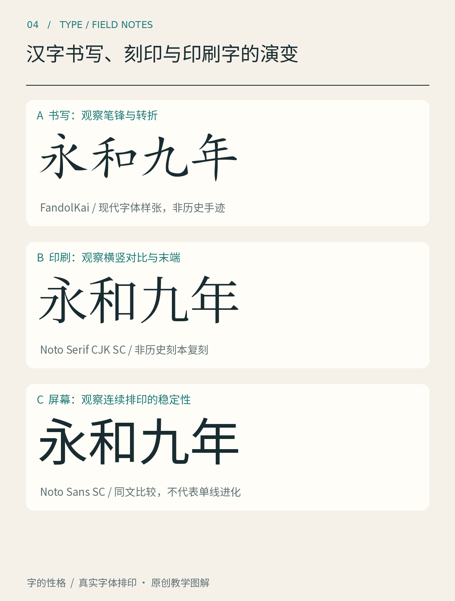

# 第04章　汉字书写、刻印与印刷字的演变

拿起毛笔写一个“永”，再把它刻到木板上，最后让一枚字模在许多页面上重复印出：每换一种制作方式，设计者面对的问题就会改变。字体史值得看的，不只是“先出现哪一种”，还包括谁在制作字、怎样复制字，以及读者怎样接触它们。

*图 04｜“永和九年”的现代字体排印参照，分别使用 FandolKai Regular、Noto Serif CJK SC Regular 与 Noto Sans SC Regular。它帮助比较设计处理，不是历史手迹、古籍刻本或古代字模的复原。*

## 从一次书写到一块印版

书写留下的是一组具体动作的痕迹。起笔、转折、行进速度和墨量都可能改变线条。在雕版印刷中，文字和图像被转换成可刷印的版面。一块版可以重复印出许多份，同一页中也可以保留较灵活的字与图关系。大都会艺术博物馆对中国版画的介绍说明了以纸上书画为起点制作木版的基本方式，也展示了这项技术漫长的使用历史。[资料：Met《The Printed Image in China》](https://www.metmuseum.org/exhibitions/listings/2012/printed-image-in-china)

复制并不等于无损地搬运。写稿与雕刻之间有解释，刀口与纸墨之间有条件，反复刷印与版片磨损也会改变最终结果。因此看古籍字样时，需要同时留意书写底稿、刻工、材料、印刷与保存状态。不能把纸上某处破损，直接当成设计者有意安排的笔画末端。

## 活字改变了组织方式

雕版以整版为主要单位，活字则让单字成为可重组的部件。排列一页、拆散后再排列另一页，要求单字既能独立制造，也能和大量其他字共同工作。字身的尺寸、字面的位置和排版操作都进入了这个系统。汉字数量多，备字、检字和补字也成为实际制作条件。

不过，技术出现的顺序不意味着旧技术立刻退场。美国国会图书馆的亚洲印刷史文章指出，在活字出现之后，整版印刷仍长期占有重要位置。具体技术是否适用，需要结合字符数量、制作成本和用途理解。[资料：Library of Congress《The History of Printing in Asia》第一部分](https://blogs.loc.gov/international-collections/2021/06/the-history-of-printing-in-asia-according-to-library-of-congress-asian-collections-part-1/)

这条历史适合画成多条并行的路径：抄写、雕版、活字在不同场景中各有用途。若只画一条“毛笔被雕版替代，雕版被活字替代”的直线，就会遗漏大量真实使用情况，也难以解释为什么后来的设计还不断回到书写和刻本中寻找资源。

## 宋体的名字不是一张出生证明

今天看到“宋体”，不宜直接推断图中的数字字体就是某一本宋代书的原样复制。现代分类名称、历史书写形态和数字字体产品属于不同层次。某一套宋体的轮廓，需要看它自己的设计说明；某一本刻本的面貌，则要看具体年代、刊刻地点和实物证据。

图 04 将现代楷、宋、黑放在一起，是为了让你看到三个方向：楷体保留较明显的书写结构线索；宋体借助粗细关系和末端形态组织笔画；黑体则以另一套厚度和末端处理建立整体。它们不是同一个字按年代连续变化的三个截图，也不能单靠这张图证明历史上的因果。

现代字体项目本身也在重新组织传统。思源宋体的官方资料把宋体、明朝体等地区术语放在泛中日韩设计的背景中讨论。这样的项目需要面对区域字形和多种语言的使用需求，说明传统风格进入数字环境后仍然有新的设计任务。[资料：Adobe《Source Han Serif》项目及设计指南](https://github.com/adobe-fonts/source-han-serif)

## 看古籍时多问一步

下一次在博物馆或数字馆藏看到古籍，可以先记四件事：它是手写还是印刷，图注记录了什么年代，页面如何安排正文与注释，字形细节是否可能受到材料与保存状态影响。若介绍没有给出某个结论，就先保留空白，避免仅凭“看起来很古”给字体定年。

也可以选一个你熟悉的字，分别抄出馆藏中的形状与本书现代样张中的形状。只描述可见差异，例如横画的倾斜、转折形状和部件比例，不急着给它们排出进化顺序。这样的比较能帮助你理解字体史的丰富性：许多设计选择持续共存，后来的人还会重新解释它们。

本章资料：

- [Met：The Printed Image in China, 8th–21st Century](https://www.metmuseum.org/exhibitions/listings/2012/printed-image-in-china)。
- [Library of Congress：The History of Printing in Asia，Part 1](https://blogs.loc.gov/international-collections/2021/06/the-history-of-printing-in-asia-according-to-library-of-congress-asian-collections-part-1/)。
- [Adobe：Source Han Serif](https://github.com/adobe-fonts/source-han-serif)。
