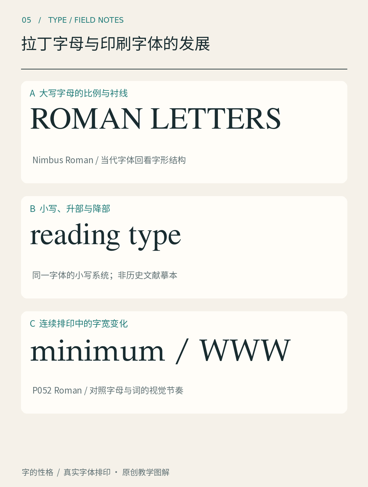
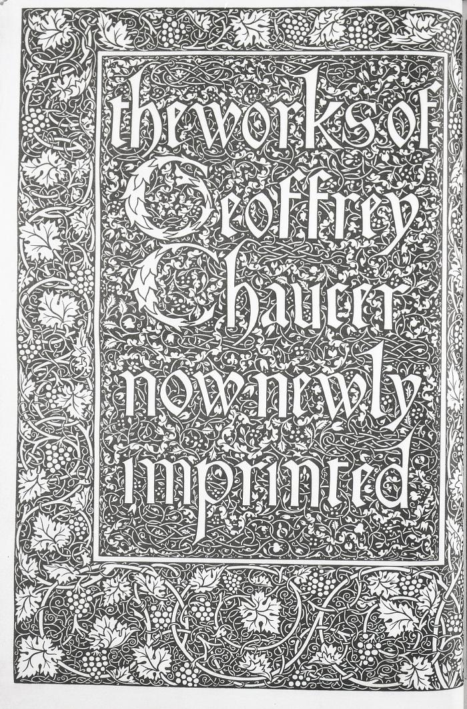
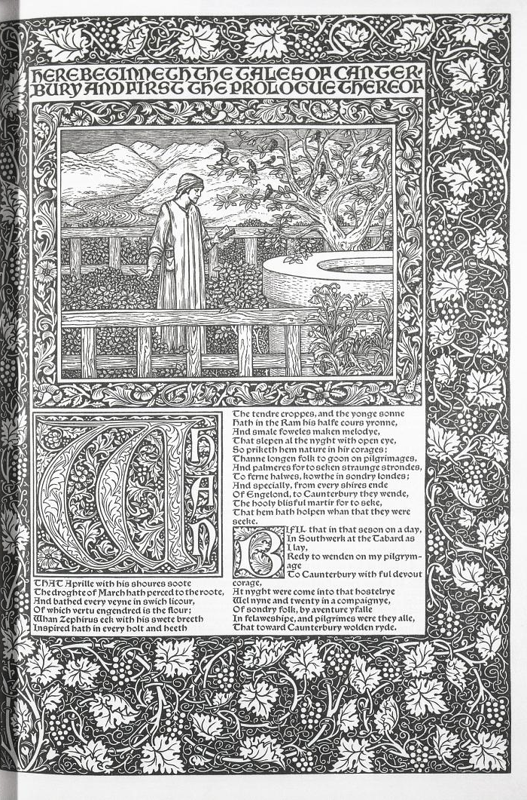

# 第05章　拉丁字母与印刷字体的发展

拉丁字体的历史里，书写与印刷一直相互影响。今天在菜单里看到的衬线体、无衬线体、斜体和装饰字体，不是按一个方向不断升级的等级表。它们来自不同制作条件与使用需求，又在后来的复刻和改绘中不断获得新面貌。

*图 05｜现代字体排印的大写、小写与词组样本。它提供形状比较，不能作为古代铭文、早期印本或原始字模的实物证据。*

## 先看结构，再记名字

观察图中的大写和小写，你会发现两者不是把同一套形状简单放大或缩小。大写往往形成另一种轮廓节奏，小写则借助高低变化、上伸与下伸部分组织词形。把一段话全换成大写，改变的不只是高度，还包括词的整体纹理和占用空间。因此，历史中的大小写发展与今天的标题处理值得分别理解。

再看词组。同一个字母在孤立状态下很容易成为图形，进入单词后却需要与左右邻居相处。印刷字体面对重复生产和持续阅读，需要让一组字母既有可辨认的个体特征，又有相互协调的比例。你在今天的字体里看到的细节，常常兼有书写线索与重复排印的要求。

## 从手稿文化进入印刷文化

欧洲早期印刷并没有突然抛弃读者熟悉的书写面貌。不同地区和用途采用过不同文字风格，后来也逐渐形成我们今天讨论的若干印刷字体传统。这里应留意，“罗马体”是字体讨论中的名称，不表示每一个现代小写字母都是直接照搬古罗马石刻。

关于这段发展，可以把具体馆藏当作锚点，而不是只背几个发明者。看一页印本时，记录正文、首字、标题和插图分别采用什么方式；看一套复刻字体时，则查看它参考了哪个设计、哪个年代，以及现代设计者改了什么。原件、后世复刻和当前数字版本，可能共享名字，却并非同一件东西。

## 用一件真实书籍看层级

*图 05A、05B｜1896 年 William Morris 印制的 Kelmscott Chaucer，取自 Smithsonian National Museum of American History 馆藏对象 nmah_808196。官网图像标为 public domain；本书仅将跨页图裁成单页，便于纵向阅读。[原始馆藏记录](https://www.americanhistory.si.edu/de/collections/object/nmah_808196)*

这两页显示，书籍中的字体不是单独站在白纸上的样本。标题字、装饰边框和正文共同分配注意力：读者先辨认入口，再进入较密的连续文本。观察装饰的面积与正文区域之间的关系，会发现页面的视觉重量来自整套安排。书中每一种大小和纹理都承担不同角色。这是一件 1896 年的作品，也是一种有意识地重新解释历史资源的设计；不能把它当成十五世纪印刷现场的照片。

V&A 关于 Morris 的介绍说明，他为 Kelmscott Press 设计字体，并参考早期印刷作品发展自己的设计。这件案例尤其适合提醒我们：字体史并非只向前走，设计者也会回看旧形式，再根据自己的目标重组它们。[资料：V&A《William Morris: literature and book design》](https://www.vam.ac.uk/articles/william-morris-text)

## 分类帮助辨认，不能代替历史

后文会介绍旧式衬线、过渡式、Didone、板状衬线，以及多种无衬线风格。这些分类可以帮助比较笔画对比、衬线形状和结构倾向，但分类系统并不只有一套，有些字体也横跨多种特征。Monotype 的风格指南本身就按不同形状和历史关联组织类别。[资料：Monotype《A guide to type styles》](https://www.monotype.com/resources/guide-type-styles)

尤其要小心英文分类中的 Modern。它在某些字体史语境里指特定风格，并不是说这类字体就是今年新出的、比其他字体更新的方案。类似地，无衬线体不天然属于科技行业，衬线体也不只能放进古典书籍。历史来源可以丰富理解，最终选择仍要回到内容、媒介和阅读条件。

选一页现代杂志，与图 05A、05B 放在一起比较。不必判断哪一页更先进，先找共同任务：哪里告诉你从何处开始，哪里负责连续阅读，哪里提供停顿与转换？再观察它们如何用不同的字形、尺寸与空白解决这些任务。这样，历史会成为你能使用的设计经验，而不仅是一串字体名称。

本章资料：

- [Smithsonian NMAH：Kelmscott Chaucer，nmah_808196](https://www.americanhistory.si.edu/de/collections/object/nmah_808196)，真实书籍图像来源。
- [V&A：William Morris: literature and book design](https://www.vam.ac.uk/articles/william-morris-text)，Morris 的字体与书籍制作背景。
- [Monotype：A guide to type styles](https://www.monotype.com/resources/guide-type-styles)，分类阅读入口。
