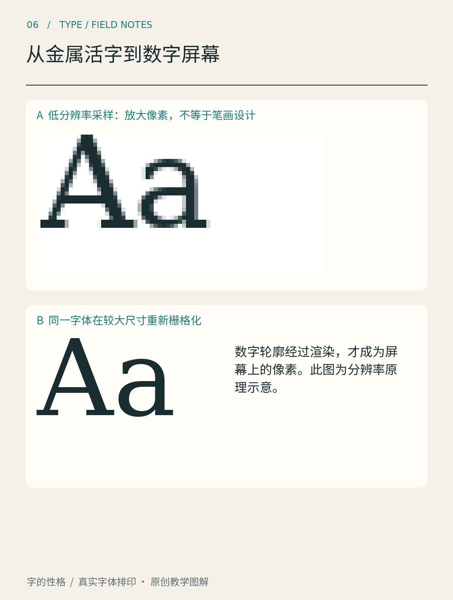

# 第06章　从金属活字到数字屏幕

纸上的字与屏幕上的字可以长得相似，制作和显示它们的方法却不同。一枚金属活字把形状固定在材料上；数字字体把形状及相关规则存入文件，再由程序在输出设备上生成图像。沿着这条变化来看，我们就能理解，为什么同一款字在不同设备上可能显得不一样。

*图06｜真实字体的数字显示实验。低分辨率字样放大后保留像素台阶；大尺寸重新渲染拥有更多像素描述边缘。本图不是早期屏幕的历史复原，也不代表所有渲染器的效果。*

## 从一个实体走向可重复的描述

金属活字需要先制成实体，再排列、印刷。同一个字在不同尺寸下，需要考虑对应的实体与印刷条件。数字化之后，形状可以由坐标和曲线描述，输出时再换算成所需尺寸；这使文字能够进入更加灵活的页面制作流程。

但这条发展并不是“铅字之后立刻就是电脑”。中间还有照相排字等技术阶段。对兴趣读者，重要的是看清保存对象的变化：实体字面、摄影或光学成像，以及数字数据，各自把不同的生产环节连接起来。不要把所有历史工艺都想成一台现代电脑的不同皮肤。

计算机历史博物馆介绍PostScript时，强调它如何用页面描述语言连接计算机与输出设备，并推动数字字体和桌面出版的发展。[资料：Computer History Museum，PostScript: A Digital Printing Press](https://computerhistory.org/blog/postscript-a-digital-printing-press/) 本章借这条线索理解技术改变了什么，不把字体史缩成某个文件格式的发明史。

## 点阵把字分配到格子里

点阵字形可以理解为一张有限大小的格子图：哪些位置有色，哪些位置留白，都已经明确。分辨率很低时，一个像素的增减就可能影响笔画粗细与字腔。针对特定尺寸精心安排的点阵，也可以拥有清楚的阅读节奏，不能仅因它的边缘呈阶梯状就认为它没有设计。

看图中的小尺寸放大样张，重点是观察像素台阶，而不是把它当作一款历史点阵字体。这里是把真实字体先渲染到较少像素，再放大显示。这样的实验帮助我们隔离“可用像素数量”这个变量，但没有模拟早期显示器的全部限制。

拿一张小尺寸文字图片放大，软件只拥有原来那些像素。插值可以让边缘看起来柔和，却不等于找回原字体中丢失的轮廓。若文字仍以字体和文本形式保存，程序就可以按新的尺寸重新生成图像；这也是保留可编辑文字的重要理由。

## 轮廓最终仍要变成像素

轮廓字体用几何数据描述边界，但屏幕不会直接显示抽象曲线。显示时仍须把轮廓转换为像素覆盖，这个过程称为栅格化。低分辨率下，轮廓与像素网格之间的关系尤其明显：几乎一样宽的两条笔画，可能落在不同位置，呈现不同深浅。

TrueType的hinting机制可以根据字体中的指令调整轮廓与网格的关系。Microsoft的说明把这种调整称为grid-fitting，即让轮廓适应具体尺寸的像素网格。[资料：Microsoft，TrueType hinting](https://learn.microsoft.com/en-us/typography/truetype/hinting) 是否使用、怎样解释这些信息，还取决于字体、渲染器与设置，不能从一个截图推断所有平台都会相同。

抗锯齿则可以通过边缘的过渡色表现部分像素覆盖。它能减轻台阶感，也可能让细笔画显得更柔或更浅。字形设计、显示分辨率和渲染策略共同决定结果，字体文件不是唯一因素。

## 用一个小实验连接技术与设计

输入一句话，先保存为很小的图片并放大，再用原来的字体把同一句话直接排大。比较细笔画、圆弧和转角。随后把大字缩回日常阅读尺寸，检查放大时看见的差别是否仍然重要。

这个实验会提醒我们两件事：文字不只是图案，它可以保留可编辑、可搜索的信息；字体也不只是一条理想曲线，它最终需要在现实的屏幕和纸张上被看见。理解这两层，后面讨论字形细节和应用尺寸时就有了共同基础。

## 本章资料

- [Computer History Museum：PostScript: A Digital Printing Press](https://computerhistory.org/blog/postscript-a-digital-printing-press/)。
- [Microsoft：TrueType hinting](https://learn.microsoft.com/en-us/typography/truetype/hinting)。
