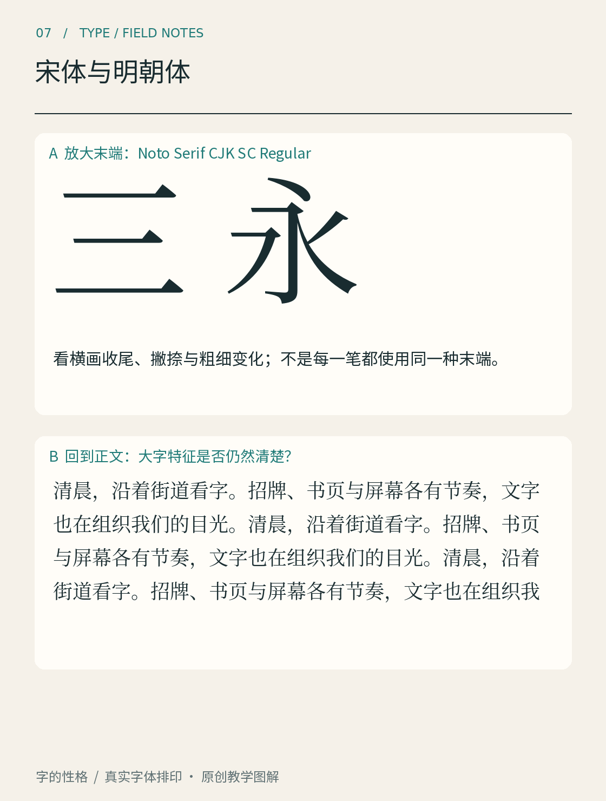

# 第07章　宋体与明朝体

在一页中文书里，我们常能见到这样一类字：横画相对细，竖画相对粗，部分横画末端带有明显的收笔形状。它们常被称为宋体；在日文字体中，会遇到明朝体这一名称。名称是进入类别的入口，真正的识别还要回到笔画与结构。

*图07｜真实字体排印。先放大观察「三」「永」的横竖、末端与转折，再回到下方正文观察连续阅读中的色度。图内具体字体名称以标注为准。*

## 先看一个横画，再看整段文字

「三」很适合初步观察。三道横画虽然都向左右伸展，长度、位置和端部处理仍然可能不同。不要把末端的小形状看作后来随意贴上的装饰：它与整条笔画的粗细变化、结束方式一起形成特征。

再看「永」。横、竖、点、撇、捺的关系，比「三」复杂得多。一款字体是否协调，不能只用一条横画判断。观察较细的部分是否还能清楚辨认，较粗的部分是否挤占内部空间，各种方向的笔画是否形成稳定节奏。

随后把目光移到正文。放大样张突出了细节，连续排印则显示文字的整体色度。某款字体的大字精致，不代表它的小字号一定适合你的屏幕；某个字单独看很有个性，也可能在整段中显得突兀。这两个尺度需要来回切换。

## 类别相近，不等于字形相同

Adobe的思源宋体项目同时使用了中文的思源宋体、日文的源ノ明朝等名称；它把不同地区的字形需求纳入同一大型项目。[资料：Adobe，Source Han Serif官方项目](https://github.com/adobe-fonts/source-han-serif) 这为理解宋体与明朝体的关系提供了具体参照：它们可以属于相关的设计大类，但语言、地区、假名与具体汉字形态仍有自己的要求。

因此，不宜从名称直接得出“所有明朝体都是同一种中文宋体”，也不要因为某款字体包含汉字，就默认它是目标地区的合适版本。选用时要核对字库的区域配置与实际字形。详细的中日韩处理放到第13章，这里先把“风格类别”与“地区字形”分开。

还要避免把名称当作准确年代标签。今天电脑里的一款宋体，是具体设计团队在特定技术与使用条件下完成的作品。它可以继承历史印刷语言，又不必等同于某一本宋代书的字样。历史来历与当代字形设计，需要各自的证据。

## 同属宋体，也有不同的面貌

有的宋体整体紧凑，有的字面舒展；有的笔画对比强烈，有的细部更厚实；有的末端尖锐，有的更柔和。可以用三个维度来比较：笔画粗细差有多大，内部空间有多开放，曲直衔接有多明确。这些观察比只说“古典”“文艺”更容易复核。

日文字厂Morisawa对A1明朝的介绍，强调其汉字曲线与假名表情形成的特点。[真实参照：Morisawa，A1明朝](https://www.morisawa.co.jp/fonts/specimen/1075) 打开官方样张时，可以观察它在整个文字系统中的效果，而不是只截取一个汉字。此处是外部真实案例，本书图07并不冒充A1明朝。

## 用宋体之前，先给它一个任务

长篇阅读需要持续检验正常字号下的节奏；海报标题则可以放大笔画对比和空间特征。不要用“宋体只能做正文”或“宋体天然高级”来代替选择。把你的真实文案排出来，看它能否表达需要的内容，是否适合显示条件。

一个简单练习是，把同一段短文分别排成标题、正文与注释。只改变尺寸和角色，先不换字体。若细笔画在小尺寸中明显变弱，考虑增大字号、调整字重，或者更换适合这一任务的设计；不要只给整张图加锐化。

读完这一章，试着把“我喜欢这款宋体”展开成一句可观察的描述，例如“它的横竖对比明显，字内空间舒展，放大后端部很鲜明”。当你能这样描述，选字就开始从印象走向判断。

## 本章资料

- [Adobe：Source Han Serif官方项目与设计资料](https://github.com/adobe-fonts/source-han-serif)。
- [Morisawa：A1明朝字体样张](https://www.morisawa.co.jp/fonts/specimen/1075)。
