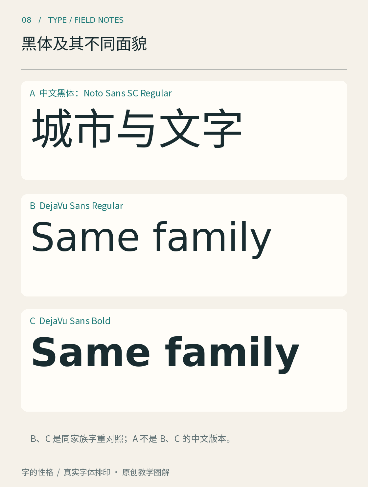

# 第08章　黑体及其不同面貌

黑体常出现在手机界面、产品说明和交通信息里。初看时，它似乎只是去掉宋体末端、把笔画做得粗细接近。继续观察便会发现，黑体同样需要处理转角、开口、重心与密度；“粗细接近”也不是每一笔都必须具有相同的几何宽度。

*图08｜上部为Noto Sans SC中文常规字样，下部为DejaVu Sans的常规与粗体。下部两种字重属于同一拉丁字族，不能用它们冒充Noto中文黑体的粗细版本。*

## 黑体的特征在结构里

先看「清风」这样的短词。注意横画与竖画在视觉上是否均衡，转折处是否显得过重，部件之间有没有充足空间。均匀的整体印象，可能来自许多不完全均匀的局部调整。几何数字相等，不一定产生相同的视觉重量。

再观察「器」「画」一类密集字。笔画增加之后，设计师需要让内部空间仍可分辨；如果只给所有笔画机械加粗，很容易把白色部分挤没。由此可以理解，粗黑体不是常规黑体外面简单增加一圈描边。

黑体也可以显得柔和、紧凑、舒展或有书写意味。这些感受应落实到具体特征：端部是平切还是带角度，转角是硬朗还是圆润，内部空间偏封闭还是开放。只凭“无衬线”这一条件，无法描述全部差别。

## 中文黑体与拉丁无衬线要一起观察

中文黑体通常会与拉丁字母、数字和标点同时使用。它们共享页面，却不共享完全相同的结构。汉字的方块组织与拉丁字母的大小写、高低变化，需要在视觉大小和位置上协调。

图中的DejaVu Sans常规与粗体让我们单独观察字重：粗体的笔画更重，内部空间与字间关系也随之变化。它们是同一字族中真实存在的字体文件；上方的中文样张则属于另一套字体。跨字体对照能帮助看现象，但不能据此宣布两者由同一设计规则生成。

[资料：DejaVu官方项目](https://dejavu-fonts.github.io/)可以帮助确认字族名称与样式。使用样张时，先核对实际文件，再讨论视觉结果，是避免误认字体最简单的方法。

## 一套黑体可以覆盖很多任务

Adobe的思源黑体项目面向多种东亚文字，并提供不同配置与字重，其官方说明也区分源文件和面向使用者的字体分发。[资料：Adobe，Source Han Sans官方项目](https://github.com/adobe-fonts/source-han-sans) 这样的项目说明，当代黑体不仅是一个“字形风格”，还是字符覆盖、地区配置、家族关系与技术交付的共同工作。

但覆盖广并不表示任意版本都适合任意语言。选择时需要看清具体地区和字符需求，也要检查你的排版工具如何调用字体。下载了一个名称熟悉的文件，只是开始，并不替代真实文案测试。

## 用字重建立层级，也要留出空间

黑体很适合做一个控制变量练习：保持文案、字号和颜色不变，只把标题从常规改为粗体。若入口更明显，说明字重发挥了作用；若标题变得拥堵，可能需要同时重新检查内白与字距。然后回到正文，避免把每一条重点都加粗，最终全篇同样重。

为一张阅读活动卡选字时，可以先让黑体承担时间、地点和报名信息。它的作用是让读者迅速找到行动条件；主标题是否也用黑体，则要看整体表达。使用场景不是类别的固定命运，真正的判断仍需通过内容与尺寸。

最后做一次缩小检查。粗字在近看时更有力量，缩小后未必永远更清楚；细字在大屏上轻盈，也可能在实际手机上过弱。记录具体难读位置，再选择字重和排版调整。把黑体看成一组精细设计的结构，就能摆脱“越粗越清楚”的简单判断。

## 本章资料

- [Adobe：Source Han Sans官方项目](https://github.com/adobe-fonts/source-han-sans)。
- [DejaVu Fonts官方项目](https://dejavu-fonts.github.io/)。
