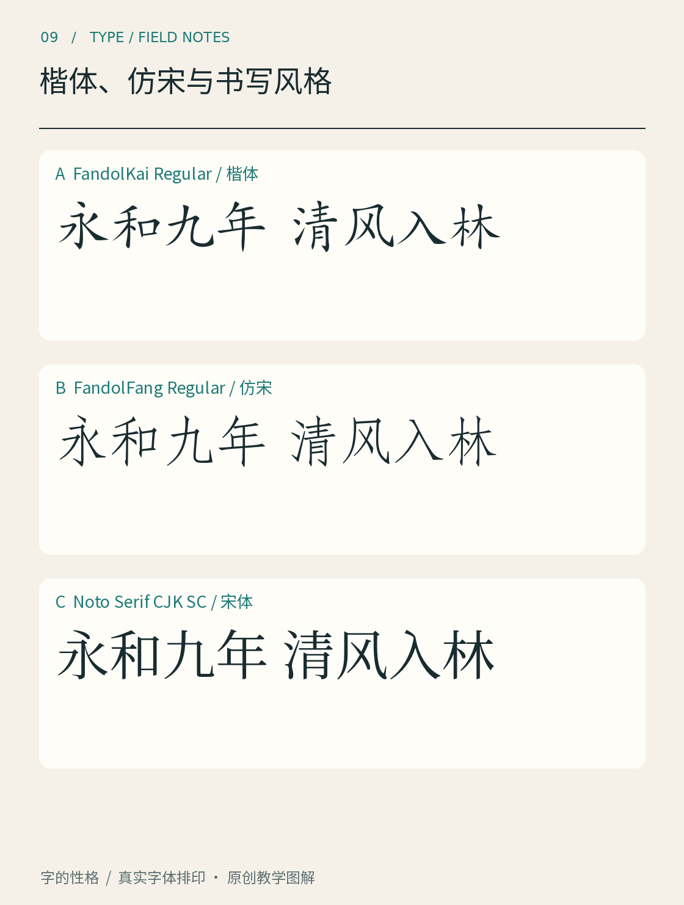

# 第09章　楷体、仿宋与书写风格

有些字让人想起毛笔运行，有些字端正纤细，却仍能看出起收笔的意味。它们可能出现在课本、说明文字、题签和引文中。要把这些印象变成识别能力，可以先区分三个对象：一笔一笔写出的书法作品、根据书写特征设计的可重复字体，以及借用某些笔意的印刷字形。

*图09｜分别使用FandolKai、FandolFang和Noto Serif CJK SC真实排印同一文字。它们是三款具体设计，不代表各类别的所有可能；宋体作为相邻类别参照。*

## 从楷体看笔意与结构

先看FandolKai样张的转折、撇捺与点画。与笔画对比更明确的宋体相比，它更容易引导我们想象书写的起止和方向。但字体中的每个字符需要反复组合，同一个字通常不会像手写那样每次出现都自然变化。

这一区别很重要：使用楷体能产生书写联想，却不等于页面上真的保存了一位书写者当时的速度、压力和情绪。书法作品中的连贯气息，与字体设计中对整套字符的统一，是相关而不同的工作。

比较时选「永」「清」「间」之类结构不同的字。看点画是否有轻重，斜向笔画怎样展开，外框与内部如何保持平衡。不要只因为某个末端尖细，就认定它属于楷体；需要把笔意、字的结构和连续排印放在一起判断。

## 仿宋要与宋体放在一起看

仿宋与宋体的名称容易让初学者误以为只是同一种字体的两档粗细。把图中FandolFang与Noto Serif CJK SC并排，先看横竖关系，再看末端、转折和整体比例。FandolFang的线条组织、笔意与空间处理形成自己的面貌，不应通过把宋体横向压缩或减细来代替。

这里的差别来自具体字体样本，不能宣布所有仿宋永远细长，或所有宋体永远横细竖粗到同一程度。类别内部存在变化，字体名称也可能受到历史、地区与产品命名方式影响。比较真实文件，比只听名字更可靠。

CTAN将Fandol明确列为面向中文排版的字体项目，包含Song、Hei、Kai和Fang四类，均以OpenType形式提供。[资料：CTAN，Fandol项目](https://ctan.org/pkg/fandol) 本书利用其中的楷与仿宋作实排教学，不把样张解释成古籍原版字样。

## 书写感可以有不同来源

一款字体可以保留毛笔轻重，也可以模仿钢笔、铅笔、记号笔或日常手写。辨认时先问：它的粗细变化像哪一种工具，笔画边缘是否规则，重复出现的字是否完全相同，连续文本是否保持同一种节奏。

这些问题帮助我们把“手写风格”拆开。规则字体也可能有自然的书写气息；一款充满不规则边缘的字体，也可能只是反复使用同一组固定轮廓。不要把视觉上的粗糙自动等同于手工，更不要把书写风格当作只有一种面貌的类别。

如果字体提供替代字形，重复字符的外形可能有所变化，但这需要实际字体数据和软件支持。没有验证时，不应因为一张宣传图中出现不同写法，就推断它能自动随机替换所有字符。

## 在应用中控制书写感的分量

用楷体排一段引用，可以让它与主文形成区别；用仿宋排说明，也可以得到另一种节奏。但这些是设计选择，不是类别固定用途。先核对正常阅读尺寸下的清晰度，再看它是否帮助读者理解角色。

做一张三栏短文实验：内容、字号和颜色保持一致，分别用图中的楷体、仿宋和宋体排印。先读完整段落，再选一个相同的字放大。记录你感到“更舒展”或“更紧凑”的具体原因，是字面比例、笔画关系还是行距造成的。下一步可以只调整行距，看看印象是否变化。

这种练习的收获不是选出永远最好的一类，而是学会把书写联想、字形结构与阅读条件分别说清。之后遇见一张带有浓厚笔意的海报，就能理解它为什么有效，也能判断它是否适合继续承担长篇正文。

## 本章资料

- [CTAN：Fandol](https://ctan.org/pkg/fandol)，字体项目、类别及文件来源。
- [Noto CJK官方项目](https://github.com/notofonts/noto-cjk)，宋体参照字体的官方资料。
