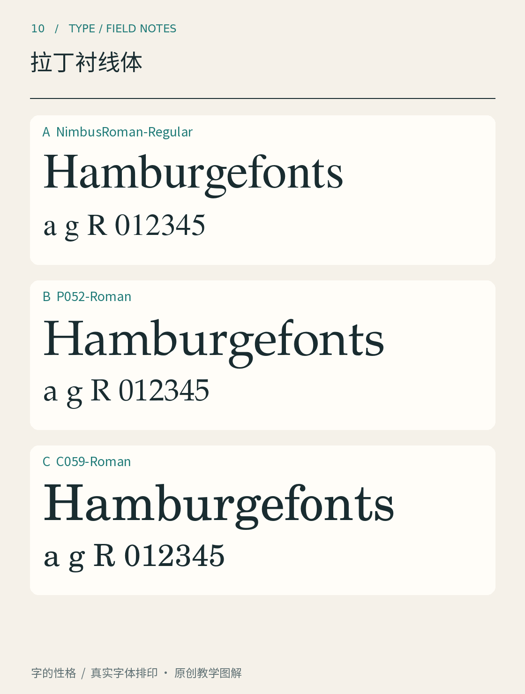

# 第10章　拉丁衬线体

拉丁字母的某些笔画末端，会伸出短小的横向或楔形结构，通常称为衬线。但识别一款衬线体，不能只数它有没有这些“小脚”。粗细对比、圆形的倾向、衬线与主笔画的连接方式，以及小写字母的比例，共同构成它的面貌。

*图10｜三个实际字体文件的同文对照。它们来自URW Base 35字体集合，用于观察设计差异；并不分别代表全部历史阶段，也不是Garamond、Baskerville、Bodoni原作的替代图。*

## 从端部走进整组字母

先看大写H的竖笔末端，再看n的拱部、a的内部空间和o的粗细变化。衬线究竟厚还是薄，连接处是逐渐过渡还是突然相接，字母内部是否紧凑，都能成为描述线索。若只盯着字母底部，容易错过更有辨识力的比例关系。

比较图中的三行时，先保持相同名义字号，观察哪一行视觉上更大，哪个字母更宽；再关注同一段文字占用的长度。字族之间的字面和度量不同，所以“同样24号”并不保证可见高度和行长一致。需要做应用选择时，还应在视觉大小相近的条件下复测。

图中的Nimbus Roman、P052和C059是具体字体名称，资料可在Artifex维护的URW Base 35官方仓库核对。[字体来源：Artifex，URW Base 35](https://github.com/ArtifexSoftware/urw-base35-fonts) 它们可以用于实排比较，但不能因为某个名称不熟悉，就随意把样张标成另一款著名字体。

## 用历史分类作观察地图

字体资料中常出现Old Style、Transitional、Didone和Slab Serif等名称。不同分类体系的边界并不完全相同；先把它们当成帮助观察的地图，而不是必须把所有作品强行塞入的四个盒子。Monotype的类型指南按结构特征介绍了这些分支。[资料：Monotype，A guide to type styles](https://www.monotype.com/resources/guide-type-styles)

| 常见分支 | 优先观察的特征 | 初学时容易误解的地方 |
|---|---|---|
|Old Style，旧式衬线|书写意味、圆形倾向、较温和的粗细关系|“旧式”不表示字体文件制作年代很早|
|Transitional，过渡式|更明确的对比与更规整的形态|名称描述设计谱系，不表示未完成|
|Didone，迪多内类|强烈粗细对比、细而明确的衬线|“Modern”这一历史用语不等于今天最新|
|Slab Serif，板状衬线|较厚实、有分量的衬线|厚衬线并不自动意味着等宽或打字机字体|

表格只提供入门线索。遇到混合了多种特征的新设计，应先描述它实际上长什么样，再查看设计者给出的定位；不需要为了得到一个标签而忽略眼前的差别。

## 正体、斜体与家族关系

衬线字族中的斜体，有时不仅是把正体倾斜，而会改变a、f等字母的结构与笔意。比较时要看具体文件。软件的人工倾斜效果，与字族设计者提供的italic，不能直接当作同一回事。

同理，粗体也需要维持字腔、衬线与连续节奏。练习时把常规、粗体和斜体排成一句话，检查强调部分是否清楚，又是否打断太多。若没有取得某个样式，先说明缺少该文件，避免用合成效果假装展示完整字族。

## 把类别放回阅读任务

衬线体可以服务书籍正文，也可以成为海报标题、包装名称或数字品牌的一部分。细而对比强的设计，在大标题中可能鲜明；到了小字号和低对比环境，细部就需要重新检查。没有一种类别天然赢得所有阅读场景。

做一个小练习：取一句英文标题和约一百词正文，分别用图中的三款字体排印。先观察标题，再连续读正文，记录换行、字面大小与视觉色度。随后只调整字号，让三款看起来接近，再比较一次。你会看到，选字体与调排版并不是两个完全分离的阶段。

这一章的目标是让“这是一款衬线体”变成更精确的判断：它的对比如何，末端怎样连接，圆形怎样展开，在目标尺寸下又怎样工作。下一章进入无衬线体时，同一套观察方法依然有用。

## 本章资料

- [Artifex：URW Base 35官方字体仓库](https://github.com/ArtifexSoftware/urw-base35-fonts)。
- [Monotype：A guide to type styles](https://www.monotype.com/resources/guide-type-styles)。
