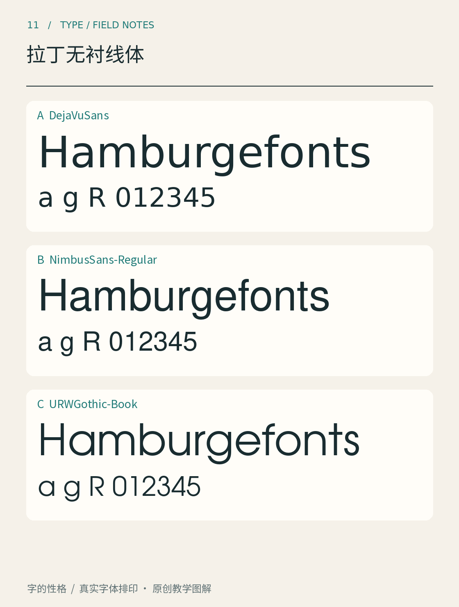

# 第11章　拉丁无衬线体

车站的方向牌、手机的设置页面和展览海报，常常使用没有明显衬线的拉丁字母。但把它们放在一起，差异仍然很大：有的字母宽阔、近似圆形，有的紧凑、开口收束；有的保留书写的起伏，有的像一套机械零件。无衬线只是共同入口，并没有替这些字体决定性格。

图11以 DejaVu Sans、Nimbus Sans 和 URW Gothic 排出真实字样。先忽略名称，只比较同一串字母的宽窄、开口和内部空间。三者是独立字体，并非某一字体的三个字重；样张也不是无衬线体全部分支的代表全集。字体来源可分别追溯到 [DejaVu 项目](https://dejavu-fonts.github.io/)与 [URW Base35 项目](https://github.com/ArtifexSoftware/urw-base35-fonts)。

## 从几个字母看出区别

圆形是容易观察的入口。看大写 O：它接近正圆，还是较窄的椭圆？再看小写 o，圆形与相邻直笔之间的留白是否均衡？即便轮廓接近圆，设计师也可能调整左右、上下的粗细和曲率，不能因为一眼像几何图形，就把它理解为直接用圆规画出的结果。

接着看 a、g、e、R。a 和 g 的单层、双层结构会明显改变词语纹理；e 的横画角度与开口大小，则影响小字中的辨认。R 的腿可以笔直伸出，也可以带曲线。一个字母常能提供线索，但分类仍要回到整套字：替代字形、斜体及不同版本，都可能改变这些局部特征。

第三步是把文字缩小。大字号时颇有魅力的小开口，在小屏幕上可能变得拥挤；看起来轻快的细笔画，也可能在低对比背景上失去存在感。字样图展示的是形态，最终用途还需要在实际尺寸和显示条件下判断。

## 分类是地图，不是身份证

介绍无衬线体时，经常遇到怪诞体、新怪诞体、几何无衬线与人文无衬线等名称。可以用它们组织观察：有些设计强调圆与直线的构成关系，有些延续书写式比例和笔画变化，有些追求紧凑、平稳、适于大量编排的字面。不同分类体系的边界并不完全一致，许多当代家族也混合了几种倾向。

因此，与其只说“这是一款几何体”，不如补充一句可验证的描述：“圆形字母较饱满，a 使用单层结构，部分大写字母宽度变化明显。”后一句能帮助别人找到同样的特征，也能解释为什么另一款同属几何倾向的字体看起来不同。

本章的三款样张适合练习这些观察，但不能用其中任何一款代替历史上的所有几何体或人文体。购买或下载某款字体前，还应查看字厂提供的完整样张，而非只凭字体名称推测其结构。

## 无衬线也会有语气

设想同一句英文“Open every day”。用于社区花店时，宽松、开放的字形可能有助于形成亲切感；用于工业设备面板时，设计重点可能转向数字区分、狭小空间和稳定读取。不过，这些都是设计判断的起点，不能变成“圆润必然友好”“无衬线必然现代”的心理定律。同一句话的字重、字号、间距、颜色和所在环境，都能改变语气。

选字时先排列三个版本：保持字号、字重级别和文本相同，只换字体；再按视觉大小略作校准；最后放进实际版面。第一轮帮助看结构，第二轮避免把“大一些”误认成“更有力量”，第三轮才检验它是否适合任务。Google Design 的[选用网页字体入门文章](https://design.google/library/choosing-web-fonts-beginners-guide)也把实际阅读条件作为选择的重要部分。

另一个有用的比较，是把文字分成大写与小写两组。全大写标题由相近高度的字母构成，宽窄和字距会更加突出；小写段落出现升降部、圆形与连接节奏，评价重点随之改变。一款在大写短标题里显得稳健的字体，进入密集小写正文后可能呈现完全不同的纹理。不要只看字厂首页最大的那一句话，也要找它的小字段落样张。若样张没有所需语言或符号，就用自己的测试文本补上。

你可以从图11挑出两个最容易混淆的字母，写下它们的区别，再用一个完整单词验证。如果描述只在孤立大字上成立，放进词中就消失，说明你发现的是局部细节；若它持续改变整行的密度与节奏，就找到了更有用的风格线索。

本章资料：[DejaVu Fonts 项目说明](https://dejavu-fonts.github.io/)；[Artifex／URW Base35 字体源项目](https://github.com/ArtifexSoftware/urw-base35-fonts)；[Google Design：How to Choose a Web Font](https://design.google/library/choosing-web-fonts-beginners-guide)。样张为真实字体排印，场景判断为本书教学分析。
