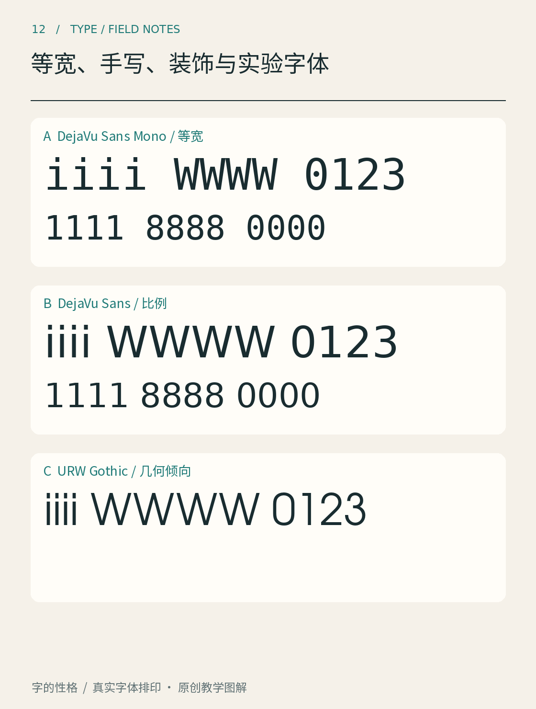
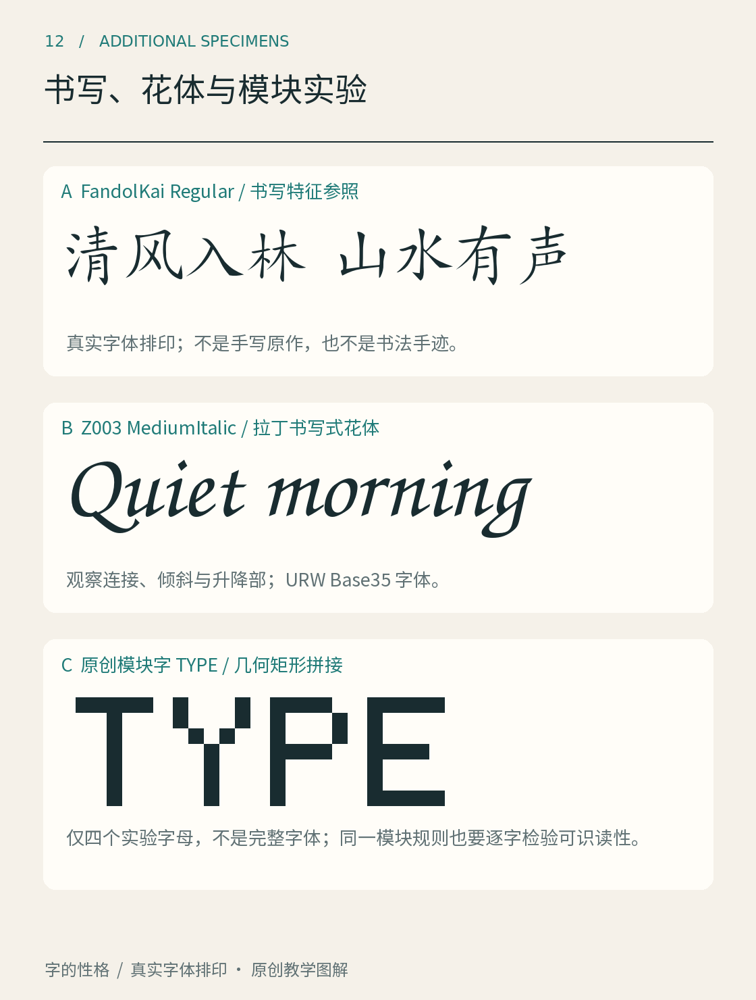

# 第12章　等宽、手写、装饰与实验字体

看见代码窗口里的字，人们容易说它“很理工”；看见连笔字，就说它“很手写”。这两种判断使用的标准却不同。等宽描述字符占用空间的方式，手写描述造型或书写来源，装饰与实验则更接近设计目的。一款字体完全可能同时等宽、带有手写笔触，而且具有强烈的装饰性。

图12先把最容易核验的一件事摆出来：同样的拉丁字符串，在等宽与比例字体中如何占位。观察 i 和 W。等宽字体中，两者获得相同的前进宽度；比例字体通常给它们不同的空间。这里说的是字符排印时的占位，不是黑色轮廓必须同宽。[OpenType 的 hmtx 说明](https://learn.microsoft.com/en-us/typography/opentype/spec/hmtx)区分了前进宽度与左侧边距，这也是理解等宽的关键。

## 等宽解决的是排列问题

如果每个字符都占一个固定格子，几行文本便容易按列对齐。代码、终端表格和字符画，都能利用这种规律。但是，一串 WWW 与一串 iii 若获得同样的总长度，设计师就要分别处理宽字的压缩与窄字两侧的留白，不能只把比例字体机械塞进方框。

编程字体还经常特别处理易混字符：数字 0 与字母 O，数字 1、小写 l 与大写 I。它们是否容易区分，要看具体设计，不能把“等宽”当作自动保证。包含中文的终端又多了一层复杂性：汉字、拉丁字母与符号可能采用不同单元宽度，字符覆盖和终端实现也会影响对齐。“所有文字一律一个格子”不是通用事实。

图12聚焦占位方式，下方补图再把书写特征、花体和模块实验放在一起观察。两张图使用不同分类维度：前者看空间规则，后者看造型来源与设计方法。

## 手写感不等于未经设计

一段真正的手写文字，每次写同一个字都可能不同；数字手写字体如果只给一个字符配置一种字形，重复排出的“哈哈哈”就会暴露规律。设计者可以通过替代字形和上下文替换增加变化，但是否具备这些功能，要看字体和排版软件的支持。[OpenType GSUB](https://learn.microsoft.com/en-us/typography/opentype/spec/gsub)描述的正是字形替换机制，而非把文字变成随机图像。

观察手写风格时，可以追踪笔势：一笔从哪里进入、在哪里转折、怎样收尾？相邻字母的连接是否合理？粗细变化是否与假定的书写工具一致？即使是故意笨拙的设计，也需要在重复使用时形成可控制的秩序。

补图12A用 FandolKai 展示书写特征：看“清”的点画与“风”的转折，再比较每个字在整行里的位置。这是数字楷体排印，不是现场手写或历史手迹，字体来源见 [Fandol 项目](https://ctan.org/pkg/fandol)。B使用真实的 Z003 MediumItalic：倾斜、笔势与升降部共同形成拉丁花体的节奏；字样是字体文件的实际排印，见 [URW Base35 项目](https://github.com/ArtifexSoftware/urw-base35-fonts)。C是本书原创的矩形模块字 TYPE，先规定方格，再用同样的模块拼成四个字母。它只有四字，不是可任意输入的完整字体。

沿着三块图观察，分类差异就更清楚了：A可以寻找书写动作的痕迹，B可以追踪连接与倾斜，C则把模块重复作为造型规则。它们都经过设计，不能因为具有手写感，就认定字形是随手写成的；也不能因为模块规整，就假定它适合持续阅读。

## 装饰与实验要放回任务

装饰字体常把特征放大：极窄比例、尖锐转角、夸张衬线、镂空或多层结构，都可能成为标题的记忆点。它们是否适合正文，需要实际测试。标题只承担几个词，读者可以停下来辨认；药品说明、长篇注释或车站时刻表，则要求读者持续准确地获取信息。

实验字体还可能探索动态、可变轴、模块拼装甚至故意破坏常规阅读顺序。这里不宜用一条“越易读越好”的尺子评价所有作品：艺术展的文字实验可能以引发注意为目标；付款确认按钮则需要迅速、明确。同样的造型放在不同任务里，优劣会改变。

做一个小练习：先写“周末开放实验室”，分别设想它用于门牌、展览主标题和正文中的活动名称。列出每处最不能牺牲的条件。门牌可能需要远看，标题可能需要识别度，正文则需要融入连续阅读。然后才寻找字体。这样的顺序能避免因为喜欢某款字，就让所有场景为它让路。

还可以做一次“去掉装饰”的观察。把纹理、阴影或额外线条暂时遮住，只看文字的主要骨架：它仍能被辨认吗，还是需要凭文案猜测？再把装饰加回去，判断它究竟强化了字的方向、材料和节奏，还是只增加噪声。对强调识别的应用，这能帮助控制变化；对实验作品，也能帮助作者清楚表达自己保留或牺牲了什么。评价会因此从笼统的喜欢，转向可讨论的设计目标。

最后检验重复：把选中的字排成一整段、把同一个字重复十次、加入数字与标点。孤立字样会隐藏的问题，往往在这里出现。字体的特别之处要在真实文本里成立，才算具有应用价值。

本章资料：[Microsoft：hmtx 水平度量表](https://learn.microsoft.com/en-us/typography/opentype/spec/hmtx)；[Microsoft：GSUB 字形替换表](https://learn.microsoft.com/en-us/typography/opentype/spec/gsub)；[FontForge：Metrics, spacing and kerning](https://fontforge.org/docs/tutorial/editexample5.html)；[Fandol 字体项目](https://ctan.org/pkg/fandol)；[URW Base35 字体项目](https://github.com/ArtifexSoftware/urw-base35-fonts)。
