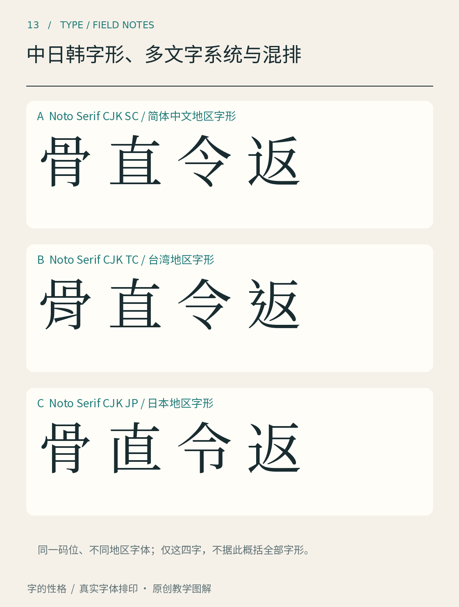

# 第13章　中日韩字形、多文字系统与混排

一个中文页面里出现日文姓名、英文产品名和阿拉伯数字，是很普通的事。然而，文字内容能保存下来，不代表它们会自动以恰当的字形、位置和间距出现。多文字排版同时牵涉语言、字符编码、字体覆盖和排版规则，这些层次需要拆开理解。

图13以真实的 Noto Serif CJK SC、TC、JP 字体文件，排出“骨、直、令、返”四个相同编码字符。SC对应简体中文版本，TC在本图特指台湾繁体中文版本，JP对应日文版本；这里没有香港或韩国版本。先逐列观察局部笔形，再回看整字，不要预设每个字在三个版本里都必须不同。[Noto CJK 官方项目](https://github.com/notofonts/noto-cjk)提供了相应字体资源与版本说明。

## 同一个字符，不一定只有一个外形

字符是文字内容的抽象单位，字形是它实际显示出来的外观。Unicode 编码并不负责规定所有字体都画出完全一致的笔画。汉字统一编码中，一个编码字符可能对应不同地区习惯的字形。[Unicode 的中文常见问题说明](https://www.unicode.org/faq/han_cjk.html)可以帮助区分编码与显示层面的问题。

这意味着：把一段日文内容交给默认中文字体显示，文字可能仍能读懂，却未必呈现日文排印所期待的字形。这里不是简单的“繁体与简体转换”；即使字符内容相同，局部笔形也可能不同。反过来，改变字体也不能代替真正的简繁转换、翻译或用词校订。

看图时，可以先用纸遮住三行标签，寻找“同一个字究竟哪里改变”。例如只追踪一个转折、一个部件的相对位置，而不急着评价哪种更好看。随后揭开标签，把观察限定为这套字体的这几个版本。不能从四字推导所有字体、所有时代或整个地区的书写规范；它们的价值在于让抽象的“地区字形”变成可见、可重复比较的问题。

思源黑体提供一个可追查的实际案例。Adobe 的[项目说明](https://github.com/adobe-fonts/source-han-sans)与[可变字体介绍](https://blog.adobe.com/en/publish/2021/04/08/source-han-sans-goes-variable)说明了其地区字形与多文字覆盖。使用这类字体时，需要选择适当版本，或在支持相关机制的环境中正确标记语言。安装了一个庞大的字体包，并不等于软件一定知道每段文字属于哪种语言。

## 三种文字并不是三种汉字

中文以汉字为主体；日文常混用汉字、平假名与片假名；现代韩文排版以谚文为主体，也可能出现汉字。它们共享部分资源，不代表排版规则完全相同。竖排、标点位置、换行限制和字符组合，都应尊重具体语言的需要。W3C 的[文字排版语言支持索引](https://www.w3.org/TR/typography/)把不同文字系统分别组织，正是因为一套拉丁文本处理习惯无法包办所有情况。

再把视野放远一些：阿拉伯文字具有连接与方向问题，部分文字依赖组合附标；把每个字符当成独立图片再逐一等距摆放，可能破坏正确显示。对兴趣读者而言，不必立即掌握全部规则，但应形成一个习惯：接触不熟悉的语言时，先查它的文字系统和排版需求，而不是把熟悉的做法直接搬过去。

## 混排先处理三个明显问题

第一个是大小。中文与英文字号相同，视觉大小仍可能不一致。中文方块占用空间与拉丁小写的 x 高并不相同，必须把完整句子排出来，检查英文是过于细小还是突兀膨胀。

第二个是位置。数字、拉丁字母和汉字需要形成一条稳定的阅读带，但不能把所有黑色轮廓的底端强行拉齐。g、p 等字母本来就会伸到基线下方；若为了“对齐”而抬高它们，整个英文段落反而可能漂浮。

第三个是衔接。看“版本2.0已发布”和含有英文名称的句子，注意标点、数字、空格与换行。人为插入很多空格虽然可能暂时改善某一行，却容易在换行或复制后破坏结构。应优先使用排版环境提供的文字间距机制，并检查实际输出。中文规范部分可继续查阅 W3C 的《中文排版需求》研究文档；它是持续更新的工作材料，不能当作所有媒介上的唯一法律标准。

练习时保留一份包含姓名、数字、日期、单位和标点的测试句。每次换字体都重排一次，特别检查字体缺字后是否发生了回退：某个字突然变粗、变窄，问题可能出在字体覆盖，而不在你对版面间距的判断。

本章资料：[Unicode：Chinese and Japanese 常见问题](https://www.unicode.org/faq/han_cjk.html)；[Noto CJK 官方项目](https://github.com/notofonts/noto-cjk)；[Adobe：Source Han Sans](https://github.com/adobe-fonts/source-han-sans)；[W3C：Language enablement index](https://www.w3.org/TR/typography/)；[W3C：《中文排版需求》工作文档](https://www.w3.org/TR/clreq/)。
