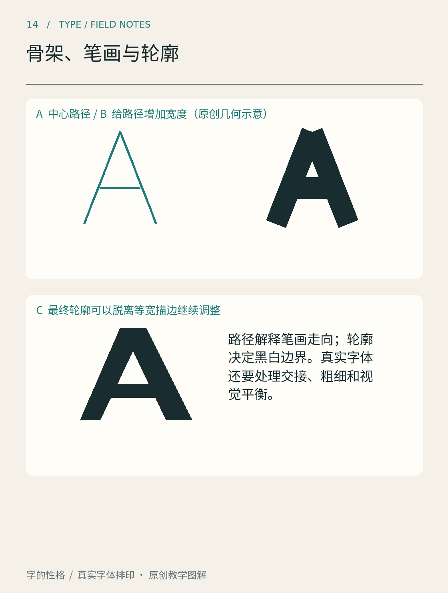

# 第14章　骨架、笔画与轮廓

在纸上写一个“木”，再用粗记号笔描一遍，字会变厚，却未必更好看。交叉处可能堵住，撇捺之间的白色空间可能被挤掉，原本舒展的字也可能显得沉重。这件小事说明，设计字体不能只想象一根笔在路径上移动，还要判断笔画最后占据了哪些空间。

图14以字母 A 的原创几何示意区分三个层次：中心路径、扩展成等宽笔画的形状，以及最终的轮廓边界。骨架帮助确定方向与位置，笔画建立厚度和端部，轮廓决定最后的黑白区域。沿着斜笔画看到交叉处，留意厚度如何改变内部三角空间。图中是教学作图，不是某款字体的真实设计档案。

## 骨架先回答“长在哪里”

骨架可以理解为组织字形的结构线。它提示横竖的长短、转折的位置，以及部件之间的关系。先画骨架的好处，是暂时搁下精细的笔画装饰，集中检查字是否站得稳、部件是否挤在一起。

不过，骨架并不等于汉字的标准笔顺，也不是所有字体项目都会保存的一组必备数据。某些设计直接从轮廓开始；某些工具支持基于笔画生成字形。这里把骨架作为观察与练习的方法，避免把一种工作流程误当作所有字库共同的内部结构。

试着用细线写“木、林、森”。三个“木”不能在组合时简单原尺寸复制：部件数量增加后，留给每个部件的空间改变，某些伸展笔画也需要收束。这个练习能解释字体设计中很重要的一点：一致性往往来自协调，而非每个零件都尺寸相同。

## 笔画回答“有多厚，怎样相遇”

给骨架加上厚度后，交叉处会增加黑色面积。两条相同宽度的线相遇，局部并不一定显得与独立笔画一样均匀。斜线、曲线与直线之间的视觉关系，也需要在实际图形里修正。

观察“十”和“田”：前者主要检查交叉与伸展，后者还要检查内部空间。若只保持每一笔的数值宽度不变，复杂字可能比简单字显得更黑。这不是必须把复杂字整体缩小，而是要考虑局部笔画、交接和留白如何共同分配重量。

端部也属于笔画设计。直切、斜切、圆端或者保留书写式收笔，会影响相邻笔画间的空白。不要先给每一笔套上一个漂亮端头，再到最后发现它们互相碰撞；应在整字中同步检查。

## 轮廓回答“最终填在哪里”

数字轮廓字体通常通过路径描述字形边界，而不是在排印时重新执行一次书写动作。外轮廓与内轮廓一起形成笔画和字腔。FontForge 的[字形创建教程](https://fontforge.org/docs/tutorial/editexample.html)用轮廓编辑、节点和曲线演示了这一层工作。

因此，给一个轮廓整体加描边，不等于得到设计完善的粗体。外缘向外增长的同时，内部空白也会缩小；窄缝可能闭合，原本需要纤细过渡的位置会变成块状。粗体设计往往需要回到部件比例和内部空间，而不仅是修改线宽参数。

画轮廓时还应克制节点数量。节点很多并不自动更精确，反而可能产生难以控制的凹凸；节点很少也不自动优雅，关键是能否稳定表达需要的形状。工具中的自动描摹可以提供起点，不能替你判断曲线是否顺畅、黑白是否平衡。

## 一次完整的小实验

选一个不太复杂的字，画出细线结构，再做细、常规、粗三版。每次只改变一个主要变量，保留前版作为对照。完成后把三版缩成正常阅读大小，看哪一处先丢失空白，再回到大图修改。

还可以把黑色字形反过来看，只描出内部空白与字外空白。这样会发现，设计笔画的同时也在设计白色形状。若黑色部分看起来很规整，白色却忽窄忽宽，连续阅读仍可能不安定。这个练习不需要字体软件，用透明纸覆盖草图即可。先画空白，再把原字放回去，观察自己是否开始注意到此前忽略的狭缝、角落和部件之间的呼吸空间。

记录时不要只写“粗版不好看”，而要指出“右下交接处形成黑块”“内侧空白小于相邻空白”。这种可以定位的描述，才会指导下一次设计。等你开始制作一组标题字时，骨架、笔画和轮廓也就不再只是三个名词，而是三个可以轮流检查的工作层。

本章资料：[FontForge：Font and glyph creation](https://fontforge.org/docs/tutorial/editexample.html)；[FontForge：Expand Stroke Facility](https://fontforge.org/docs/techref/stroke.html)。图14及“木、林、森”练习属于本书原创教学示意，不是字体工程源稿。
