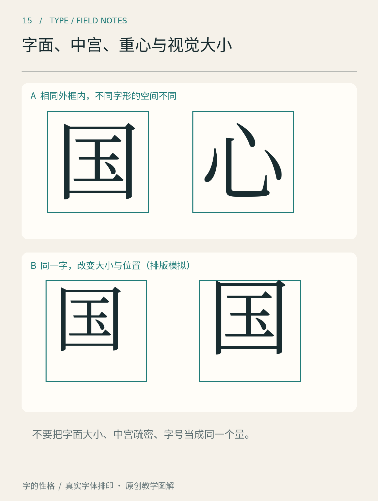

# 第15章　字面、中宫、重心与视觉大小

把两款字体都设成同样字号，屏幕上的字却可能一款显大、一款显小。若接着把较小的一款放大，行距和相邻文字的位置又可能改变。问题出在字号不是一个字的黑色轮廓高度，也不是它给人的视觉体积。

图15上方把“国”与“心”放进相同外框，比较包围结构与开放结构的空间；下方再用同一个“国”改变大小和位置。先区分“换字”与“同字调整”这两种观察，再看空间怎样分配。下方是排版模拟，不能仅靠整体缩放或移动，就完成一套成熟字体的字面设计。

## 字号对应空间，字面对应看得见的字

数字字体把轮廓放在内部坐标空间中；字号使这套空间按比例映射到输出尺寸。轮廓并不必须填满整个空间，也可能有部分越出常用的高度参考线。字体的 em、字形边界与前进宽度，是有关联但不相同的量。[OpenType hmtx 文档](https://learn.microsoft.com/en-us/typography/opentype/spec/hmtx)明确记录了前进宽度和左侧边距，而不是把它们合成一个“可见字宽”。

中文设计讨论中的字面，常用来描述字形在字身或设定空间内的视觉占用。实际比较时，应说明自己测量的是轮廓包围框、黑色面积，还是整行的视觉大小；只说“字面大”，很容易把几种不同变化混在一起。

例如，让“口”的外轮廓更大，和保持外轮廓而增加笔画粗度，都可能让它更有存在感。但前者扩大空间占用，后者减少内部空白，放进段落后产生的效果不同。若目的是修正某个部件拥挤，整体放大通常还会把其他问题一起放大。

## 中宫是观察内部组织的方法

中宫常用于谈汉字中心区域与笔画聚合的关系。“收紧”“放松”能帮助表达直观感受，却不是给每个字都套上一个固定大小的内框。独体字、左右结构和上下结构，中心空间的组织方式不同，不能只用一个面积百分比说明全部差异。

试着观察“国、明、安”。“国”的包围结构使外框与内部部件互相制约；“明”需要协调两部分的宽度与缝隙；“安”的上下结构又让顶部和下部形成另一种关系。在同一套字体里，它们不必拥有一样大小的中心白块，而要在连续阅读中显得属于同一系统。

设计时尤其不要把“中宫紧”简单理解为把所有部件向中心挤。这样可能让字中央发黑，外围却松散。真正有用的检查，是指出哪些笔画靠近了、哪些空白变窄了，以及这些变化如何影响字的伸展。

## 重心不能只靠包围框定位

一个字的几何中心容易计算，但读者感到的稳定还与黑色分布、伸出笔画和方向有关。带长撇捺的字，即使轮廓左右边界对称，内部重量也可能不对称。把每个字的包围框都机械居中，未必能让整行看起来整齐。

图15中移动同一个字，可以直观看出位置变化；下一步应换用不同结构的字，而不是只围绕一个字寻找万能偏移值。设计师需要在个别字与整行之间来回切换：孤立字要合理，整行也不能忽高忽低、忽大忽小。

拉丁文字还有大写高度、x 高、上伸部和下伸部等参考关系。小写字母看起来较大，可能是 x 高增加，而不是整个字体字号更大。FontForge 的[术语表](https://fontforge.org/docs/glossary.html)分别解释这些概念，可以配合英文小写样张观察，避免直接用汉字的方块经验解释全部拉丁字形。

检查整行时，不妨把字串换成“山水日月、天地人和”，再加入更复杂的汉字。简单字可能显得空，复杂字可能显得密；目标是让它们在同一阅读带里协调，而不是让每个字拥有相等黑色面积。接着把句子倒置观看，暂时减弱熟悉词义对判断的影响，专注寻找明显跳出的大小与位置。倒置只是一种辅助观察，最后仍要回到正常方向，确认阅读时的效果。

做一张“同字号”样张，再做一张“近似视觉大小”样张，是很实用的比较方法。前一张揭示字体自身比例，后一张帮助判断实际搭配。两张都保留字体名和字号记录，之后才能区分：究竟是字体结构不同，还是你的排版参数改变了效果。

本章资料：[Microsoft：hmtx 水平度量表](https://learn.microsoft.com/en-us/typography/opentype/spec/hmtx)；[FontForge：Typographical glossary](https://fontforge.org/docs/glossary.html)。字面、中宫与重心部分是本书的观察说明，未将这些术语简化为统一数值标准。
