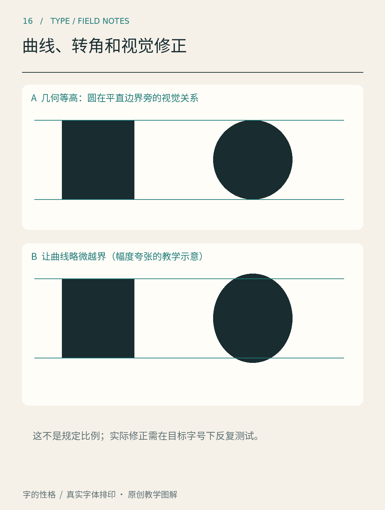

# 第16章　曲线、转角和视觉修正

画出一个正圆，让它的顶端与方块顶端严格齐平，再退后看：圆形有时会显得稍矮。如果把圆略微向上、向下伸出参考线，它反而可能与方块形成较一致的视觉高度。字体设计里，这类让数学尺寸服从视觉结果的调整，通常被称为视觉修正。

图16通过圆与平顶图形解释越界，英文术语是 overshoot。它不是某款字体的测量报告，也不提供适用于所有字形的固定比例。FontForge 的[术语表](https://fontforge.org/docs/glossary.html)将圆形或尖形越出相应高度参考线的现象单独说明；观察真实字体时，应同时看字重、字号与相邻字形。

## 为什么齐平还需要调整

方块顶端沿着一整条水平边抵达最高处，圆形则只在很小的区域接近最高点。虽然两者的最大高度相同，靠近顶端的黑色分布却不同。尖顶字形也存在类似的观察问题。视觉修正的目的，是让读者感到相近的高度与重量，而不是证明几何作图出了错误。

越界只是一类修正。两条数值同宽的横线和竖线，未必显得同样厚；斜笔画与直笔画也需要比较。复杂字交叉处可能积黑，细字中的内部空间又可能过于脆弱。每一种调整都应针对具体问题，不宜背诵成“横线永远减细多少”“圆永远超出多少”的固定公式。

判断时要反复缩小。放大后的微妙差异，可能在实际尺寸消失；小字中很严重的拥挤，放大后却容易被漂亮的轮廓掩盖。可以在同一张纸上同时打印大字和正文大小的字，让两种观看距离互相约束。

## 曲线怎样变得顺畅

数字字体里的曲线通常由贝塞尔路径描述。对读者而言，先理解节点、控制柄与切线的关系就够了：节点确定路径经过或衔接的位置，控制点影响曲线离开与抵达的方向和弯曲程度。不同轮廓格式采用的曲线表示可能不同，FontForge 的[贝塞尔曲线说明](https://fontforge.org/docs/techref/bezier.html)对此有具体图示。

平滑连接首先要避免在不需要的地方突然改变方向，但“方向连续”也不等于整条曲线已经漂亮。弯曲变化不均匀时，仍可能出现鼓包、平塌或局部收缩。用鼠标把每个小凹陷都补上一个节点，常常会让路径越来越难维护。更有效的做法，是判断问题属于节点位置、控制柄方向，还是前后曲线段共同造成的比例失衡。

字体编辑工具通常帮助检查极值点、路径方向和轮廓错误。这些检查能发现工程问题，却不能自动决定一个 o 应当多圆、一个肩部应当多舒展。技术校验和视觉判断需要同时存在。

## 转角是另一种重量分配

想象两条厚笔画形成锐角。若只让轮廓直接相交，尖端可能过长，交接处也可能过黑；若简单削平，又可能让字显得突然缺了一块。处理转角时，需要兼顾外缘、内侧空间和邻近笔画。

有些字体会使用有意识的内凹、切口或开放连接，但不能把所有凹口都叫作同一种“陷阱”，也不能假设某种结构必然为低质量印刷而生。需要讨论真实案例时，应查设计者说明；仅凭一张图片推测技术目的，容易把视觉效果误写成历史事实。

试做三版几何标题字：一版保持严格齐平，一版只调整圆形高度，一版再检查交叉重量。把三版打乱交给别人看，先请他们指出不协调处，再揭示你的修改。若对方根本没有看到你想修正的问题，可能是调整太细，也可能是实验条件不合适。

也可以把同一轮廓换成白字深底再看一次。相同几何数据进入另一种明暗关系，局部的轻重感可能改变；这并不自动要求为每个背景单独设计一套字，却提醒我们不能只在一种放大预览下判断。若作品实际用于发光屏幕、背光标牌或深色包装，应以这些使用条件复核。观察笔记中写清媒介，避免把某次特定观看经验说成对所有字体都成立的规律。

最后保留修改记录。写下“圆形顶部略越界，缩小后与平顶字协调”，比“做了光学校正”更有指导性。前者说明对象、动作和判断条件，下次设计时才能重复检验，而非只记住一个听起来专业的术语。

本章资料：[FontForge：Typographical glossary](https://fontforge.org/docs/glossary.html)；[FontForge：Bézier Splines](https://fontforge.org/docs/techref/bezier.html)；[FontForge：Outline Glyph View](https://fontforge.org/docs/ui/mainviews/charview.html)。图16为放大教学示意，修正幅度不作为制作参数。
