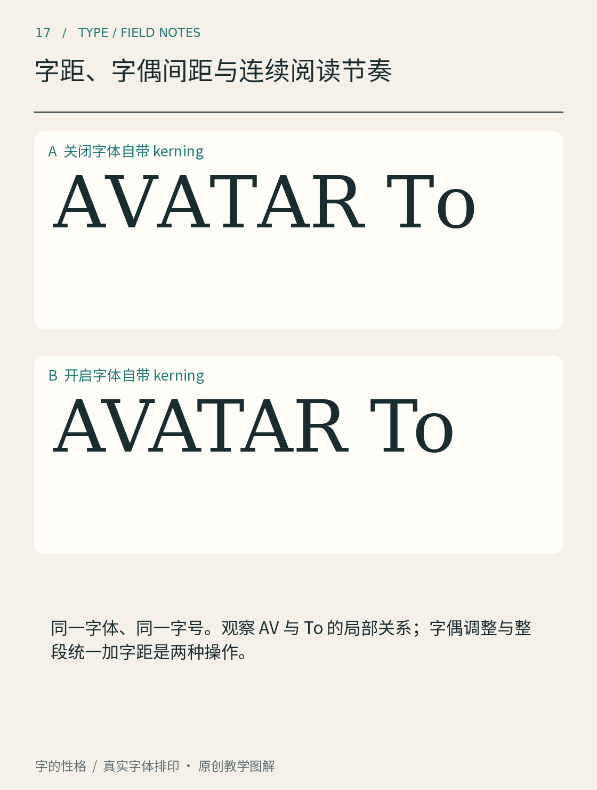

# 第17章　字距、字偶间距与连续阅读节奏

把 A 与 V 放在相邻的位置，它们之间容易留下一个张开的空洞；把 H 与 H 放在一起，空隙的形状又不同。即使字符的起点距离相同，读者看到的白色空间也未必相等。字体设计处理的不是把每个字隔开一样远，而是让一串文字形成合理的节奏。

图17使用 DejaVu Serif，以相同的135像素排印字号显示“AVATAR To”：上方关闭字体自带的 kerning，下方开启。观察 AV 斜边之间与 To 之间的白色空间，下方字串整体更紧凑，局部调整的幅度也不同。先比较空白形状，再看整个单词，不要只盯两个轮廓最近的地方。

## 三种调整，三个尺度

第一层是字形本身的边距。一个字形两侧保留多少空间，会影响它和所有相邻字形的关系。左到右横排时，两字之间的基础空间由前字的右侧边距与后字的左侧边距共同形成。[FontForge 的度量教程](https://fontforge.org/docs/tutorial/editexample5.html)强调，应在相邻字形中检查这些度量，而不是孤立地设置一个字。

第二层是字偶调整，通常称 kerning。它针对某些组合补偿基础间距无法照顾的形状关系，例如斜线相对时留下的空洞。OpenType 可以通过 [GPOS 字形定位表](https://learn.microsoft.com/en-us/typography/opentype/spec/gpos)记录定位与前进量的调整；应用程序需要实际使用相关数据，排印结果才会体现出来。

第三层是整段或整串文字的统一字距调整，常称 tracking。它适合改变标题整体的松紧，却不能代替字偶调整。若把所有字之间都减去相同距离，AV 的空洞可能改善，其他紧密组合却可能碰撞。相反，一份字偶数据也不负责替所有字号、语言和排版目的决定最终的松紧。

## 白色空间不是尺子量出的缝

判断间距时，最小距离容易误导人。圆对圆之间，即使最近处很窄，往上下展开后仍有较大空白；平直边相对时，窄缝可能从上到下都维持相近宽度，感觉就更紧。设计者需要比较一片空间的形状与节奏，而非只测一条水平线。

可以先用 H、O 或 n、o 建立直边与圆边的基本关系，再加入 A、V、T、Y 等变化较大的字母。测试字符串不是为了背出一个标准答案，而是让不同形状连续出现，暴露哪些关系偏松、哪些关系偏紧。然后再用真实词语检验，因为读者实际阅读的是词和句子。

标题尤其容易暴露问题。大字减少了文字数量，却放大了每个空隙；短词中一个异常字偶，就可能形成视觉断裂。但手工调整时仍要保留文本的正常结构，不应靠插入许多空格或把文字拆成独立对象，制造只有一张截图成立的结果。

## 中文也有自己的空间逻辑

汉字通常具有较稳定的基本占位，但轮廓与内部结构仍有疏密差别。标题可以根据视觉节奏调整字距，连续正文则需要同时考虑标点、行尾处理和中西混排。不能因为拉丁标题适合紧密字偶，就把同样的策略无差别施加给整段中文。

排印数字还要区分比例数字和表格数字。表格数字可以帮助数字列对齐，但并不等于整套字体都是等宽；是否提供这种功能，需要查看字体及软件支持。做账单时只检查“2026”还不够，要把金额、负号、小数点和不同位数一起放进表格里。

## 用两次检查避免越调越乱

第一次在目标字号下检查单词，把明显断裂或碰撞的地方标出来；第二次拉远看整行，判断整体节奏。只修第一个异常空隙，可能让它显得比其他组合更精密，反而形成新的不均匀。

中文标题也可以做相似实验。选四个结构差异较大的字，先保持默认字距，再只调整一个明显松散的位置。不要立即把其余三处全部改成一样数值，而要比较白色空间是否连贯。接着加入标点，检查标题末端是否突然松开。若为一张海报做过局部微调，应保留可编辑文字与参数记录，避免日后替换文案时以为这组局部数值仍然通用。

保存原版和修改版，同时记录字体、字号、字距以及字偶调整状态。若换设备后效果不同，先排查软件是否使用了相同字体与功能，再讨论审美。把排印设置与视觉判断区分开，才能知道问题应在字体文件、排版参数还是最终媒介中解决。

本章资料：[FontForge：Metrics, spacing and kerning](https://fontforge.org/docs/tutorial/editexample5.html)；[Microsoft：GPOS Glyph Positioning Table](https://learn.microsoft.com/en-us/typography/opentype/spec/gpos)；[Microsoft：hmtx Horizontal Metrics Table](https://learn.microsoft.com/en-us/typography/opentype/spec/hmtx)。
