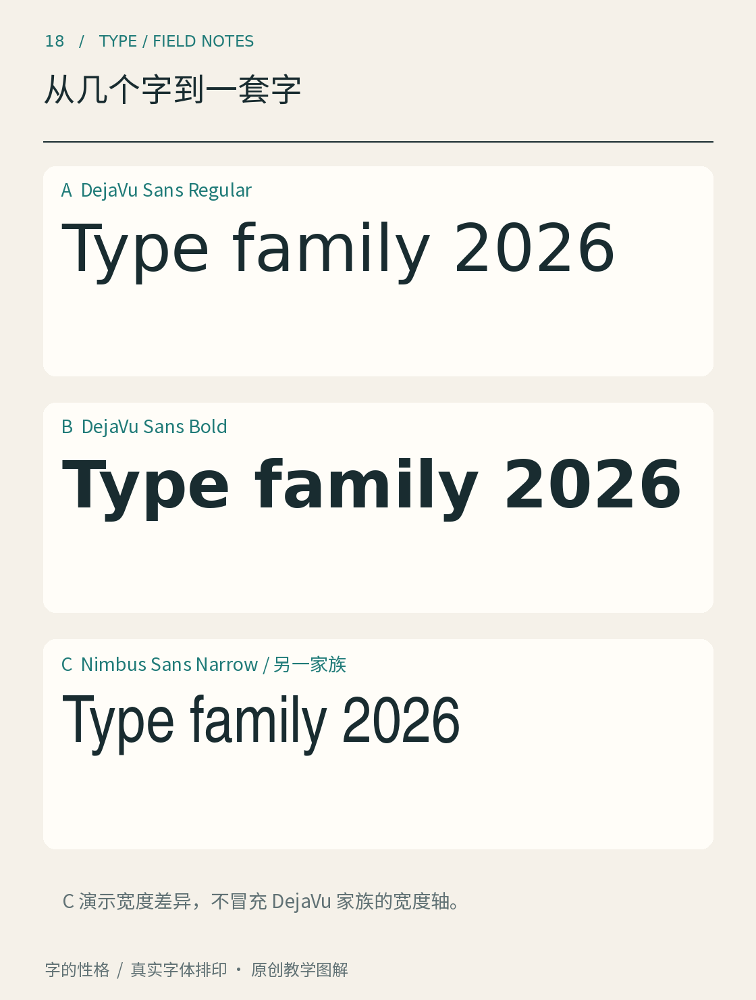

# 第18章　从几个字到一套字

设计四个海报标题字，可以逐一调整到彼此协调；设计一款字体，则要面对还没出现的句子。常用字、罕见字、数字、标点、重音符号，以及不同字重之间的变化，都需要遵守某种共同逻辑。一套字的难点，在于让规则足够稳定，又能处理每个字的例外。

图18先比较 DejaVu Sans 的常规与粗体，再加入另一家族的 Nimbus Sans Narrow。前两者帮助观察同一家族的规则怎样延续，第三者则提供窄体造型的参照，不是 DejaVu 的宽度变化实例。把相似处与不同处分别记下来，不要只按“粗体”或“窄体”这样的样式名称判断它们必然属于一套字。

## 一致性首先是规则之间协调

假设设计一组拉丁小写字母，n 的肩部、h 的肩部和 m 的连续肩部具有联系，但不必把同一段轮廓复制三次就结束。m 的空间更紧，h 有上伸部，相邻部件也改变了局部的视觉重量。共同规则可以指导它们，最终仍需逐字修正。

中文的部件系统更能体现这个问题。同一个偏旁进入不同结构后，宽度、伸展和连接关系可能改变；独体字里的“木”与作为左偏旁的“木”也不能简单等同。复用部件能提高制作效率，协调后的部件才会让字形真正属于一套字。

建立家族时，可以记录一些观察项：主要笔画的粗细关系、转折方式、端部处理、内部空间、整体视觉大小与常用标点。记录的目的不是把所有字压进一个模型，而是发现某个例外是否仍与系统相容。

## 粗细之外，还有宽度与姿态

字重描述笔画的轻重。由常规走向粗体时，内部空白容易先被挤压，因此优秀的粗体设计通常不仅增加外缘，还会重新安排空间。两款字体即使都叫 Bold，看起来也可能并不等重；数字或名称用于组织家族，不能替代视觉比较。

宽度变化也不等于横向缩放。直接压窄轮廓会同时压细竖笔、改变曲线与字腔；专门设计的窄体可以针对这些问题重新调整。窄体适合某些受限空间，却不能成为容纳过多内容的万能解法。拥挤的标牌可能首先需要删减或分层，而不是继续压字。

斜体与机械倾斜也应分开看。一些拉丁斜体会改变字母结构与书写节奏；另一些设计采用较接近直立体的倾斜形式。不能只看倾斜角度就判断是否“真斜体”，应查看家族说明和具体字形。中文是否提供相应设计，也必须核实，软件临时合成的效果不等于字体作者制作了该样式。

## 可变字体把关系装进文件

可变字体能够在设定的轴上提供变化。OpenType 的[设计变化轴注册表](https://learn.microsoft.com/en-us/typography/opentype/spec/dvaraxisreg)为字重、宽度等轴规定了含义与标记，字体也可以定义自己的轴。它提供的是被设计和编码的变化范围，而非自动把任意字体变成无限多种风格。

插值也有前提。设计师需要让相关源稿满足相应结构要求，并测试中间位置；端点好看，不代表所有中间状态都自然。对使用者而言，先确认字体有哪些轴、软件是否支持，再判断某个变化是否适合正文、标题或动画。

光学尺寸又是另一种关系：小字与大字可能需要不同细节。它改变设计以适应观看条件，并不是简单地把字体字号改大或改小。这个概念会在下一章的选字实验中继续使用。

除了字形，还要列出交付范围。一组品牌标题字可能只覆盖固定名称，一套出版字体则需要更广的字符、标点与语言支持。把已经完成的字符、尚未覆盖的字符，以及只能用于展示的部分写清楚，能够避免使用者把局部设计当作可任意输入的字库。尤其中文，几个漂亮字只是起点；覆盖量增长时，审校、部件协调与测试会成为真正庞大的工作。

完成四个标题字后，可以故意加入一个最不相似的字：若前四字都是简单结构，就加入一个复杂结构；若全是大写直线字母，就加入圆形和斜线字母。新字会检验原有规则究竟具有扩展能力，还是仅在一个短词里成立。字体系统正是在这种不断出现的新问题中逐步形成。

本章资料：[Microsoft：OpenType Design-Variation Axis Tag Registry](https://learn.microsoft.com/en-us/typography/opentype/spec/dvaraxisreg)；[Adobe：Source Han Sans goes variable](https://blog.adobe.com/en/publish/2021/04/08/source-han-sans-goes-variable)；[FontForge：Tutorial](https://fontforge.org/docs/tutorial.html)。
