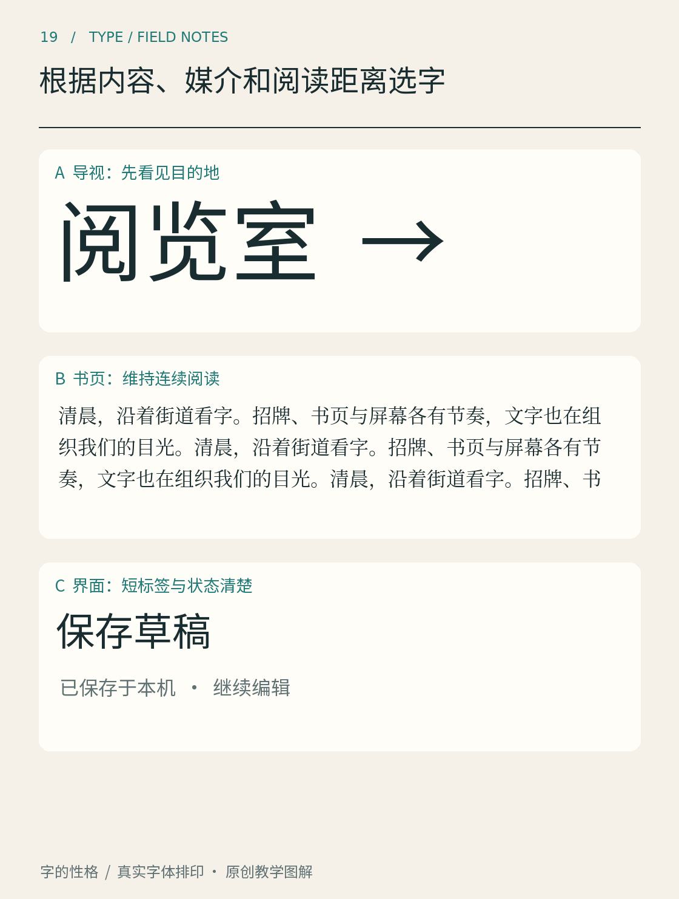

# 第19章　根据内容、媒介和阅读距离选字

咖啡豆包装正面的四个大字、背面的冲煮说明和手机里的购买按钮，可能属于同一个品牌，却不必使用完全相同的字体样式。它们承担的任务不同：吸引注意、传达细节、帮助操作。选字应先把这些任务写清，再讨论某款字体是否漂亮。

图19分别展示导视中的“阅览室”、书页段落和界面中的“保存草稿”。三者的内容与任务不同：先找到目的地、维持连续阅读、确认短标签和状态。它是一组用途示例，不能用来证明某款字体比另一款更易读，也不提供适用于所有设备与距离的标准字号。接下来需要用自己的真实内容，逐一检查相应任务。

## 先问这段字要完成什么

如果读者需要比较金额，数字和小数点就很重要；如果需要辨认药品或地名，易混字与复杂字的区分就很重要；如果是短时出现的提示，信息能否迅速被找到就比微小装饰更重要。把这些条件列成几句话，往往比直接搜“高级字体”更有效。

接着看文本本身。样张里的一个英文单词，不能代表中文长段落；几个简短汉字，也不能代表包含专业名词、括号、日期和单位的说明。至少准备一段真正要使用的内容，同时加入容易暴露问题的字词，才能检验覆盖、间距与整体纹理。

字符覆盖也是选字条件。字体漏掉一个姓名用字，软件可能用另一字体补上，使同一行突然出现不同的重量或比例。若项目涉及多语言，应在确定视觉风格前检查语言版本、地区字形和必要标点，而不是到交付时才补救。

## 观看条件会改变同一款字

纸张、油墨、印刷方式和表面反光，会影响笔画与留白；屏幕的尺寸、像素密度、缩放设置和背景，也会影响细节。设计图中放大到数倍观看的清晰轮廓，不是最终读者的观看条件。打印、真机查看和实际距离测试，应成为选字过程的一部分。

距离尤其容易被忽略。把海报缩成手机屏幕上的小图，虽然可以粗看层次，却不能直接证明几米外的招牌足够清楚；反过来，桌面上近距离可读的字，也不保证挂到高处后仍然可读。复杂导视还需要考虑角度、光照、移动速度及现场遮挡，不能只用一个字号数字作结论。

有些字体家族提供适合不同尺寸的光学设计。OpenType 的 [opsz 轴说明](https://learn.microsoft.com/en-us/typography/opentype/spec/dvaraxistag_opsz)把它定义为随预期文本尺寸调整设计的机制，变化可能涉及比例、笔画和细节。它是否存在、是否自动生效，需要同时检查字体和软件；不能把每个文件名里的 Text 或 Display 都理解为同一套技术实现。

## 可读性不只属于字体

选中一款字形清楚的字体，如果把它排得过小、颜色过淡或行距过紧，结果仍然难读。文字与背景的对比尤其需要实际检查。W3C 的 [WCAG 对比度说明](https://www.w3.org/WAI/WCAG22/Understanding/contrast-minimum.html)对网页文字有明确的适用条件与阈值；它可以指导数字内容检查，但不能当作所有印刷、招牌场景的唯一评判标准。

网页和应用还要允许读者放大文字。W3C 对[文字缩放](https://www.w3.org/WAI/WCAG22/Understanding/resize-text.html)的说明强调，放大后应保留内容与功能。一个精巧但文字一变大就重叠的按钮系统，并没有因为字体选择精美而变得可用。

## 把选择收敛成一次小测试

先选三款符合基本条件的字体，保持文案与版面相同做第一轮比较。然后按视觉大小、行距和字重适度校准，不要让其中一款因为未经调整而被不公平地淘汰。最后把候选放入真实媒介，检查最关键的任务：金额能否比对、标题能否找到、注释能否持续阅读。

测试还应包含最差的合理情况：说明文字最长时是否溢出，屏幕变窄时是否断得很碎，品牌深色背景上是否仍能分辨。把这些情况提前排出来，通常比在交付后不断缩字号更省力。若某款字体只能在特别有利的短文案和大尺寸下成立，可以保留它用于标题，再为正文选择更合适的伙伴；一份设计不必强迫所有内容共用一种表现方式。

邀请另一位读者完成一个具体动作，比问“你喜欢哪款”更有信息。例如让他找出活动时间，或准确读出一组相似编号。你仍然可以保留个人风格判断，但至少知道审美选择付出了什么代价，又在哪些任务上获得了收益。

本章资料：[Microsoft：Optical Size 轴定义](https://learn.microsoft.com/en-us/typography/opentype/spec/dvaraxistag_opsz)；[W3C WAI：Contrast (Minimum)](https://www.w3.org/WAI/WCAG22/Understanding/contrast-minimum.html)；[W3C WAI：Resize Text](https://www.w3.org/WAI/WCAG22/Understanding/resize-text.html)。
