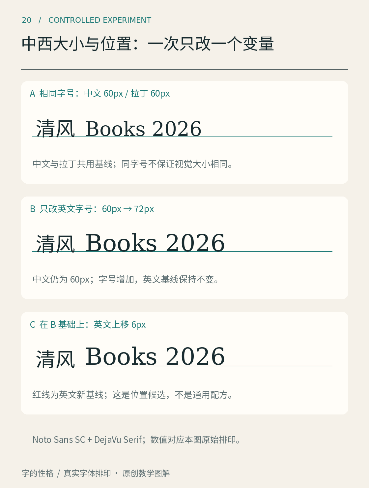

# 第20章　中文与西文字体怎样搭配

“山间书店 Mountain Books”看起来只是一行字，却已经包含两套不同的形态组织。汉字占据较完整的方形空间，拉丁字母依靠大小写、升降部和词间空格形成节奏。让它们相处得好，需要寻找视觉关系，而不是只按分类名称配对。

图20展示中文宋体、黑体与拉丁字体的组合。保持文案相同，可以观察更换字体后，英文是否过轻、中文是否过满、整行是否出现不必要的跳动。图中搭配是教学实验，不能据此声称某一组合适用于所有品牌或长文。

## 先决定谁承担主要阅读

在中文为主的书籍里，英文可能只用于书名、单位和少量术语。此时连续中文的阅读质量应优先，英文需要融入而非频繁夺目。在双语展览海报中，两种语言可能承担同等信息，就应分别检查大小、行长和层级，而不是把英文永远作为较小的装饰。

这一步也决定了比较方法。中文正文搭配少量英文，要观察句内切换；两种语言分栏排印，则更应看整块文字的密度和阅读顺序。同一组字体可能适合后者，却在前者出现明显大小跳变。搭配没有脱离版面的永久答案。

## 比较四种可以说清的关系

第一种是视觉大小。不要以同字号作为最终结果。中文的整体字面与拉丁小写的 x 高不同，一行英文可能显得比相邻中文矮。可以适度调整字号，但放大英文也会改变大写字母、数字和行框的关系，应把大小写与数字一起测试。

第二种是重量。中文笔画数量多，整体纹理可能较密；拉丁笔画较少，即使名称同为 Regular，放在一起仍可能一方显轻。一味把英文改成粗体又可能过头，最好在真实可用字重之间选择，并把整句缩到实际阅读尺寸判断。

第三种是形态。宋体与衬线体之间可以建立笔画粗细、端部与书写感的联系；黑体与无衬线体之间也可能共享某种平稳感。但这只是起点，不是必选关系。端部接近而比例差异很大，仍可能不协调；有意形成对比的宋体与无衬线体，则可能在标题与正文之间工作得很好。

第四种是位置。英文应依据基线与中文视觉位置协调，而不是把所有字形底部抹平。数字和小写下伸部都要保留正常关系。出现“漂浮”时，先看字体自身度量、字号和实际组合，再考虑小幅位置修正。[OpenType BASE 表](https://learn.microsoft.com/en-us/typography/opentype/spec/base)提供了不同文字基线协调的技术机制，但软件支持与字体数据仍会影响实际结果。

补图20保持中文为 Noto Sans SC 60像素，拉丁为 DejaVu Serif。A让两者都用60像素，并共用一条基线；B只把英文增至72像素，观察小写、数字和大写的视觉变化；C在B的基础上把英文上移6像素，红线显示新的英文基线。这里的数值对应原图的排印尺寸，阅读器缩放后不再等于屏幕上的物理像素。

比较B和C，注意调整位置没有改变英文字母本身的大小；比较A和B，则注意字号变化同时影响高度与总长度。三个版本没有被标作对错，因为这个短词不足以决定整页的最佳参数。真正采用某一版前，还应加入带下伸部的 g、p、y，以及括号和数字，确认调整不会让其他内容显得突兀。一次只改一个变量，才能知道改善或问题来自哪里。

## 一体化家族也是设计选择

有些多文字家族已经对中文与拉丁部分做过协调。思源黑体的项目资料说明，其拉丁部分与 Source Sans 存在设计联系，并作了适配。这类家族可以成为可靠起点，却仍需检查使用的语言版本、字重与具体内容。相关设计背景可以从 Adobe 的[发布介绍](https://blog.adobe.com/en/publish/2014/07/15/introducing-source-han-sans-an-open-source-pan-cjk-typeface)追查。

另一方面，把一款独立中文字体与另一款拉丁字体搭配，并不意味着设计不专业。只要关系经过测试，独立组合可以更好地服务某个品牌或出版物。关键是清楚自己为什么这么配，并记录组合参数，避免不同页面逐渐漂移。

数字往往是最先暴露问题的地方。做一份包含日期、价格、百分数、括号与英文缩写的测试句，观察数字的大小、横线与小数点位置。标题搭配再和谐，若表格数字一会儿来自中文字体、一会儿来自另一字体，信息页面仍可能失去一致性。

## 用一个完整页面验收

完成一行双语标题后，再排一个小页面：加上中文段落、英文副标题、一行时间地点和一条注释。这样就能检查组合能否跨越层级，而不是只在一个漂亮短语里成立。

还应让这份小页面经历一次内容替换。把短英文名称换成长名称，把两位数日期换成含星期与时区的完整信息，看原来的层级和间距能否继续工作。若每换一句话就要大幅修补，问题可能不在某一个字偶，而在字号关系或空间预算。经过这种检验留下来的组合，比只在封面标题上协调的搭配更有复用价值。

最后保留两份对照：一份是未经校准的同字号组合，一份是根据实际阅读调整后的组合。注明为什么改字号、换字重或调整间距。读者可以由此学会判断，你自己也能在下一次项目中复用方法，而无需记下一串“最佳字体搭配”名单。

本章资料：[Microsoft：BASE Baseline Table](https://learn.microsoft.com/en-us/typography/opentype/spec/base)；[Adobe：Introducing Source Han Sans](https://blog.adobe.com/en/publish/2014/07/15/introducing-source-han-sans-an-open-source-pan-cjk-typeface)；[W3C：《中文排版需求》工作文档](https://www.w3.org/TR/clreq/)。
