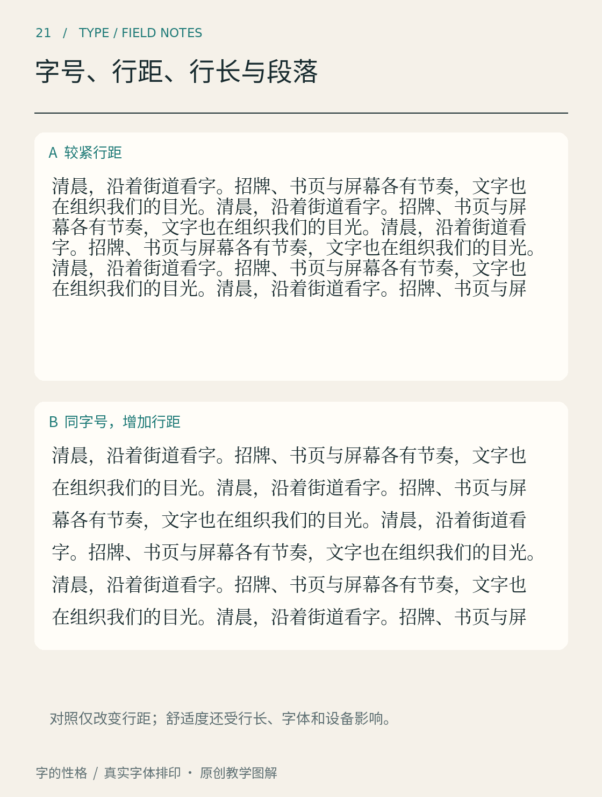

# 第21章　字号、行距、行长与段落

把同一段文字放进手机和杂志，最先改变的往往不是字体，而是每行能容纳多少内容。字体决定字的形状，排版决定目光怎样从一个字走向下一个字。读得吃力时，不妨先调整这条路径，再寻找另一款字体。

*图21｜原创排版实验。比较时保留文案、字体和栏宽，只改变行距，观察相邻行是否容易区分。图中疏密用于演示，不是所有媒介通用的标准。*

## 先确定阅读发生在哪里

屏幕中的字号通常以CSS像素等单位描述；印刷常用磅，但同为某个字号，两款字体实际可见的字面仍可能不同。不要只抄数值。将正文按预期尺寸显示，保持正常阅读距离，读上三四段；如果不断靠近、缩放，或者把两个相似字看错，记录具体位置。

可以先给练习页设一个便于比较的起点，例如手机正文18 CSS像素、行高约1.7倍。它只是本书的试验设置。更换字体、换成横屏、读者放大系统文字后，都需要重新检查。小屏阅读也不是无限缩字以装下更多内容：屏幕虽然装得多，眼睛的工作未必减少。

行高指相邻文本行所占行框的高度，不等同于两行黑色字形之间的净空。字体的上下延伸、注音或组合附标，都可能改变实际观感。比较图中疏密不同的段落时，先看目光能否稳定沿同一行前进，再看换行之后会不会误接相邻行。

## 三个变量一起配合

行长增加，眼睛从行末返回下一行开头的距离也增加；行距如果仍然很紧，容易找错位置。行很短时，过大的行距又可能把一个连续段落拆成零散的短条。本书建议的调试顺序是：先选可辨认的字号，再限定文本栏宽度，最后调整行距。不要同时改变三个参数，否则很难知道哪一步有效。

做一个五分钟实验：准备约三百字的同一篇短文，排成窄、中、宽三个文本栏，保持字号、字体、颜色一致。读完后用手遮住一部分文本，观察回行时是否需要寻找。随后只改变行距，比较差别。这里记录的是你的阅读体验，不能凭一人的结果宣布某种排法对所有人最好。

中文不能完全照搬英文的行长经验。汉字、标点和夹杂的西文会形成不同节奏；长网址、数字与单位也会打断均匀字列。W3C《中文排版需求》讨论行首行尾禁则、标点处理和中西混排等问题，提醒我们一行文字的结束方式同样属于排版。[资料：W3C《中文排版需求》](https://www.w3.org/TR/clreq/)

## 让段落看起来确实是一段

段落是意义单位。首行缩进、段前后间隔都可以帮助读者识别它；两者如何组合，应根据版式来决定。练习时先选一种主要方式并保持一致：正文用首行缩进，小标题与正文靠段前间隔区分；或正文不缩进，段与段之间留明确间隔。不要让段间距和行距几乎相同，否则读者难以判断哪里换了话题。

最后检查最不理想的情况：一行只剩两个字、段首只留在页底、注释挤入正文、放大后文字被固定高度的容器截掉。美观的初始截图不足以证明排版稳健。W3C WCAG的文字间距条款，要求在适用条件下允许用户覆盖行距、段距等设置而不丢失内容或功能；它**没有要求所有页面默认使用1.5倍行高**。[资料：WCAG 2.2，理解文字间距](https://www.w3.org/WAI/WCAG22/Understanding/text-spacing)

把这一章用于实际项目时，保留一张调试记录：采用何种字体、正文尺寸、栏宽、行高，以及在哪个设备上检查。下次修改就能从已知条件出发，而不用重新凭感觉猜。

## 本章资料

- [W3C：《中文排版需求》](https://www.w3.org/TR/clreq/)，中文行与段落的排版问题。
- [W3C：Understanding SC 1.4.12 Text Spacing](https://www.w3.org/WAI/WCAG22/Understanding/text-spacing)，用户调整间距的适应性要求。

段落关系确定后，再检查[第33章的中文精排](33.md)与[第34章的数字符号](34.md)。
