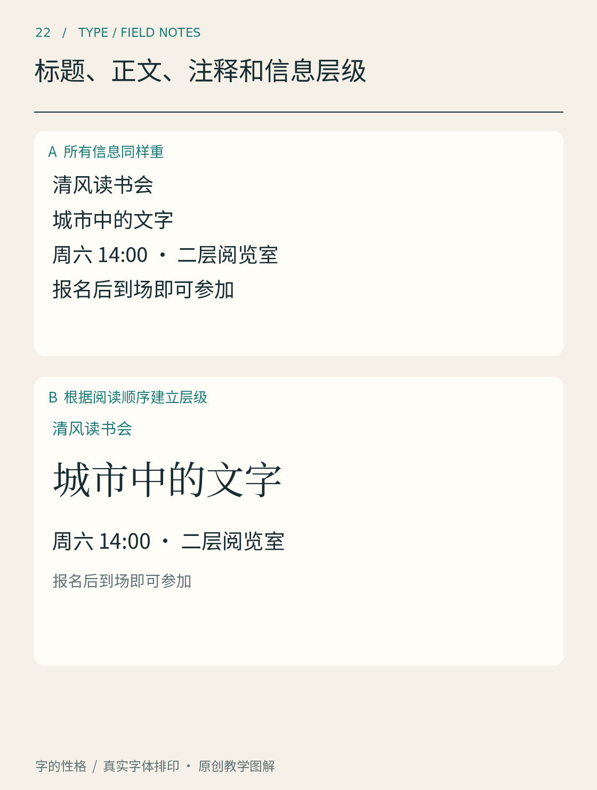

# 第22章　标题、正文、注释和信息层级

一张展览通知可能只有一百字，读者却需要依次知道主题、时间、地点和报名方式。如果所有文字一样大，寻找顺序便由偶然决定；如果每一行都夸张加粗，整张纸又会同时争夺注意力。信息层级的任务，是让读者知道从哪里开始、什么可以略读、什么需要仔细核对。

*图22｜原创信息层级实验。先遮住细节，观察能否辨认主题；再寻找行动信息，比较两种编排需要经过多少次跳读。*

## 先分内容，再定字号

用一份虚构的「字间小展」通知练习。内容包括展名、一句话介绍、日期时间、场地、票务说明和主办者。先在纸上给每段标注角色。展名回答“这是什么”，介绍解释“为什么值得看”，日期和场地支持行动，票务说明影响决策，主办信息提供背景。这些角色没有必要分别对应六款字体。

试着只设三级：主标题、关键说明、正文及辅助信息。再用位置与间距表达组内关系。例如把日期和地点放在相邻区域，把主办者放到末尾；即使它们字号相同，也能通过组织方式形成层次。层级不仅存在于字号中，也存在于先后、聚合、对齐和留白中。

GOV.UK设计系统将标题的语义标记与视觉样式分开处理：网页应使用合适的标题级别，再应用相应样式。这种区分很有启发性：一行字在结构上是某个章节的标题，不应仅仅因为视觉上需要变小，就被当作普通段落。[资料：GOV.UK，Headings](https://design-system.service.gov.uk/styles/headings/)

## 建立少量、稳定的关系

标题与正文需要有可察觉的差别，但差别可以来自一个主要变量。先保持同一字族，把标题变大；仍不够清楚，再考虑增加字重或段前空间。若同时改变字形、颜色、角度、描边和阴影，读者虽然可能被吸引，却不一定更容易理解结构。

图中的分层示意，可以依次观察三个位置：入口是否明确；相同角色是否保持相同样式；次要信息是否仍可阅读。不要把「次要」理解成「几乎看不见」。展览地址、药品说明和账单备注在版面中可能处于辅助位置，但对特定读者仍然关键。

正文负责承载连续解释，注释负责提供出处或补充条件。若注释频繁打断正文，可以把较长解释移入独立段落；若正文中的某个判断必须依赖注释才能成立，考虑直接把条件写进正文。排版不能修复内容本身的模糊。

## 色彩的层级需要经过核查

浅灰文字常用于辅助信息，但低对比会降低辨认能力。网页的WCAG最低对比度要求通常以4.5∶1衡量普通文字、3∶1衡量符合定义的大字，并有特定例外；这些是可访问性的阈值，不能理解成“达到阈值就一定舒服”。细笔画字体在实际渲染中还可能显得更弱。[资料：W3C，理解最低对比度](https://www.w3.org/WAI/WCAG22/Understanding/contrast-minimum.html)

因此，先在黑白版本中建立层级，再引入强调色，是一种容易控制变量的练习方法。颜色可以强化已有结构，但不应是辨认结构的唯一线索。把蓝色链接与正文区分时，也要考虑下划线、上下文和交互状态。

## 用两种阅读速度验收

第一遍给自己五秒钟，只回答三个问题：页面讲什么、最关键的信息是什么、接下来可以做什么。第二遍逐行阅读，核对细节有没有被视觉效果遮住。如果第一遍找不到主题，入口不足；如果第二遍不断被大字、粗字与色块打断，强调可能过多。

最后让通知增加一条临时交通说明，再缩小屏幕宽度。如果新增信息只能硬塞进角落，原先的层级还不够灵活。成熟的文字系统应能容纳内容变化，而不仅是把某一份文案摆得漂亮。

## 本章资料

- [GOV.UK Design System：Headings](https://design-system.service.gov.uk/styles/headings/)，标题语义与视觉样式。
- [W3C：Understanding SC 1.4.3 Contrast (Minimum)](https://www.w3.org/WAI/WCAG22/Understanding/contrast-minimum.html)，文字对比度及适用范围。
