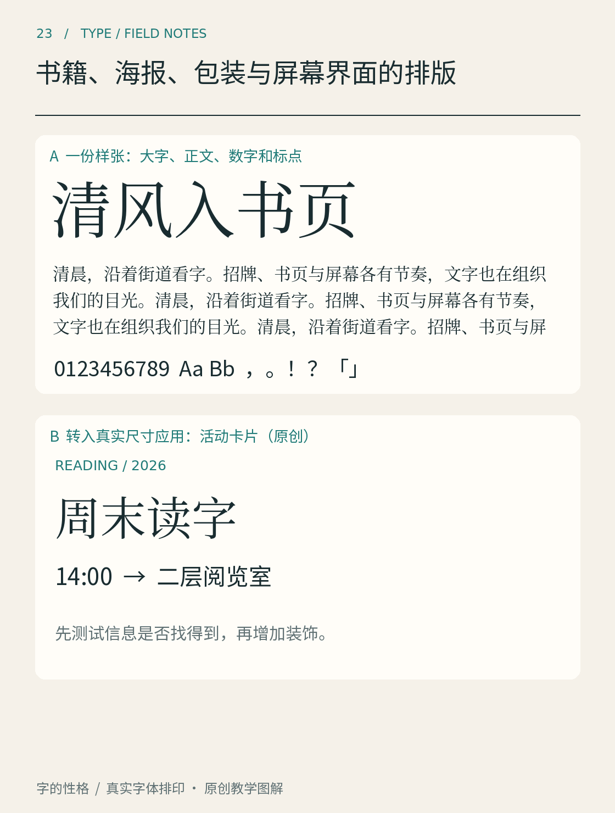

# 第23章　书籍、海报、包装与屏幕界面的排版

同一款字体可以出现在书、海报和手机上，读者面对它们时的动作却不同：书页需要持续阅读，海报需要迅速吸引并传递信息，包装需要在有限表面上组织品牌与说明，界面则要求文字帮助完成操作。字体应用的差异，往往首先来自任务。

*图23｜原创媒介练习，不对应真实品牌。上部样张检查大字、正文、数字和标点，下部活动卡片检验信息组织。包装、书籍与界面还须按本章方法另做实尺寸样件。*

## 书页需要维持一段旅程

书籍版面不应只展示最漂亮的一页。正文页、小标题页、带图页、引文页和注释页会连续出现，读者需要在变化中保持方向感。可以先用三个连续跨页检验系统：一段长正文、一张图片、一段图注，再加一个小节标题。检查正文栏宽是否稳定，图片是否打断了句子，图注与正文能否区分。

中文书页还涉及行首行尾标点、段落缩进、横排与直排等习惯。《中文排版需求》将这些作为实际排版问题展开讨论，它不是一套替所有书决定美学的配方。[资料：W3C《中文排版需求》](https://www.w3.org/TR/clreq/) 本书的建议是，先用正常内容测试，再用带括号、引号、数字和西文的困难段落补测。

## 海报需要一个可信的入口

海报可以把标题做得非常大，但读者最终还要知道时间地点。先决定观看距离和停留方式：路过的行人与坐在手机前的人，能分配的注意力并不相同。把标题放大之后，重新检查日期、地址和报名条件是否仍然连贯，不要让它们沦为装饰纹理。

练习时使用同一份展览文案，先做纯文字黑白海报，只允许两个字号层级。确认信息顺序后，再加入图片与颜色。这样可以知道海报吸引力来自文字结构，还是只来自一张大图。海报中的变形字可以有表达力，但承担行动信息的文字应保留充分辨认条件。

## 包装的每一面都有工作

包装不是一张无限平展的画布。正面承担识别与初步选择，侧面和背面可能承载使用方法、成分与其他说明；折线、接缝、曲面和被手握住的区域都会影响阅读。练习可以做一个虚构茶叶盒：正面写名称、类别与净含量，侧面排冲泡建议，背面放品牌介绍。这里不模拟某个行业的全部法定标签要求。

把纸样折起来，比在平面文件里看更容易发现问题：一个名称可能在转角处断开，背面的段落可能太密，深底细字可能在实际印刷中变弱。字体选择需要和材料、印刷工艺及实际样件一起判断。本书的包装图只演示信息组织，不能据此确定生产规格。

## 界面的文字必须应对变化

界面中的文字会随着语言、用户名、价格和错误状态改变。按钮不能只在“确认”两个字时成立，还要试一试较长的操作名称；表单也不能只有空白、整齐的初始状态，还要放进输入内容、帮助文字和错误说明。

GOV.UK设计系统把字号与行高组织为可复用的尺度，体现了界面文字需要保持关系一致，而不是逐个页面随意定尺寸。[资料：GOV.UK，Type scale](https://design-system.service.gov.uk/styles/type-scale/) 借用这种思路，给练习界面定义标题、正文、标签和辅助信息四种角色，再测试窄屏与文字放大。

跨媒介设计不要求每一处都一样。可以保留字族、字重关系和语气，同时调整栏宽、间距与信息密度。读者感到它们属于同一系统，应来自稳定的组织逻辑，而不是把一张印刷海报等比例缩成手机截图。

## 本章资料

- [W3C：《中文排版需求》](https://www.w3.org/TR/clreq/)，中文段落与行的组织。
- [GOV.UK Design System：Type scale](https://design-system.service.gov.uk/styles/type-scale/)，界面字号和行高的系统化管理。

四种媒介的完整深化案例见[第35章书籍](35.md)、[第36章海报](36.md)、[第37章包装](37.md)和[第38章手机界面](38.md)。它们使用同一虚构活动，便于追踪跨媒介改变的原因。
