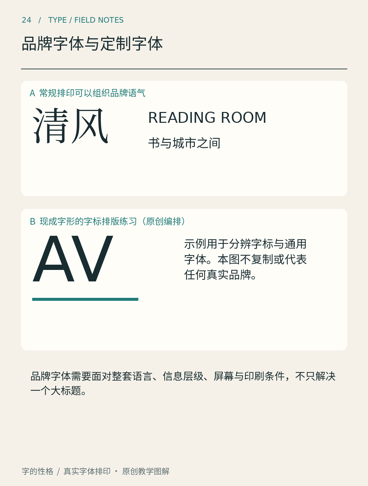

# 第24章　品牌字体与定制字体

一家店可以直接选一款现成字体，也可以为自己的名称画几个专用字，还可以委托设计一套能输入各种文案的字体。这三种做法的工作量与用途不同。讨论“品牌字体”时，先分清自己需要的是一个固定图形，还是持续生成文字的工具。

*图24｜原创教学示意。上部使用常规字体组织语气，下部用现成字形安排字标。这里没有展示一套定制字形，也不是任何真实品牌的定制字体项目。*

## 先决定需要设计多少字

一个固定店名可以逐字调整连接、空间与重心，最后作为矢量图形使用。它不必自动适应其他词组，也不一定具有完整标点和字重。字体文件则需要处理反复组合：今天排店名，明天排活动标题，后天还要容纳一个新地名。几个漂亮字并不能证明整套系统已经成立。

品牌使用的字体也不一定是专属定制。选择一款现成字族，规定标题、正文、数字与多语种搭配，再长期一致地执行，同样可以形成鲜明的文字面貌。定制是解决特定问题的路径之一，需要先找到现成方案无法满足的部分。

例如，一个虚构的城市读书活动，需要中文主标题、英文副标题、日期和长段介绍。先列出实际需求：小尺寸是否清楚，年份和时间是否容易核对，合作方能否在常用软件中使用，繁简文本如何处理。只有把这些条件写明，才知道应该定制四个标题字、修改某些字形，还是设计完整家族。

## 从品牌特征找到可重复的规则

Duolingo的Feather提供了一个清楚的案例。Monotype的项目记录介绍了团队如何从猫头鹰吉祥物Duo的形态出发发展标志与标题字体，并在测试中修订。[资料：Monotype，Duolingo Feather项目](https://www.monotype.com/resources/duolingo-custom-font-inspired-their-owl-mascot-duo) 值得学习的是把形象特征转化为可反复使用的字形语言，而不是给每个字都画上羽毛图案。

为自己的练习项目，可以选一个结构规则，例如圆角的转折和较开放的内白。先画几个差异较大的字，看看规则能否兼容它们：外框方整的「日」、带斜笔的「人」、结构复杂的「间」。如果同一规则使某些字难认，就需要调整规则的适用方式，而不是强迫所有笔画完全相同。

品牌性格的描述也应变得具体。「亲切」可以落实成较柔和的转折、宽松的内部空间和适当的字距，但这些形式并不保证所有读者都会产生相同感受。把它们当作设计假设，通过实际文案和读者反馈检验。

## 定制的价值在于持续使用

IBM官方将Plex介绍为回应自身品牌历史与表达需求的字族，并提供多种类型与字重。这个项目提示我们，品牌字体可以同时承担辨识与日常工作的任务，而不只是标志旁的一句口号。[资料：IBM Design，Plex](https://www.ibm.com/design/impact/plex/)

因此，验收时不应只有品牌首页大标题。还要看一页说明文、一张价格表、一条错误提示、一个长名称，以及真正需要的语言文字。定制字体若只在宣传稿的三个单词中成立，尚未证明它能成为组织的日常工具。

最后把授权和交付放到需求阶段。确认使用者、媒体、嵌入方式、修改权与分发范围，保存实际合同或许可证。不要把“网上能下载”“已经安装在电脑里”当作所有用途都获准的依据。即使采用开放字体，也需要读它自己的许可条件；设计决策与授权条件共同决定项目能怎样长期使用。

## 本章资料

- [Monotype：Duolingo custom font Feather](https://www.monotype.com/resources/duolingo-custom-font-inspired-their-owl-mascot-duo)，品牌形态向字体语言的转译。
- [IBM Design：Plex](https://www.ibm.com/design/impact/plex/)，定制字族的品牌目标与应用范围。
