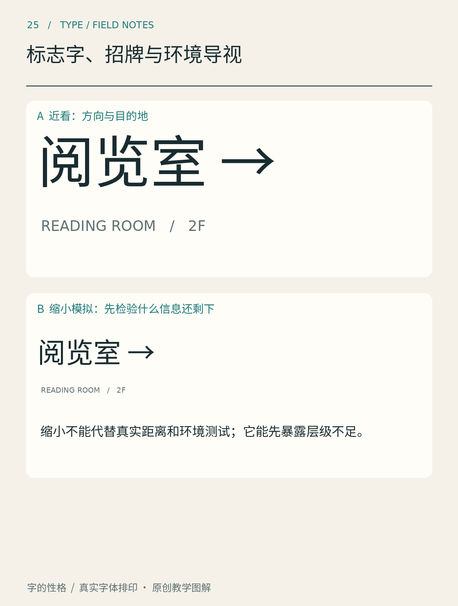

# 第25章　标志字、招牌与环境导视

在一条街上，咖啡店的招牌可以让人慢慢欣赏，地铁出口的指示则需要帮助人及时作出决定。它们都由文字构成，但成功条件不同。标志字强调身份识别，招牌还要面对建筑与街道，导视则要把文字、箭头、位置与路线组织成可靠的信息。

*图25｜缩小样张用于比较细节保留情况，不等同于真实距离、光照和视力条件的测试。观察时同时注意字重、内白和信息数量。*

## 看字之前，人先要看见牌子

一块牌子即使字形清楚，也可能被树枝挡住，挂在错误的转角后面，或者淹没在周围广告中。因此，导视设计先要确定出现位置：人在什么地方犹豫，需要在什么时候知道哪个方向，错过后能否恢复路线。文字的美观必须进入这个空间过程。

做一条从入口到阅览室的虚构路线：入口确认到达，分叉处提供方向，楼层口确认位置，门边给出名称。每块牌子不必重复所有信息。把路线画出来，再决定每处要放的字，比先挑一种“导视感字体”更有效。

## 距离改变了可用的细节

近看时漂亮的细线、尖角和紧密内白，远看可能消失或黏连。过细的笔画容易变弱，过粗又可能压缩字腔。图中的缩小实验可以帮助发现风险，但正式项目仍需要按真实尺寸、安装高度、照明和材料制作样件，在实际位置测试。

加拿大交通署关于无障碍旅客信息的实践文件把观看距离、字高、对比与反光等因素一起讨论，说明导视不能只用一个字号数值解决。[资料：加拿大交通署，无障碍旅客信息实践守则](https://otc-cta.gc.ca/eng/publication/removing-communication-barriers-travellers-with-disabilities-code-practice) 其中的具体要求有自己的地域、场景和适用对象，本书不把它们转换成所有招牌的通用施工标准。

测试文字也应包括易混内容。英文可以观察I、l、1以及O、0，中文可以挑选结构相近、笔画密集的地名。站在远处快速读一次，再请不了解路线的人寻找目标。能在设计师已知答案时读出，与陌生访客能否及时理解，是两种不同的测试。

## 导视中的主次要服务于行动

例如“阅览室 Reading Room →”中，中文名称、英文名称与箭头不一定同大。首先确认主要使用者、语言需求和空间条件，再建立稳定顺序；如果每个楼层都任意更换语言位置，访客需要重新学习。名称、编号和箭头还应保持意义一致，避免同一处在地图上叫A区，在门牌上却只写一个陌生别名。

长地名不宜直接压扁字体来塞入固定框。可以调整牌面布局、采用经过设计的窄体、分行，或重新审视信息量。每种调整都需要检查辨认。箭头也要与路线真实方向对应，尤其是在楼梯、电梯和斜向通道附近。

## 招牌允许表达，但也需要辨认底线

一家糕点店可以在店名字中加入手工感，服务时间和入口说明则可以采用更平实的排印。两种文字角色配合，不必强迫所有信息都穿同一件华丽衣服。白天的反射、夜间的发光以及材料边缘，都会改变字形的实际可见部分。

一个实用练习是做同一店名的两版：一版强调独特形态，一版强调快速辨认。随后将它们放入同一张街景草图，并缩到路人观看的比例。比较哪一版仍能认出名称，哪一版只留下模糊轮廓。最后选取两版各自有效的部分修订，而不是预先把表达和可读性当成不可兼得。

## 本章资料

- [Canadian Transportation Agency：Removing Communication Barriers for Travellers with Disabilities](https://otc-cta.gc.ca/eng/publication/removing-communication-barriers-travellers-with-disabilities-code-practice)，导视的观看条件与信息可达性。
- [英国交通部：Inclusive Mobility（2021版PDF）](https://assets.publishing.service.gov.uk/government/uploads/system/uploads/attachment_data/file/1044542/inclusive-mobility-a-guide-to-best-practice-on-access-to-pedestrian-and-transport-infrastructure.pdf)，公共交通和步行设施的无障碍实践背景。
