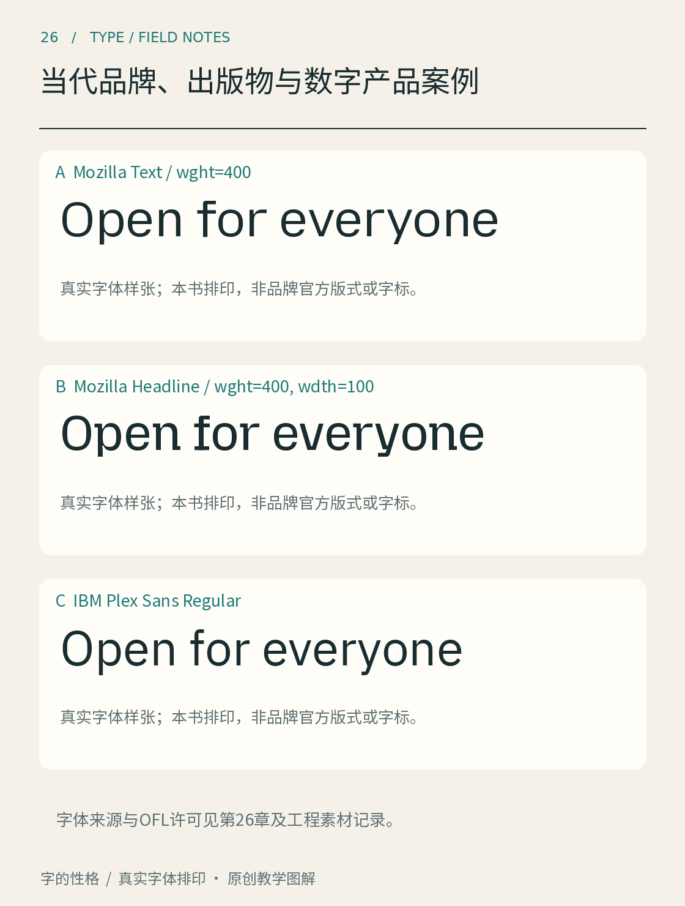

# 第26章　当代品牌、出版物与数字产品案例

观察真实项目时，最有价值的不是记住“某品牌用了某字体”，而是看清它解决了什么问题。一套字体可能被设计来突出身份，也可能用来组织大量信息；同一个品牌还可能为标题和正文安排不同角色。下面把几个项目放在一起读，练习从具体证据推导设计判断。

*图26｜品牌字族的真实字体排印，具体字体名称见图内标注。样张由本书重新编排，不是品牌广告原稿，不代表其完整视觉规范。*

## IBM Plex：身份识别与日常工作

IBM在2018年推出Plex。官方项目介绍将其与品牌历史、人与机器的关系联系起来，字族包含Sans、Sans Condensed、Mono和Serif等成员；官方仓库提供字体与OFL许可。[资料：IBM Design项目说明](https://www.ibm.com/design/impact/plex/) [字体来源：IBM Plex官方仓库](https://github.com/IBM/plex)

读这个案例，可以把“品牌声音”拆成两个尺度：大标题中的字形细节帮助建立辨识，正文、代码和说明中的成员分工支撑持续工作。本书据此提出的观察方法是，把同一个主题分别排成标题、长段落与数字表；检查它们是否既有共同气质，又能履行各自任务。不要仅凭一个大写字母的特征，就推断整套字体在所有用途上表现相同。

在本书实排样张中，先认出图注所写的具体字族成员，再观察字母末端、曲直衔接和内部空间。样张只代表所使用的字体文件；没有出现的语言、字重与版本，不应靠想象补成它的全部能力。

## Duolingo Feather：让形象成为字形规则

Monotype的项目记录说明，设计过程从Duo吉祥物的形态寻找线索，并将标志中的想法发展为Feather标题字体。它体现了从品牌资产中提炼形式规则的路径。[资料：Monotype，Duolingo Feather项目](https://www.monotype.com/resources/duolingo-custom-font-inspired-their-owl-mascot-duo)

阅读原项目中的样张时，可以对照字母的圆润形态、突出部位以及连续单词的节奏，思考哪些特征在多个字母中重复出现。这是本书的视觉分析角度，不等于项目团队对每一笔的解释。没有取得该字体的分发授权时，就通过原项目页面看真实作品，不用相似字体冒充Feather。

它也提醒我们，标题字体承担的表达强度不必覆盖整个界面。一个富有形象联想的标题，搭配较平静的说明文字，可以让不同角色相互支持；真正的搭配关系仍应以项目规范及实际应用为依据。

## Mozilla：为不同文字角色安排字族

Mozilla的2024品牌更新提供了较新的数字品牌参照。当前官方Protocol文档将Mozilla Headline用于Mozilla品牌标题、Mozilla Text用于正文，并明确给出标题字体的使用范围说明；Mozilla还发布了对应的开放字体项目。[资料：Mozilla Protocol，Typography](https://protocol.mozilla.org/docs/fundamentals/typography) [背景：Mozilla品牌更新说明](https://blog.mozilla.org/en/mozilla/mozilla-brand-next-era-of-tech/)

把两种字排在一起，观察标题的展示性与正文的连续阅读条件，可以理解为什么“同一品牌”不等于“全篇同一种字形”。官方还介绍了字族的uniwidth设计：保持不同字重之间的字宽关系。这里的重点是某个已设计好的字体系统如何应对变化，不能推广成所有可变字体都会自动保持行长。

## 出版物：看文字怎样承担栏目工作

《卫报》公开设计页面区分了标题、正文及其他用途的字体，并说明Guardian Titlepiece与标志字的联系。[资料：The Guardian，Design](https://design.theguardian.com/) 这个案例适合观察字体与编辑结构的关系：新闻主标题、栏目提示、正文和数据说明，有不同的阅读速度与信息责任。

看完案例后，回到自己的项目，写下三条可迁移的原则：明确不同文字角色；让特征在一组字中重复而不僵化；用实际内容检查系统。不要把案例名称当成审美结论，也不要照搬品牌的字体数量。案例的价值，在于让自己的决定更有依据。

## 本章资料

- [IBM Design：Plex](https://www.ibm.com/design/impact/plex/)与[官方字体仓库](https://github.com/IBM/plex)。
- [Monotype：Duolingo Feather](https://www.monotype.com/resources/duolingo-custom-font-inspired-their-owl-mascot-duo)。
- [Mozilla Protocol：Typography](https://protocol.mozilla.org/docs/fundamentals/typography)；[2024品牌更新](https://blog.mozilla.org/en/mozilla/mozilla-brand-next-era-of-tech/)。
- [The Guardian：Design](https://design.theguardian.com/)。资料核查于2026年10月，线上规范可能继续修订。
