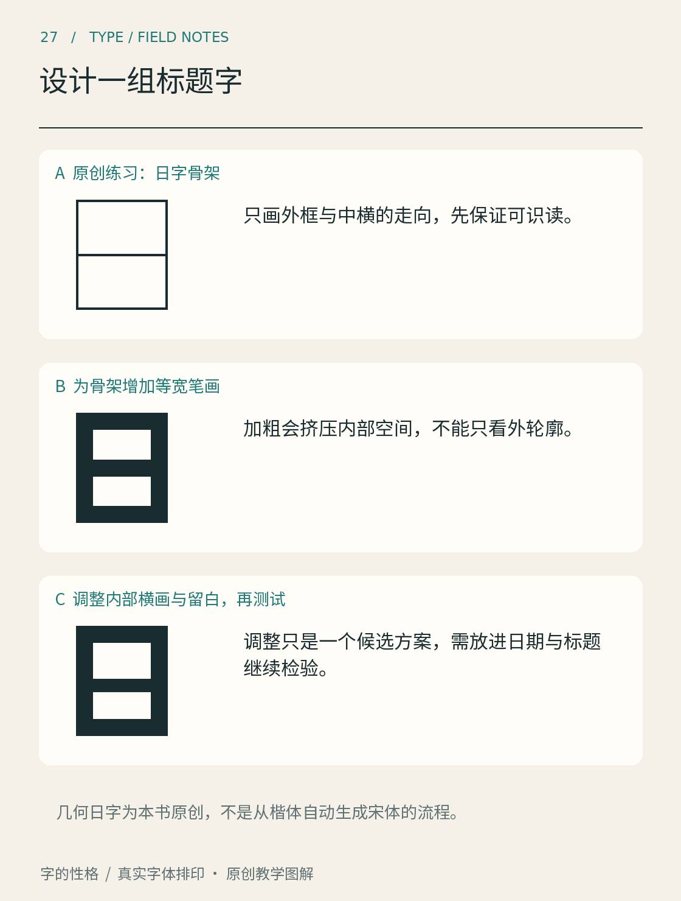
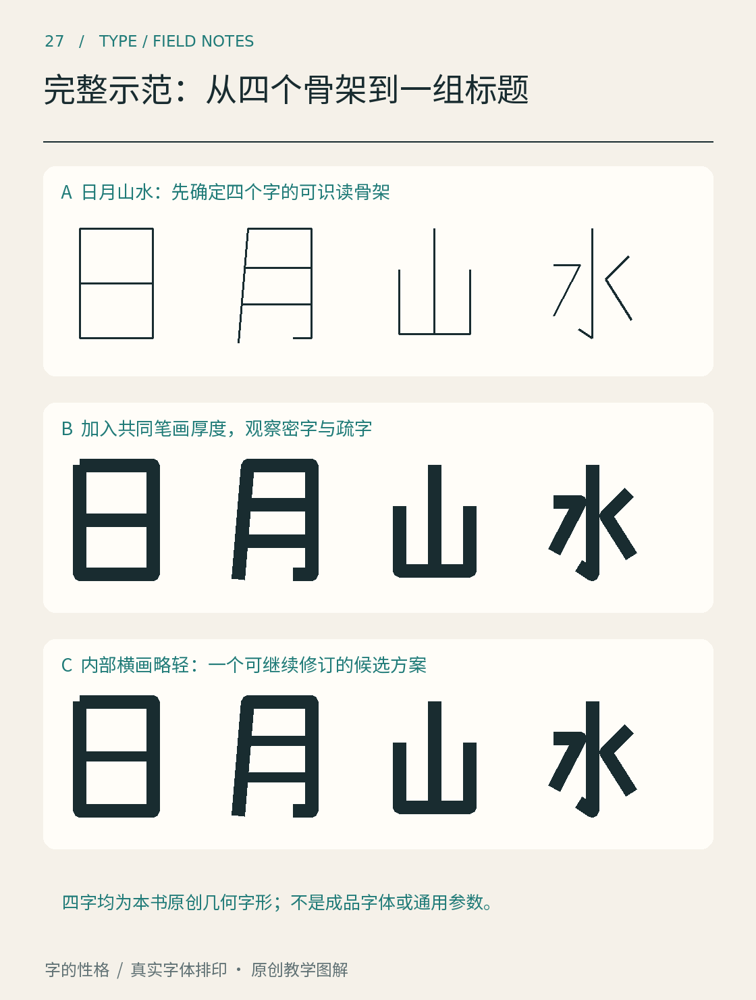

# 第27章　设计一组标题字

第一次设计字，不必从几千个字符开始。为一个小展览画四个标题字，已经足以遇到字形设计的核心问题：每个字要能认出，几个字要有共同语言，连起来又要保持节奏。本章把完整项目设为「字间小展」，先用一个更简单的「日」字练习结构，再进入这四个字。

*图27｜本书原创的几何「日」字局部练习。A确定骨架，B增加笔画，C调整内部横画与留白。它演示修改思路，不是某款字体的开发记录，也不是从楷体自动生成宋体的方法。*

## 在画之前写一张小任务卡

项目是一场小型字体展，标题将出现在活动卡片与手机封面上。目标是“结构清楚、带一点几何趣味”，只设计固定四字标题，不宣称完成了一套可输入任意文案的字体。先把这几条写在纸边，它们能在后面帮助判断一个改动是否值得保留。

准备方格纸、铅笔和橡皮即可。数字工具可以稍后加入。画四个同样大小的框，把共同高度、主要横画位置与大致笔画粗细标出来；这些线是比较工具，不要求所有字都精确贴满框。

## 从「日」练习骨架与黑白关系

看图A，只保留外框与中间横画的走向。这个阶段先确定高宽比例和识别结构。接着像图B一样，给线条增加笔画宽度。你会发现，原来顺眼的骨架变成实心笔画后，内部的两块白色空间变小了。设计对象已经不只是黑线，而是黑线与白空间的共同关系。

图C尝试让内部横画略有区别，并调整位置。它不是唯一正确答案，而是一种候选修订。把两个版本缩小，比较上、下空间是否均衡，横画是否过于抢眼。若某一版只在放大图里漂亮，缩成活动卡片标题就糊成一团，它仍需要继续修改。

## 先看一组完整的四字示范

*补图27｜本书原创几何标题「日月山水」。四个字都由明确的中心路径构成，A至C保留字形身份与顺序，便于连续比较。工程中另附可编辑SVG。*

先逐列看同一个字，再横向看四字是否属于一组。A只规定骨架；B使用共同的笔画厚度后，「日」「月」的内部空白比「山」更容易变紧；C把部分内部横画略微减轻，作为一个可比较的修订版本。「水」的开放斜向结构则提醒我们，统一粗细并不会自动统一视觉重量。

这组示范刻意使用结构较简单的字，先完整走过一遍过程。你可以在矢量工具里打开工程中的`assets/designs/riyueshanshui.svg`，修改其中一条线的宽度，保存新版本再缩小观察。SVG仍是中心线描边结构；若要进行轮廓节点编辑，先在工具中把描边转为路径。接下来再挑战「字间小展」中更复杂的部件关系，不能只把这组的数值照搬过去。

## 给四个字建立共同规则

回到「字间小展」，先画单线骨架，不急着加装饰。「字」含有上部与下部关系，「间」有外框和内部，「小」较疏，「展」较密。它们恰好提供不同压力：相同笔画粗细，在疏字里可能显轻，在密字里可能显堵。

先选择两个共同规则，例如主要转角采用同一种处理、整体字面保持相近的视觉高度。再分别处理每个字：笔画较多时，可以调整局部空间与笔画关系；笔画较少时，可以略调宽度和重心。统一不是把所有部件机械做成同尺寸，而是让它们在连续阅读中显得属于同一组。

此时把四字按预期顺序连起来，不要只逐字检阅。再交换顺序，看看哪些问题来自字本身，哪些只发生在特定相邻组合中。固定标题允许针对这组组合调整字间关系，但要记录下来，避免把特定排版调整误认为通用字形能力。

## 装饰要通过识别测试

如果想在笔画中加入切角、断开或连接，先保留一版无装饰底稿。每次只增加一种变化，然后请别人直接读字，不提前告诉答案。对方猜错的地方就是重要反馈：可能是关键笔画丢失，也可能是两个部件过于靠近。

手绘转为矢量时，保持原有结构目标，再逐步清理轮廓。Glyphs官方的轮廓教程适合用来理解路径、节点与曲线质量；具体工具操作放到下一章。[资料：Glyphs，Drawing good paths](https://glyphsapp.com/learn/drawing-good-paths)

最后交付三样东西：四字黑白版本、一张缩小后的应用卡片、一页修改记录。记录写清“哪里难认、怎样修改、缩小后是否改善”。能够解释为什么留下这个版本，比只得到一张装饰丰富的标题更接近真正的设计学习。

## 本章资料

- [Glyphs：Drawing good paths](https://glyphsapp.com/learn/drawing-good-paths)，从草图进入数字轮廓时的路径质量参考。
- 本章项目、几何「日」字和练习步骤为本书原创教学设计，不是现成字体的临摹配方。
