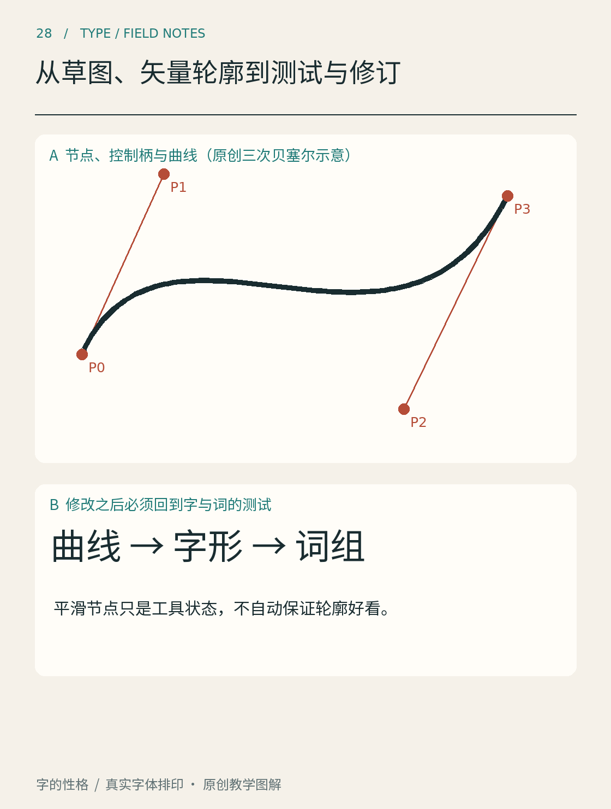

# 第28章　从草图、矢量轮廓到测试与修订

纸上画出的一个字，放大后可能有毛边，但大体关系仍然顺眼。进入矢量软件之后，曲线变得光滑，却可能失去原来的精神。数字化并不是按自动描摹按钮，它需要把草图中的结构判断转化成容易控制、能够反复修订的轮廓。

*图28｜原创路径原理图。观察轮廓、节点和控制柄的关系；示意图用于理解局部曲线，不代表一款已经通过完整检验的字体。*

## 先保留草图的判断

在扫描或拍照之前，圈出草图里值得保留的三个关系，例如字面宽度、内部开口和重心。照片应尽量正对纸面，减少透视倾斜；把它当作底稿，而不是绝对坐标。因为拍摄误差而扭曲的边缘，不应忠实复制进最终字形。

普通矢量编辑器适合制作固定标题字；若要生成可安装字体，则需要进一步处理字符映射、字宽、字体信息与导出。FontForge官方教程展示了在字体编辑器中创建字形、使用参考线及编辑轮廓的基本过程。[资料：FontForge，Font and glyph creation](https://fontforge.org/docs/tutorial/editexample.html) 初学时可先完成一个局部项目，再决定是否进入完整字体工程。

## 节点要表达结构

节点不是越多越精细。过多节点会让曲线难以控制：移动一个点，旁边出现小凹陷；修好凹陷，又产生新的波动。先用尽量清楚的结构描述轮廓，把直线、转角和曲线分清，再逐步处理细节。

以三次贝塞尔曲线为例，一段曲线由端点与控制点共同决定。控制柄改变曲线离开端点的方向与力度。需要平滑相接时，连接位置两侧的方向关系应经过检查；需要尖角时，则不能为了“顺滑”把原有转角磨掉。Glyphs的官方教程讨论了冗余节点、极值点和控制柄等问题，适合与图中的原理示意对照阅读。[资料：Glyphs，Drawing good paths](https://glyphsapp.com/learn/drawing-good-paths)

也不要把一种软件的路径经验直接变成所有字体格式的硬性规则。不同轮廓表示与导出流程会有各自限制；此时最可靠的目标，是保持形状清楚、拓扑合理，并用实际导出来检查结果。

## 放大、正常、缩小，三种尺寸轮流看

放大检查能找到折点、毛刺与不自然的曲率；正常尺寸检查整体风格；缩小检查内白和笔画是否还能区分。只在高倍放大下工作，容易把时间花在正常阅读根本看不见的细节上，却忽略字距和重心这种更大的问题。

给每轮修订保存一个版本。第一轮只处理结构：是否难认、是否倾斜、某个部件是否过重。第二轮检查笔画和空间。第三轮再处理曲线细节。不要在同一轮同时更换全部比例、笔画风格和字距，否则前后比较失去依据。

## 测试必须进入真实组合

单字居中展示时，左右空间很容易被忽略。把字排进「字间小展」的标题，再放进活动卡片，看看是否出现某个字孤立、某一对字挤紧的问题。若准备做字体文件，还要用不同词组检查字形能否重复组合，不能只为唯一标题设置一个巧妙位置。

导出后应在真正使用的程序中重新打开。轮廓在编辑器中正常，不代表安装、映射、显示和嵌入都已经正确。用普通文本输入目标字符，检查是否出现缺字、字宽异常、上下截切与替代字体混入；必要时将导出文件重新导入检查。

最后保留源文件、导出文件和测试样张，并写明版本。把修改原因和测试结果放在一起，下次发现问题就能知道应回到哪一步。字体设计的专业感，常常来自这些可追踪的小修订，而不是一次完成一个毫无瑕疵的轮廓。

## 本章资料

- [FontForge：Font and glyph creation](https://fontforge.org/docs/tutorial/editexample.html)，字体编辑器中的字形创建与轮廓概念。
- [Glyphs：Drawing good paths](https://glyphsapp.com/learn/drawing-good-paths)，路径与节点的检查方法。
