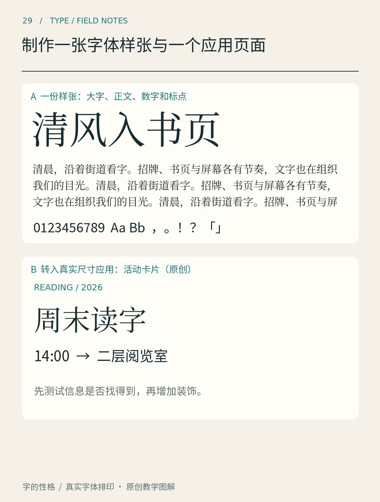

# 第29章　制作一张字体样张与一个应用页面

样张让我们认识字体，应用页面让我们认识字体在工作时的表现。前者可以放大细节、排列多个尺寸；后者必须接受真实内容的限制。如果只做样张，容易挑选最漂亮的几个字；如果只看应用，又可能不知道问题来自字形还是排版。

*图29｜原创排印练习。样张负责暴露字形与字符组合，应用负责检验信息顺序。它们使用各自的观察尺度，不互相替代。图中活动为「周末读字」；正文另以「字间小展」练习，可按相同方法完成，不把本图当作四字设计项目的成品。*

## 第一张纸：让字体接受检查

准备一张竖版样张，顶部写字体名称、来源与使用版本。这里应写完整名称，而不是“高级黑体”“复古宋体”等情绪标签。若只使用某个字重，也要注明；不能让读者误以为展示了整个字族。

第一部分放几个大字，选择结构差异明显的字，例如「日、永、国、间」。第二部分放连续短句，观察相邻字的节奏。第三部分放一段正常正文。第四部分加入数字、大小写西文和常用标点。若准备发布给特定读者，再加入他们真的会遇到的姓名、地名与术语。

不要只选择已经确认美观的内容。可以有意加入密集字、括号、百分数、日期和较长的英文词。样张的任务是暴露能力边界。发现某个字没有覆盖时，标注缺字；不要默默让系统用另一款字体代替之后，仍将整张图称为同一种字体。

## 第二张纸：安排一个真实任务

用同一套字做一张虚构活动卡，内容为「字间小展」、一句介绍、日期、地点和报名信息。先只使用黑白，不加照片。把主题设为入口，再组织关键行动信息，最后安排补充说明。这里可以复用第22章的信息角色。

练习时可以先限定两个字重、三个字号角色，作为降低复杂度的方法；它不是优秀版式必须遵守的数量规则。将卡片缩到手机上检查：能否立刻认出主题，日期和地点是否还清楚，长信息是否溢出。再制作一个打印尺寸，观察同一份版面在不同媒介中的变化。

官方设计系统常把这些重复关系写成规则。Mozilla Protocol不仅说明字族分工，也将字号限制在预设尺度中；GOV.UK提供配套的标题与正文样式。[资料：Mozilla Protocol，Typography](https://protocol.mozilla.org/docs/fundamentals/typography) [资料：GOV.UK，Type scale](https://design-system.service.gov.uk/styles/type-scale/) 对个人练习来说，不必照搬数值，可以学习它们把临时决定整理为可重复关系的做法。

## 把对照做成能回答问题的实验

如果比较两款字体，先保持文案、颜色、文本框与用途一致。随后检查相同名义字号下的视觉大小；需要调整时，保留原始版，再注明调整后的设置。否则“字体A更醒目”可能只是因为它被排得更大。

如果比较两种排版，保持字体不变。一次只改变主要变量，例如行距、标题字重或段间距离。这样回头看才能解释差异。不要把全新的颜色、插画、背景纹理和字体一起换掉，再把所有改善都归功于字体。

可以在样张边上记录四项：难辨认的字符、过密或过松的组合、缩小后丢失的细节、应用中需要再次调整的位置。这些记录应该包含具体字词，避免只写“感觉不够高级”。

## 让交付保持可复现

保存可编辑文件、最终图片或PDF、字体来源和许可证记录。若文件要交给别人编辑，先确认对方是否具有所需字体及相应权限。文字转为轮廓可以保留固定图形的外形，却会失去普通文本的一些能力；图片中的正文也不便搜索、复制或由辅助技术读取，不能把它当成所有交付的默认方案。

完成这一章后，你应得到一张观察用样张和一张能完成任务的应用页。两者互相反馈：应用提出问题，样张帮助定位，修改后再回到应用验证。这就是从“喜欢一款字体”走向“能够判断它是否适用”的实际路径。

## 本章资料

- [Mozilla Protocol：Typography](https://protocol.mozilla.org/docs/fundamentals/typography)，文字角色与预设尺度。
- [GOV.UK Design System：Type scale](https://design-system.service.gov.uk/styles/type-scale/)，可复用的字号、行高关系。
