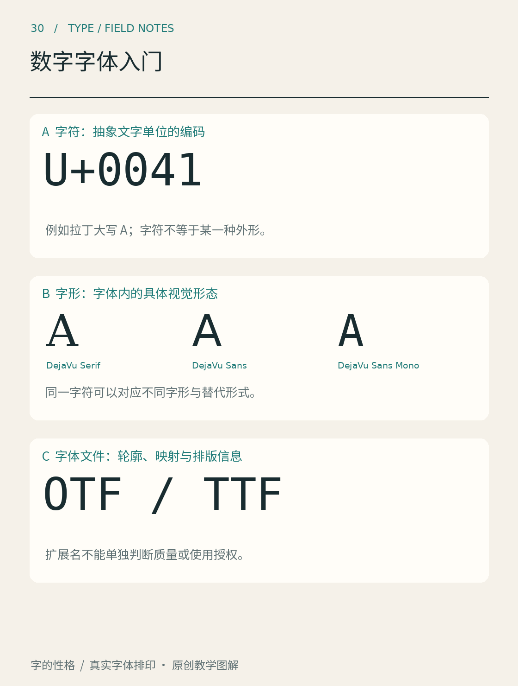

# 第30章　数字字体入门

下载一个字体文件、安装、输入文字，看起来只有几步。背后却有几种不同对象在配合：字符告诉系统“这是什么文字”，字形告诉系统“它画成什么样”，字体文件储存绘制与排版所需的数据，排版程序负责把它们组织成可见文本。认识这几层，许多缺字、样式和授权问题就容易说清。

*图30｜概念关系示意。A用U+0041表示字符编码，B展示具体字形，C说明字体文件。真实排版还包含字形替换、定位与字体回退等环节；本图是对象分层，不是完整执行流程。*

## 字符与字形不是一对一的关系

字符是文字信息中的抽象单位，字形是具体外观。同一个字符在不同字体中可以有不同形状，一个字体也可能为同一字符提供不同形式。反过来，多个字符在特定排版规则下可能形成一个连字字形。

OpenType的cmap表承担字符编码到字形索引的映射；其他排版数据还可以进一步参与字形替换与定位。因此，看到一个漂亮轮廓，并不意味着程序已经知道输入哪个字符时应该调用它。[资料：Microsoft，cmap说明](https://learn.microsoft.com/en-us/typography/opentype/spec/cmap) 对初学项目，先验证目标字符能正常输入，再扩大字符覆盖范围。

中文字体尤其需要留意覆盖。能排出一条宣传语，不代表能显示所有人名、繁体字或罕用字。遇到缺字时，系统可能使用回退字体，让一段文字里混入不同风格。检查方法是用真实内容测试，并在需要时查看实际使用的字体，而不是只确认文件已经安装。

## 文件后缀只能提供部分线索

常见的.ttf、.otf和网页使用的.woff、.woff2，各自关联字体的存储或封装方式；仅凭后缀不能判断审美质量、字符数量、语言支持和使用权限。OpenType字体可以采用不同轮廓表示，字体中也不只有可见轮廓，还可能包含名称、度量与排版信息。[资料：Microsoft，OpenType字体文件](https://learn.microsoft.com/en-us/typography/opentype/spec/otff)

因此，选择文件时需要同时核对用途和工具支持：是桌面排版、网页加载，还是应用嵌入；文件来自哪个官方版本；目标软件是否识别需要的特性。不要将“在我的电脑上打开”当作所有平台都能正确显示的证明。

## 可变字体是一组已设计的变化空间

可变字体可以在一个字体资源内提供沿设计轴变化的字形或其他数据。字重、宽度等是常见的轴，但具体有哪些轴、范围多大，由字体本身决定。它不是任意把所有字体拉伸变形的工具。[资料：Microsoft，OpenType Font Variations Overview](https://learn.microsoft.com/en-us/typography/opentype/spec/otvaroverview)

试用时先打开字体实际提供的轴，保持正文内容不变，观察中间位置是否仍然协调。字重改变可能影响段落色度，宽度改变可能影响换行；光学字号轴存在时，也要理解它承担的是针对尺寸的字形调整，而不是单纯把字放大。不同软件对轴和命名实例的界面支持可能不同，交付前仍须实测。

## 授权与设计质量是两件都要确认的事

免费获取、开源发布与可用于某种商业项目，不能简单画等号。需要查看这一个字体项目的许可证或购买条款，确认桌面使用、网页加载、嵌入、修改和再分发等实际行为。下载站的简短标签不能代替原授权。

OFL是常见的开放字体许可。其官网说明字体可用于书籍、海报、标志等作品，也允许在条件下修改和再分发；项目若声明保留字体名称，修改版本可能需要更名。[资料：SIL Open Font License官方站](https://openfontlicense.org/) 这些条件不能自动套到其他许可证的字体上。保存字体时同时保存来源、版本和许可文本，能减少日后无法追溯的问题。

到这里，可以为一个小项目建立简洁的交付清单：目标字符能够输入，连续组合没有明显问题，所需样式在实际软件中正常，来源和权限有记录。它不会代替完整字体工程的专业检验，却足以帮助兴趣学习者从“安装成功”走到“明白自己正在使用什么”。

## 本章资料

- [Microsoft：cmap](https://learn.microsoft.com/en-us/typography/opentype/spec/cmap)。
- [Microsoft：OpenType font file](https://learn.microsoft.com/en-us/typography/opentype/spec/otff)。
- [Microsoft：OpenType Font Variations Overview](https://learn.microsoft.com/en-us/typography/opentype/spec/otvaroverview)。
- [SIL Open Font License官方站](https://openfontlicense.org/)。本章为使用知识介绍；具体项目以其实际许可文本为准。
