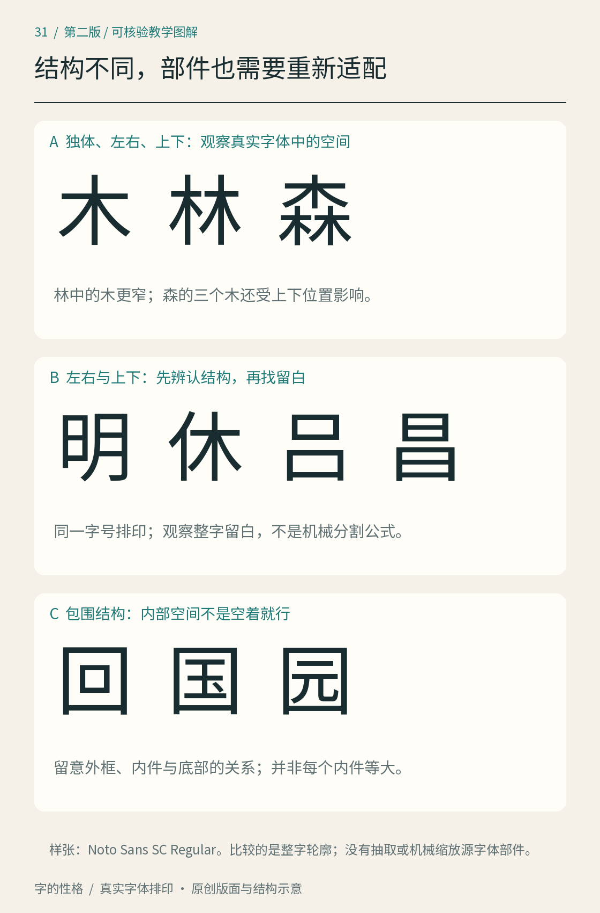

# 第31章　中文结构与部件适配

同样一个“木”，独立成字时可以舒展，放进“林”就要与另一部分相让，进入“森”又必须适应上下叠置。这里改变的不只是大小。字形设计需要重新安排伸展方向、相邻空白和黑色密度，才能让读者在看清每个字的同时，感到它们属于同一套字体。

[第14章](14.md)介绍骨架、笔画与轮廓，[第15章](15.md)讨论字面和重心。本章把观察进一步落实到汉字的内部组织。下面的结构分类是设计时便于检查的工具，不是对全部汉字的穷尽分类，也不等同于解释字源的六书。

*图31｜使用真实字体排印结构不同的汉字。样张比较的是完整字形的轮廓与内部空间，没有从字体源文件抽取部件，也不是标准笔顺图。*

## 先认清部件承担的空间

汉字部件（component）是构成字形的组织单位，部首则还承担字典检索等用途，二者不能一概混用。设计师可以围绕相同部件整理相关字形，但不必把每一笔都拆成独立零件。程勋昌在 ATypI 的[中文字体设计与生产讲座介绍](https://atypi.org/presentation/beyond-thousands-how-chinese-typefaces-are-designed-and-produced/)中，将少量关键字的风格确立与后续字符扩展区分开来，并强调笔画和部件的系统作用。它给初学者的启发是：先在有代表性的字上建立规则，再用更多结构检验规则。

可准备“木、林、森、休、明、吕、昌、回、国”作为观察组。把它们以同一字号排成一行，再各自放大。第一遍只看结构：哪里开放，哪里被围住，两部分之间的接缝朝什么方向。第二遍再看具体笔画。不要用单个最漂亮的字作为全套设计的唯一模板。

## 独体字：少笔画也需要组织

“木、山、心”没有被一个共同外框填满。它们的空白来自不同方向：山有高低起伏，心有较宽的下部和分离点画。若强迫每个字的黑色边界都贴满同一个正方形，容易把原有的伸展与呼应破坏。

练习时先画同样大小的字身框，把字放在其中，标出最远的上下左右边界。随后遮住外框，看字是否显得过大、过小或倾斜。外框便于比较，却不能替代视觉判断；黑色面积相等、边界完全居中，也不保证几个字放在一起协调。

如果一个简单字显得很空，不要立刻把所有笔画加粗。可以先比较其伸展是否不足、内部转折是否过于集中、周围字是否字面过大。一次只改一类关系，保留旧版，再回到整行判断。

## 左右结构：相让不是平均分格

“明”可用于观察两个有内部空间的部分如何并置；“休”则适合观察窄侧部件和较宽主体的关系。两者都不需要预设为左右各占一半。分区比例应同时服从具体字形、字体风格与相邻空白。

拿“木”作练习，可以先保留一份独立字形，再画它在“林”左部的适配草图。检查靠近接缝的伸出笔画是否与右部相碰、竖画是否过于靠中、左右两个部分的底部是否形成突兀台阶。不要仅把“木”横向压缩：机械压缩也会改变笔画的粗细关系和转角比例。

接着把草图排成“木林木林”。当字内部缝隙与字外间距差距过大时，读者可能感觉“林”像两个分开的字，或感觉左右部件挤成一团。内部与外部空白需要一起看；它们可以不同，但应有可辨认的层次。

## 上下结构：高度与方向一起调整

看“吕、昌、森”。上下部分的关系不只由中间横缝决定，还取决于上部下缘与下部上缘怎样相遇。某个部件的顶端突出，可能使两部分的最近距离很小，而大多数区域仍显得疏远；只测两条水平边界会漏掉这种差别。

画“森”的草图时，先安排上部与下部的大致范围，再放入骨架。然后分别检查上部是否过重、下部是否撑得住、三处相似笔画是否挤到一起。若把三个同样的“木”等比例缩小后直接摆放，能够形成可辨认的起点，却还没有完成对笔画与空间的协调。

对修改做简短记录，例如“收短上部右侧伸出”“给下部中央留白”“保持底部展开”。这些描述比“整体更好看”更能指导下一次迭代。它们是此练习的设计选择，不应推广为所有字体必须采用的固定口诀。

## 包围结构：内外两套空间互相制约

“回”和“国”都具有外部包围，但内部密度不同。先观察外框，再观察内部轮廓与四周留下的距离。若只要求内外同心，复杂内部可能显得沉重；若一味增加内侧空白，整字又可能与旁边的字大小失衡。

画一个方框包围简单内容，再把内容换复杂，能直接感受这种牵制。调整顺序可以是：先确定整体字面，再安排内部部件位置，随后修正外框粗细与交接，最后回到小尺寸检查。包围内的空白无需四边数值相等，设计依据应来自实际形状与阅读效果。

半包围、交错和更复杂的结构还会提出不同问题，不能把本章四种观察直接视作全部答案。[GRANSHAN 的汉字专题](https://granshan.com/insights/hanzi-chinese-characters)提供了更多结构样式与字身、字面示意，可作为扩展参照。

## 做一张部件适配记录

用一个晚上的时间完成六字即可：选择同一部件参与的独体、左右和上下结构，每种各一两字。先写设计意图，例如“适合活动标题、笔画较厚、内部保持开放”；再为每字保留初稿、修改稿与正常阅读尺寸样张。

检查分三轮进行：放大时看交接和空白，缩小时看辨认与密度，连续排印时看大小和节奏。最后补进标点与几个无关结构的字，避免只在熟悉的小组里自洽。这张记录的完成标志，是你能指出哪处改变、为何改变，以及改变后在整行中解决了什么问题。

## 本章资料

- [ATypI：Beyond Thousands: How Chinese Typefaces Are Designed and Produced](https://atypi.org/presentation/beyond-thousands-how-chinese-typefaces-are-designed-and-produced/)，程勋昌，2025，关于关键字、部件与生产流程。
- [GRANSHAN：Hanzi — Chinese Characters](https://granshan.com/insights/hanzi-chinese-characters)，汉字结构与数字字体的观察参照。
- [Adobe：Source Han Sans](https://github.com/adobe-fonts/source-han-sans)，可查阅实际字体、源文件与设计资料。本章适配练习为原创教学方法，不是该项目的制作档案。
