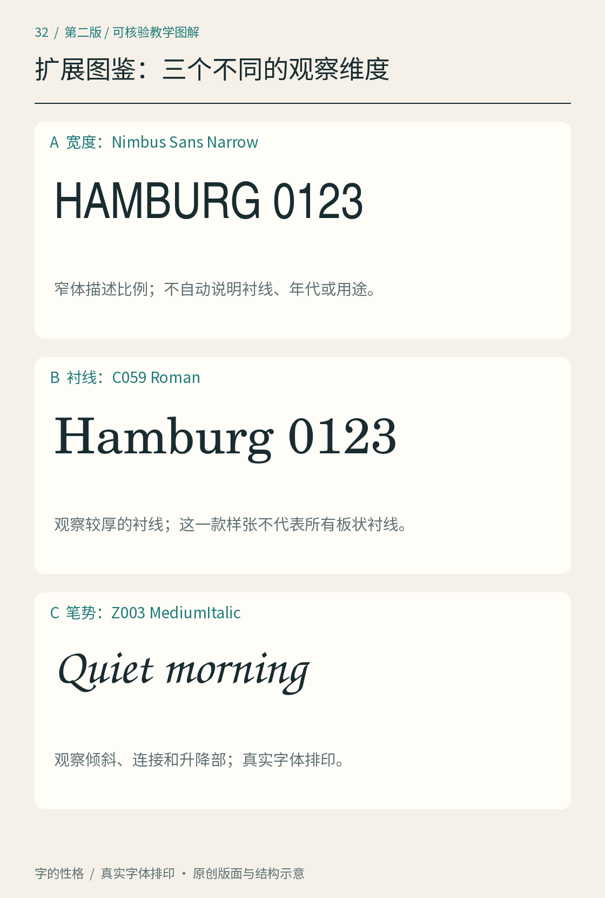
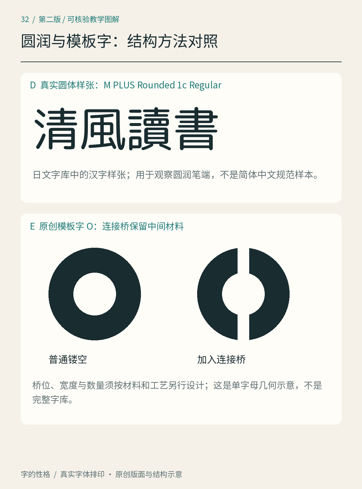
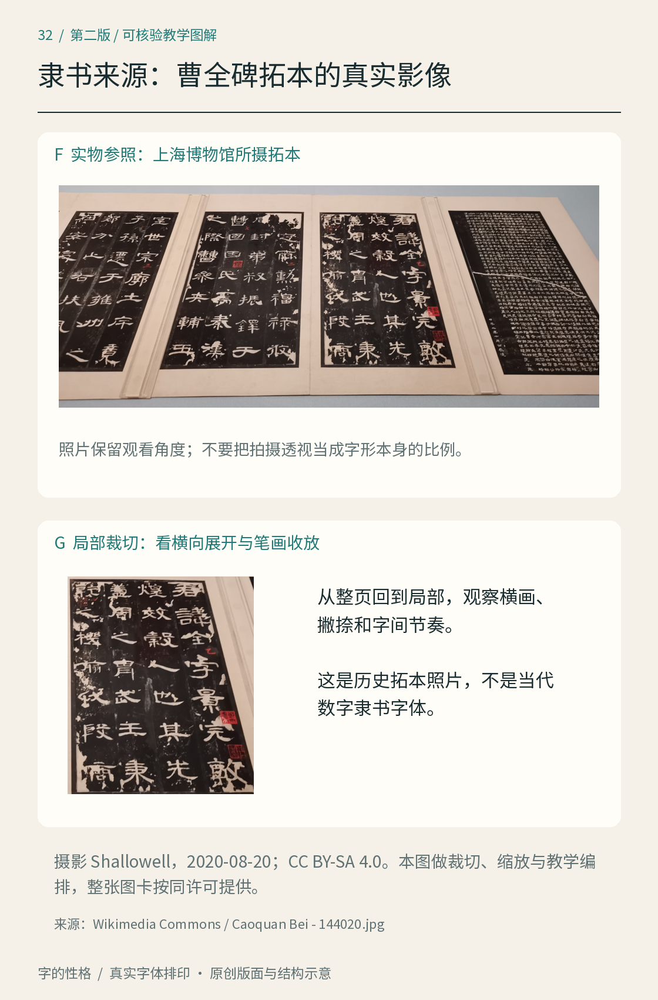
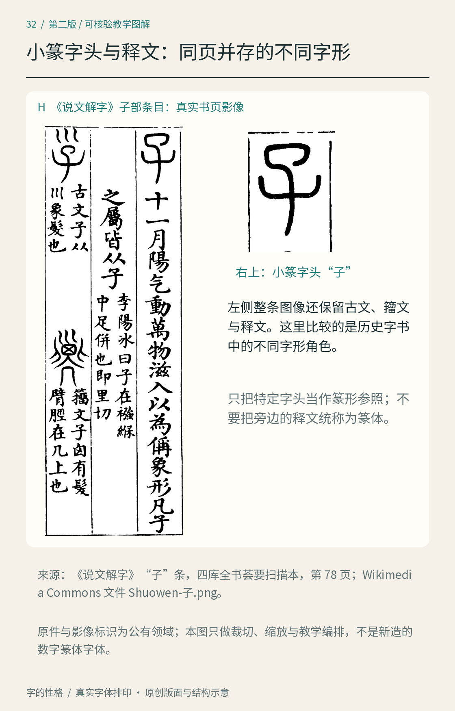

# 第32章　扩展字体图鉴：圆、窄、板状衬线与模板字

字体菜单里的类别不会整齐地排成一棵树。“窄”说的是比例，“圆”可能说端部与转角，“隶书风格”指向书写传统，“标题字体”又主要描述用途。若把这些词理解为互不相容的盒子，遇到一款又窄、又粗、又有圆角的字，就会失去判断依据。本章给已有图鉴增加几个观察方向，并把分类依据写清。

*图32｜比较比例、衬线、书写连接与构造方法。真实字体名称与原创示意分别标明；原创几何实验只解释造型方法，不是历史字样，也不是可输入任意文字的完整字体。*

## 圆体：观察端部，也观察内部

圆体的辨认不能只靠“柔和”这种印象。先看笔画的终止位置是平切、微圆还是明显半圆，再看横竖相遇处、折角与字腔。有的设计主要改变外端，有的连内角也处理得圆润；两者在密集字和小字号里会呈现不同空间。

把“口、田、日”与“人、木、心”放在一起，分别观察封闭空间和开放末端。若将黑体图像整体做圆角滤镜，短笔画可能变成圆点，交接处可能丢失辨认线索。这能解释为什么成熟圆体仍需要逐字设计，不能把所有角磨圆就算完成。

真实参照可看 [M PLUS Rounded 1c 的项目介绍](https://fonts.google.com/specimen/M%2BPLUS%2BRounded%2B1c)：它具有圆端特征，并面向日文等文字覆盖。使用其中汉字观察造型时，仍需检查具体字符与地区字形，不能把日文字体默认当作完整简体中文字库。圆体也不专属于儿童或食品包装；用途应由字形、信息与阅读条件共同决定。

*补图32A｜M PLUS Rounded 1c Regular 实际排印“清風讀書”，这是日文字库中的汉字样张，不是简体中文规范样本。另一部分为原创 O 字模板连接桥示意，解释内部区域如何保留，不是商业字体样张。*

## 隶书、篆书风格：先分清书体与数字字体

隶书（clerical script）与篆书（seal script）有各自的书写传统。现代字体可以取用其中的结构、笔势或装饰线索，但一款数字字体的名称里出现“隶”“篆”，并不能证明它精确复原了某件古代作品。有关书体及相邻风格，可参看 [GRANSHAN 的汉字专题](https://granshan.com/insights/hanzi-chinese-characters)；历史材料的观察要保留作品身份与出处。

看隶书风格时，可以留意横向展开、起收笔形态以及笔画间的节奏，再比较同类设计之间的差异。不要把“每个字都扁、每条横画都带夸张波磔”当作定义。看篆书风格时，则要同时注意结构和字形辨认：有些古今字形差异不能靠把现代楷体拉长、弯曲来获得。

*补图32B｜《曹全碑》拓本，上海博物馆展陈照片；摄影 Shallowell，2020年8月20日。取自 [Wikimedia Commons 原文件页](https://commons.wikimedia.org/wiki/File:Caoquan_Bei_-_144020.jpg)，按 [CC BY-SA 4.0](https://creativecommons.org/licenses/by-sa/4.0/)提供。本图进行了裁切、缩放与教学编排，整张图卡沿用相同许可。它是历史拓本的照片，不是当代数字隶书字体。*

先沿照片的一列看横画收放与相邻字的节奏，再看裁切局部里的撇捺。照片带有透视和展陈角度，不宜直接测量字宽比例；可观察笔画形态，却不能把拍摄造成的变形当作字体特征。现代隶书风格字体如何吸收这些特点，仍需用该字体的实际文件另作比较。

*补图32C｜《说文解字》“子”条，四库全书荟要扫描本，Internet Archive 图像页78；[原始图像与出处](https://commons.wikimedia.org/wiki/File:Shuowen-%E5%AD%90.png)标识为公有领域。本图保留条目并放大右上小篆字头，另有古文、籀文与解释文字；裁切、缩放用于教学，不是数字篆体字体。*

先看右上的小篆字头，再看旁边较熟悉的释文，体会二者承担的不同任务。不要把一张古籍页上的全部文字都称为篆书，也不要假定只要给现代“子”字换一种圆线条，就会得到图中的结构。这个例子展示了核对真实字形的重要性；它不足以概括全部篆书风格。

做海报题签时，先核对字是否正确，再决定是否采用古文字形或相关造型。若读者不熟悉，可以让准确易读的现代文字承担说明，将特殊字样承担标题。不得把自动生成或猜画的篆字当作规范示范。书体研究需要更细的字例与文献，本章提供的是辨别现代应用时的入口。

## 美术字与展示字体：用途大于统一外观

美术字常围绕特定文案进行造型；展示字体（display typeface）则可能是一套可重复输入的设计。它们都可以在标题中突出特征，但不必拥有同一种形态：几何模块、极端对比、切角、影线、轮廓和多层结构，都可能用于展示。

检验方法是先拿掉颜色、纹理与阴影，只看主轮廓。标题还能认出吗？再把相同字重复几次、加进不熟悉的字，检查规则能否继续成立。若只有四个字经过设计，应称为四字标题或字标练习；不要因为排列得像样张，就宣称拥有完整字库。[第27章](27.md)的四字实践可以沿这个方向继续深化。

还要区分独立轮廓设计与现成字体效果。给一款字体加描边、倾斜、阴影，能够形成海报视觉，但未必改变字形的结构规则。记录素材来源和处理过程，能帮助读者理解作品究竟做了哪些设计。

## 窄体：比例变化不能只靠水平压缩

窄体（condensed typeface）减少字形与占位的横向比例，能在有限宽度中放入更多内容。但真正的窄体设计通常还要照顾笔画、字腔与字距。将普通字体整体横向挤压，会使竖画变细而横画厚度不按同样方式变化，字形关系随之改变。

比较 Nimbus Sans 与 Nimbus Sans Narrow 的同文样张，可以先看整词宽度，再看 a、e、m 的内部空间。两者来源可查 [URW Base35 项目](https://github.com/ArtifexSoftware/urw-base35-fonts)。把窄体用于海报时，应在预期阅读距离测试；狭窄并不自动等于清晰，也不保证长文更节省读者精力。

## 板状衬线：衬线的厚度和连接也有性格

板状衬线体（slab serif）的衬线通常比较厚重、明确，但类别内部仍存在衬线连接方式和笔画对比的差别。看 C059 的字样时，可以先找大写 H、E 和小写 n，再观察衬线怎样进入主笔画。不要只看某一条横画很粗，就把所有粗衬线字都归为同一种设计。

把它与[第10章](10.md)的其他衬线样张放在一起，用同一段标题和正文检查。标题中的厚重末端可能很醒目，缩成小字后却需要重新判断空白与色度。类别提供观察方向，不能替你决定一切用途。

## 花体与模板字：书写动作和制造方法

花体、连笔体常对应 script 一词，重点在于笔势、倾斜与连接。Z003 的真实样张可用来追踪入笔、出笔和升降部；真正的连接效果还受字形组合影响，不能只看一个孤立的大写字母。花饰也不是越多越好，标题里有效的长尾放进连续正文可能互相干扰。

模板字（stencil）的另一观察线索是断口与连接桥。若在实体板材上镂空一个 O，内部孤立部分需要桥接，才能留在模板上；数字字体可以保留这种视觉语言，却未必对应一张实际可制作的模板。[Adobe 对 Stencil 的介绍](https://fonts.adobe.com/fonts/stencil)说明其镂空模板字的造型来源。观察时检查断口是否具有一致的位置逻辑，以及它是否破坏关键辨认部分。

本章最实用的练习，是为一个陌生字样写三行记录：第一行描述比例和笔画，第二行描述结构与造型来源，第三行写预期用途。允许同一字样同时拥有多个标签。这样遇到新字体时，就能从“像某种风格”走向可比较、可核验的观察。

## 本章资料

- [Google Fonts：M PLUS Rounded 1c](https://fonts.google.com/specimen/M%2BPLUS%2BRounded%2B1c)，圆端字体的具体项目参照。
- [GRANSHAN：Hanzi — Chinese Characters](https://granshan.com/insights/hanzi-chinese-characters)，书体与当代字体的关系参照。
- [URW Base35](https://github.com/ArtifexSoftware/urw-base35-fonts)，Nimbus Sans Narrow、C059 与 Z003 字体文件来源。
- [Adobe Fonts：Stencil](https://fonts.adobe.com/fonts/stencil)，真实字体的模板字造型介绍；图中的原创模板实验不复刻该字体。
