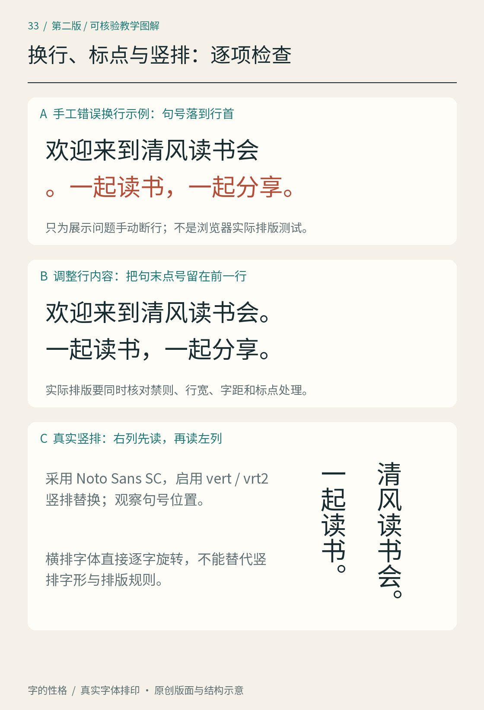
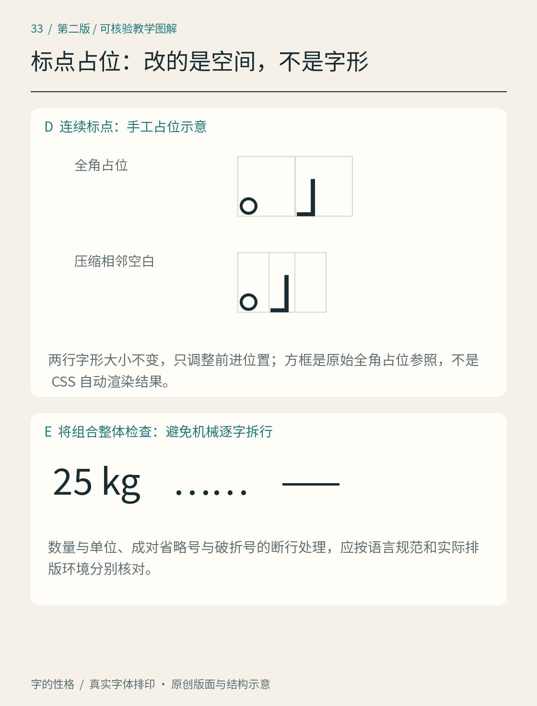

# 第33章　中文精细排版：标点、换行与竖排

一段中文即使字体、字号都合适，仍可能出现这样的阅读阻碍：新行从逗号开始，左引号孤零零地留在上一行，连续标点之间空得像漏了字，或“25”和“kg”被拆到两行。修整这些细节，首先要保留文字原义，再处理显示位置，而不是为了排得整齐随意改写字符。

本章接续[第13章](13.md)的混排与[第21章](21.md)的段落组织。图中的手工对照只突出一项排版决定；真实页面需用目标软件、字体和栏宽重新测试，不能把示意图当成浏览器自动排版的测试结果。

*图33｜原创排版练习，使用真实字体。上两部分手工安排句号断行，对照问题与调整方向；下部启用竖排字形替换，按右列到左列阅读。图中没有演示相邻标点压缩；相关实验按下文另做。*

## 先保住标点与文字的关系

行首行尾禁则（line-start and line-end prohibition rules）约束某些标点不宜落在行的特定位置。例如，结束一段话的逗号、句号或右括号一般不应孤立地来到新行开头；左括号、左引号也不宜悬在上一行末尾，与后面的内容分离。具体符号集合和严格程度需结合语言、地区与出版要求。可查 [W3C《中文排版需求》的行首行尾禁则](https://www.w3.org/TR/clreq/)。

先把“请阅读《城市散步》再出发。”放进较窄的文本栏，让问题出现在边界附近。调整时不要只盯着标点，可以把它与相邻文字一起移到下一行，再比较前一行是否因此过松。一个断行点的改变会牵动整段，最好的局部位置还需要服从段落的整体节奏。

不要用大量普通空格或每行手动回车修复可变宽度的网页。换一个屏幕，之前的回车可能造成新的短行。印刷中的定稿可进行局部微调，但应明确这是固定版面修订；网页和可重排电子书需要保留自动适应的能力。

## 标点压缩调整的是占位

连续出现“。”与右引号，或者右括号与逗号时，若每个标点都占完整字宽，空白可能显得过大。标点挤压或宽度调整（punctuation width adjustment）可以协调相邻符号的占位；它与把标点本身横向压扁不同。先看黑色形状之间的距离，再判断是字形、边距还是排版设置造成了问题。

做一份“他说：‘明天见。’”与“项目说明（第二版），现已更新。”的样张，另加书名号和引号组合。保留文字、字号和栏宽，只改变相邻标点间的占位，才能看出调整作用。压缩过度也可能让点号贴上括号，产生碰撞或错误连接。目标是让语句连贯，不能把所有空白消灭。

网页排版中，某些相关能力仍随规范和实现发展。W3C 的 [CSS Text Level 4](https://www.w3.org/TR/css-text-4/)是工作草案；看到某个属性名称，不等于所有阅读器已经一致支持。书内教学应把意图与某软件的开关区分开，交付时检查实际结果。

*补图33A｜上部保持“。」”两个字形大小不变，手工调整前进位置，比较占位与可见轮廓；这不是 CSS 自动排版的实测。下部把“25 kg”“……”“——”作为组合检查，具体空格与断行仍按内容规范核对。*

## 破折号与省略号是一组符号

中文破折号与省略号常以连续两字宽的形式出现，例如“——”与“……”。阅读时它们分别形成一个语义单元，断在两行之间会削弱关系。不要拿两个减号代替破折号，也不要把英文三个句点的输入习惯直接当作全部中文环境的排印方式。

将“她停了停……又继续往下读。”排到恰好接近行末的位置，观察整个省略号能否保持在一起。再换破折号与括注测试。字体自身是否连续、软件是否保留不可分的组合，需要分别确认；一次顺利排出不能证明所有字体都一样。[Unicode 换行算法](https://www.unicode.org/reports/tr14/)处理可断行位置，实际系统还会结合语言和版面条件选择换行。

## 竖排需要重新组织文字

中文竖排通常从上向下读字、从右向左读列。把横排截图旋转九十度，并不能得到正确的竖排。标点可能需要改变位置或字形，夹入西文时又涉及方向选择。W3C 的 [CSS Writing Modes](https://www.w3.org/TR/css-writing-modes-3/)分别定义书写方向、字符朝向与相关布局机制。

练习可从一张书签开始：先只排“山水之间，自有清风”，确认读序与列距；随后加入年份、英文词和括号。每增加一种对象，都看它的方向是否合理、读者是否需要转动页面、标点是否占到预期位置。如果软件只把每个横排字形竖着堆放，应将其视为简化试验，不要当作已经完成复杂竖排。

短数字可以采用直排中的横向组合，较长西文也可能侧转；具体采用什么形式，应以内容和排版约定为依据，不能把所有拉丁字母一律转向。中文与日文都使用竖排，却不能直接互换全部标点规则；涉及日文内容时应另查 [W3C《日文排版需求》](https://www.w3.org/TR/jlreq/)。

## 数字、单位与空格要同时检查

“25 kg”“20 °C”“版本 2.0”在句子中承担不同关系。先判断数字与单位是否属于一个应连续阅读的表达，再决定空格和换行。单位与数字之间的空白不等于任意装饰；实际文稿还需遵循所属学科、出版社或编辑规范。本章不把一种空格习惯强加给全部中文出版物。

对可能被拆开的短组合，可在支持的环境中用不换行空格等机制保持联系。但不要把整句都锁成不可换行：窄屏上可能溢出或被裁切。遇到网址和长型号，则应另行考虑可接受的断点，而不是套用一般短单位组合的处理。

最后复制排好的句子到纯文本编辑器，确认没有为了对齐插入错误字符。再把文字放大、缩窄栏宽，查四处：行首行尾、连续标点、不能分离的符号组、数字与单位。精细排版的效果往往不显眼，却能让读者持续读下去，而不用替版面修补意义。

## 本章资料

- [W3C：《中文排版需求》](https://www.w3.org/TR/clreq/)，行首行尾、标点配置与中文排版；使用时注意其文档状态和适用语境。
- [Unicode Standard Annex #14：Line Breaking Algorithm](https://www.unicode.org/reports/tr14/)，断行机会与语言调整机制。
- [W3C：CSS Writing Modes Level 3](https://www.w3.org/TR/css-writing-modes-3/)，书写方向、字符朝向与竖排布局。
- [W3C：CSS Text Level 4](https://www.w3.org/TR/css-text-4/)，工作草案，相关排版控制不代表已获普遍实现。
- [W3C：《日文排版需求》](https://www.w3.org/TR/jlreq/)，日文内容的独立参照，不能自动替代中文编辑约定。
