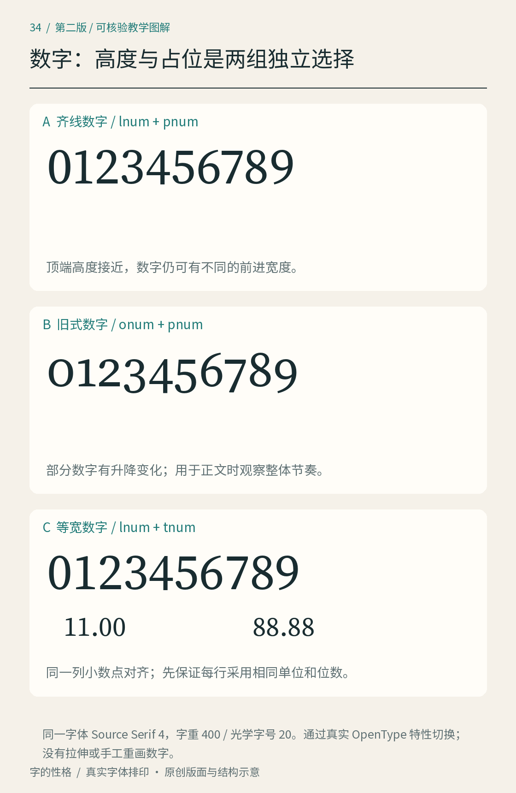

# 第34章　数字与符号：文字系统里容易忽略的一半

选字体时，我们常先看一句中文或几个漂亮字母；真正使用时，价格、年份、百分数、括号和单位却可能占据页面的一半。一款字体的汉字很协调，不能保证它的数字也适合账单；数字在海报里很醒目，也不能保证它们能在长表格中保持秩序。数字与符号需要单独观察。

*图34｜比较数字的占位和价格列的对齐。字体名称及演示条件以图内标注为准；不同字族的对照不能被解释成同一字体打开了某个功能。*

## 先分开两个问题：高度和宽度

齐线数字（lining figures）通常沿共同基线排列，并具有接近大写字母的高度；旧式数字（oldstyle figures，也称文本数字）则可能有上下伸部，更容易融入小写字母形成的高低节奏。这里说的是设计方式，不是新旧版本，也不是质量等级。将正文中的“2026”换成旧式数字，改变的是它与周围文字的形态关系，不能由此断言读者一定读得更快。

另一个维度是宽度。比例数字（proportional figures）为不同数字分配不同的前进宽度；等宽数字（tabular figures）让一套数字具有相同的前进宽度，便于按列排列。同为齐线数字，可以是比例的，也可以是等宽的；旧式数字也可能提供两种宽度。这两个维度不能合并成一条从“正文”到“表格”的分类线。

OpenType 用不同的特性标签描述这些选择，包括比例数字 `pnum`、等宽数字 `tnum`、旧式数字 `onum` 和齐线数字 `lnum`。但字体必须实际包含相应数据，软件也必须支持调用；界面上出现按钮，不代表当前字体一定提供四种组合。[资料：Microsoft，Registered features：p–t](https://learn.microsoft.com/en-us/typography/opentype/spec/features_pt)；[Registered features：k–o](https://learn.microsoft.com/en-us/typography/opentype/spec/features_ko)

## 做一张能暴露问题的价格表

为虚构的清风读书会制作一张材料费用练习表。这里的金额仅是排版测试：资料打印为12.00，茶样为108.50，纸卡为8.90，统一使用“元”。初稿把所有金额左对齐，读者先看到相同起点，却需要不断寻找各行的小数点；金额位数变化之后，整数和小数部分的关系变得松散。

修订时先把金额与项目名称分列，保留固定的小数位。最直接的办法是使用小数点制表位或相应对齐功能，让小数点落在共同位置。另一种办法是确认字体提供等宽数字并开启它，在相同字体、相同标点和同样保留两位小数的条件下，将金额右对齐：此时小数点之后的占位相同，才能稳定形成纵列。比例数字的“.00”、“.50”和“.90”未必同宽，不能仅凭保留两位小数就保证右对齐后的点号也对齐；小数位数不一致时更应直接按小数点对齐。不要在数字之间塞普通空格凑列，换字体或复制到别处之后，这种排列很容易失效。

观察时同时看“1111”和“8888”。轮廓宽度不同，不等于占位必然不同；反过来，视觉上宽窄接近，也不能证明前进宽度相等。要判断数字是否等宽，应查看字体度量或实际排印位置，而不是只量黑色笔画。

## 符号不是随便替换的装饰

“×”与字母“x”、“−”与连字符“-”、“℃”与单独的字母“C”，在形状、编码或语义上存在区别。不要因为当前字体缺少某个符号，就不加说明地换成看起来接近的字符。特别是数据、公式、价格与温度，视觉相似不能代替意义一致。Unicode 字符表可用于核查字符身份；它不为所有使用情境决定排版风格。[资料：Unicode，Code Charts](https://www.unicode.org/charts/)

同样要看标点是否与正文协调。将“（阅读）”“《清风》”“50%”“¥108.50”排在中文句子中，比较括号高度、货币符号与数字的距离，以及百分号的黑度。某个符号突然变粗或抬高，可能来自字体回退；先确认实际调用的字形，再讨论是否需要微调。不要把两个不同字体的符号拼在一起后，仍把整行标为单一字体样张。

## 用真实内容完成选择

最后保留三条测试文本：“本期共12人，阅读约90分钟”“材料费用108.50元”“版本2.0，比例为3∶2”。第一条看数字融入正文的程度，第二条看金额，第三条看标点与混排。测试条件包括字体文件、字重、字号、启用的特性和使用软件。记录越具体，日后修改越容易判断。

本章与[第17章的字距](17.md)、[第20章的中西搭配](20.md)共同使用：数字样式处理系统关系，字距处理连续组合，混排处理不同文字之间的衔接。它们相互影响，却不能互相代替。

## 本章资料

- [Microsoft：Registered features，p–t](https://learn.microsoft.com/en-us/typography/opentype/spec/features_pt)，比例和等宽数字等特性。
- [Microsoft：Registered features，k–o](https://learn.microsoft.com/en-us/typography/opentype/spec/features_ko)，齐线及旧式数字等特性。
- [Unicode：Code Charts](https://www.unicode.org/charts/)，核查字符身份。
