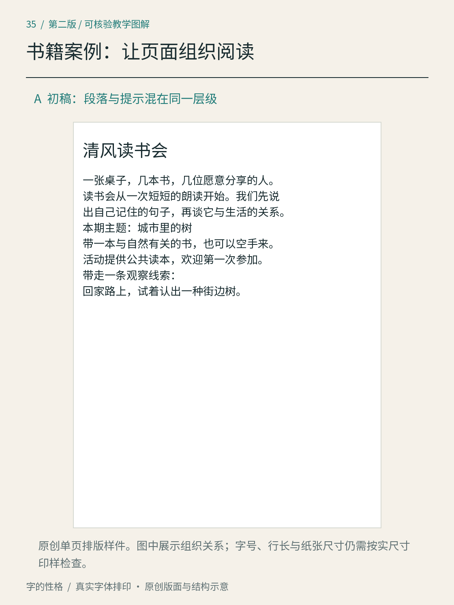
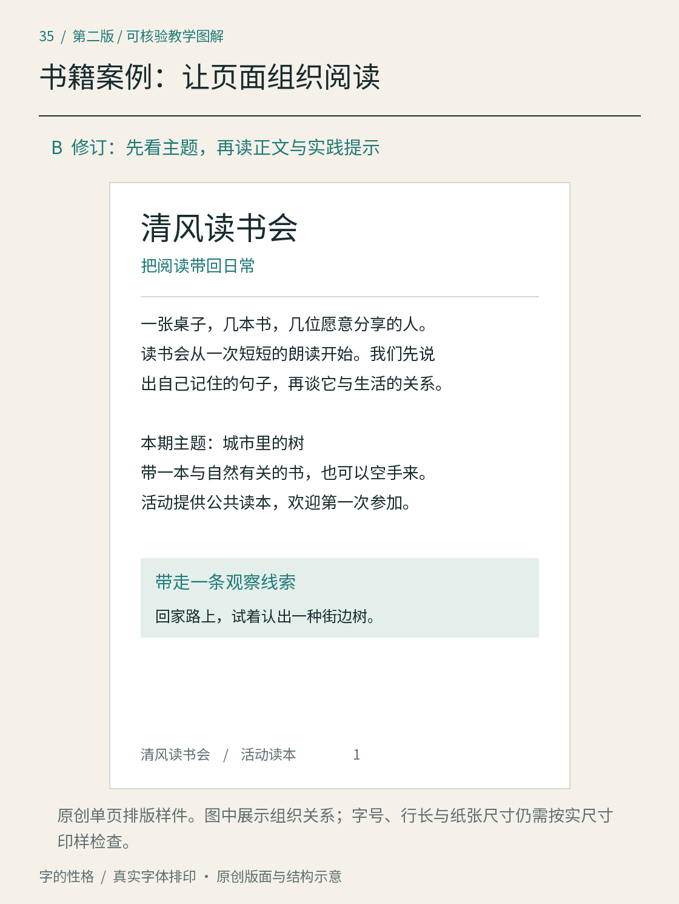
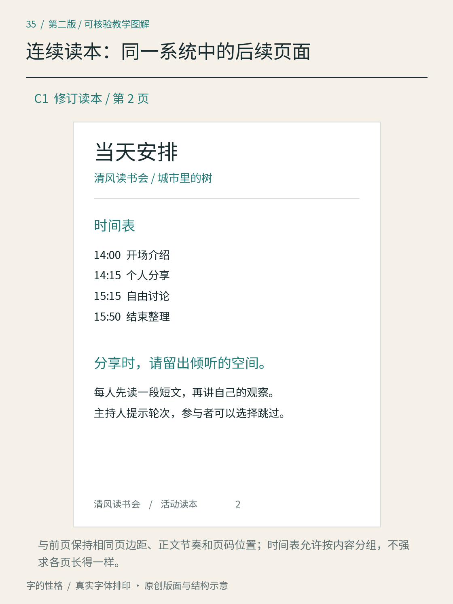
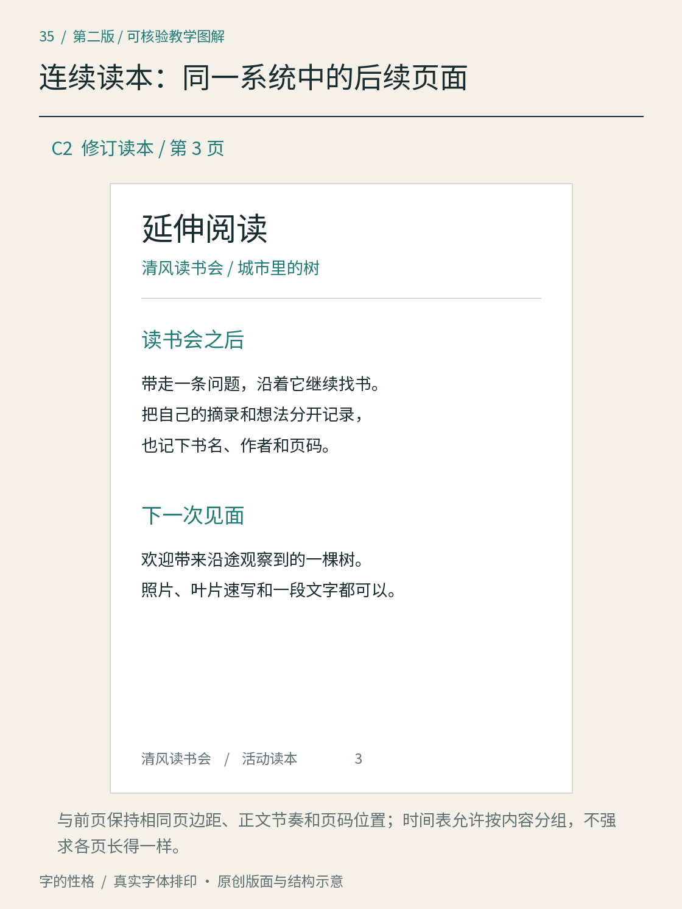

# 第35章　书籍案例：从一张读本页建立连续阅读

这一章开始用同一个虚构项目完成四种媒介。清风读书会是一场社区阅读活动：名称、时间、地点与文案均为本书自编，不能当作真实报名通知。小册、海报、茶礼纸套与报名界面共享文字气质，但各自承担不同工作。先从活动读本的一页开始，再检查同样的文字系统能否延续到后面的页面。

*图35A｜原创初稿。正文、本期主题和实践提示挤在相近的文字层级中，页边空间也较紧。图中是单页样件，不是已经排好的整本活动手册。*

## 让一页内容拥有清楚的角色

练习页先确定五类内容。项目名是“清风读书会”；导语为“一张桌子，几本书，几位愿意分享的人。读书会从一次短短的朗读开始。我们先说出自己记住的句子，再谈它与生活的关系。”本期主题是“城市里的树”；参与说明为“带一本与自然有关的书，也可以空手来。活动提供公共读本，欢迎第一次参加。”实践提示则写“回家路上，试着认出一种街边树”。

这些内容不是五段同等重要的正文。项目名帮助识别来源，导语建立活动情境，主题说明这一期读什么，参与说明消除疑问，实践提示把阅读带回日常。先划清角色，才知道哪里应该成为入口，哪里适合连续读，哪里需要读完之后重新找到。

初稿把它们大多排列为间距相近的连续行。读者能够逐字读完，却不容易略读；“本期主题”像是导语的下一句，“带走一条观察线索”也没有与上一段明确分开。边距较紧，让页面的外轮廓与正文都显得拥挤。这些问题主要出在关系，没有必要立刻更换字体。

## 修订：先整理，再强调

*图35B｜修订增加标题区与正文区的间隔，将主题说明独立成段，并把实践提示组织为独立区域。初稿与修订以相同核心文案比较；“把阅读带回日常”和页脚属于新增的导航文字。*

修订首先保留黑体风格的主体，让它继续承担阅读；再把项目名、导语、主题说明和实践提示拉开关系。标题区加入一句短语“把阅读带回日常”，帮助读者理解本页的任务。它是新增文案，因此这组图并非只改变一个参数的严格实验，而是一次包含编辑和排版的整体修订。比较时应把新增文字的影响与版面调整分开理解。

正文区把导语维持为连续段落，之后用段间空间引出本期主题与参与说明。留白在这里表达意义边界：它告诉目光刚才一段已经结束，下一段可以重新定位。并不是空白越多越好；如果两句紧密相连的说明被拉得很远，也会让人误以为属于不同任务。

实践提示放入独立的浅色区域，并使用与正文有所区别的标题与位置。即使暂时遮住背景颜色，它仍应凭区域、间距和文字样式被辨认；颜色只是强化关系。页脚注明“清风读书会／活动读本”，提供来源和文档身份，不与正文争夺注意。

## 单页成立之后，再把规则延续下去

在修订后的第1页基础上，下面继续排出第2、3页，让同一组样式面对不同内容。

*图35C1｜第2页保留标题、引导文字、页边距与页脚关系；时间表按时段分组，分享说明独立成段。*

*图35C2｜第3页把阅读后的行动建议与下次见面的观察任务分开，页脚数字接续前页。这些是实际排出的三页样件，尚不能代替印刷尺寸检查。*

当天安排与延伸阅读沿用同一组样式。当天安排的实际测试内容为“14:00开场介绍、14:15个人分享、15:15自由讨论、15:50结束整理”；延伸阅读页安排摘录记录与后续观察的建议，并未虚构具体书目。如果之后加入参考书，应填写真实书名、作者和版本，而不是把示例页当成已有书单。列表与说明段各有任务，不必伪装成相同的正文。

连续排版时固定页码的位置，检查小标题是否孤立在页底，图注是否与对应图分离。若某个标题放不下，应让它与后面的合理开头一起移到下一页，而不是独自留下；短图注也应与图邻近。这些是延伸制作时的检查项目，图35本身没有展示这些错误。

中文书页还需检查行首行尾、标点和长书名。W3C《中文排版需求》把这些问题分别展开，适合核查具体排版现象；它是持续更新的工作材料，不能代替某一本书的全部编辑判断。[资料：W3C《中文排版需求》](https://www.w3.org/TR/clreq/)

## 用两种阅读速度验收

先完整读导语，判断是否能稳定地从行末回到下一行；再只寻找“这一期讲什么”和“回家后可以做什么”，观察能否快速定位。随后以预期印刷尺寸输出样张，在正常距离检查。缩略图可以帮助判断黑白分布，不能证明实际字号、行长和细笔画适合阅读。

将选择保存为标题、正文、主题说明、实践提示和页脚几种样式。增加页面时优先复用这些关系，再根据真实内容调整。关于段落与层级，可回看[第21章](21.md)和[第22章](22.md)；本章把这些方法放到一份有实际文案的页面里，下一章将用同一项目处理短时观看的海报。

## 本章资料

- [W3C：《中文排版需求》](https://www.w3.org/TR/clreq/)，中文行、段落与标点问题的持续更新研究文档。
- [GOV.UK Design System：Headings](https://design-system.service.gov.uk/styles/headings/)，标题结构与视觉样式分别管理的实例；本案例借鉴组织方法，不照搬网页数值。
