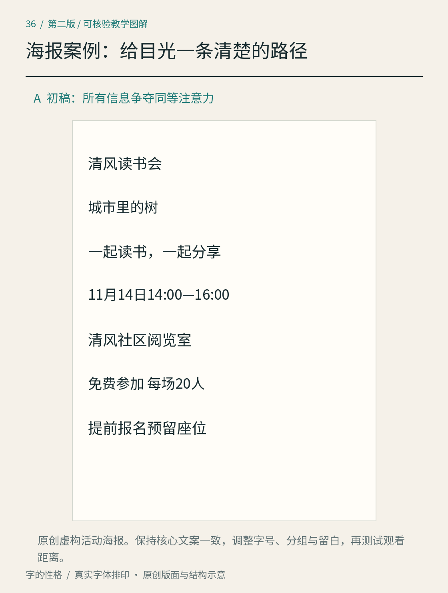
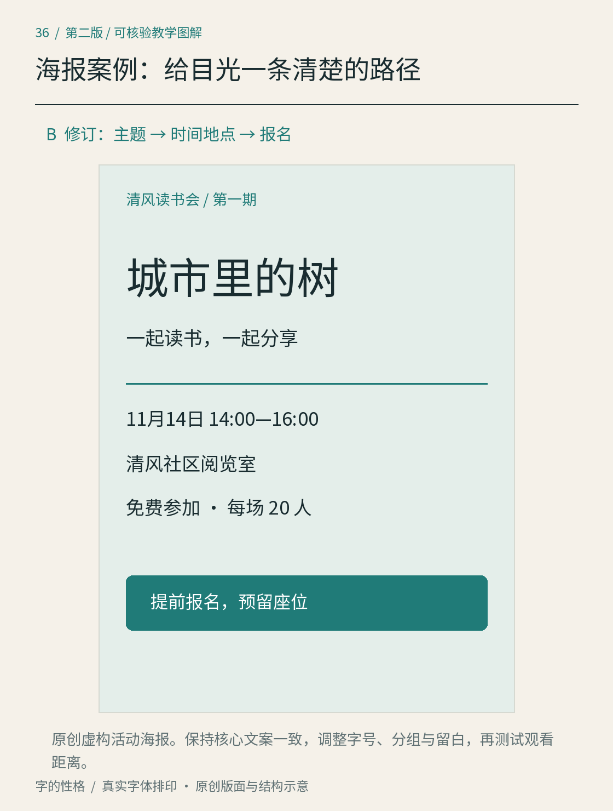

# 第36章　海报：从平均用力到清楚邀请

小册面对愿意坐下来阅读的人，海报面对还没有决定停留的人。同一个清风读书会项目，不能把小册某一页放大就算海报设计完成。海报需要让读者先识别活动，再判断时间与地点是否适合，最后找到下一步行动。

*图36A｜原创活动海报初稿。所有活动信息均为虚构；“扫码报名”是本练习文案，不配置假装可用的二维码。初稿和修订使用同一份核心信息，便于观察层级变化。*

## 先确定不可丢失的文案

这张海报使用活动名“清风读书会”、本期主题“城市里的树”、短句“一起读书，一起分享”、时间“11月14日14:00—16:00”、地点“清风社区阅览室”、参与条件“免费参加，每场20人”和行动提示“提前报名，预留座位”。它们承担不同角色，不能仅按字数多少决定大小。

练习先以A3竖版作为纸面画布，同时准备手机传播版本。A3只规定这一次的载体；字号、留白和对比仍需要按展示位置测试。我们希望本期主题成为第一个入口，活动名称说明来源，时间与地点成为第二组，短句和参与条件帮助读者完成决定。主办信息如果加入，应作为背景而非抢占入口。

## 初稿：每句话都想当标题

初稿让活动名、介绍、日期和地点采用接近的字号，并为每段增加粗字或边框。结果并非“信息更充分”，而是所有部分几乎同时出现。读者首先看到一个拥挤文字团，随后必须逐行翻译哪些是主题、哪些是细节。初稿即使使用好看的字体，也没有建立阅读顺序。

这里先不换字体、不加插画，只改关系。删去多余边框，让标题获得独立空间；把日期和地点放在同一区域；把“一起读书，一起分享”恢复为辅助短句。控制变量之后，读者才能判断改善来自信息组织，而不是来自新的背景照片。

## 修订：让三次停留各有所得

第一处停留看见“城市里的树”，上方的“清风读书会／第一期”交代系列来源。主标题是这一期的主题，系列名称无需和主题争夺同样的大小。标题可以根据画布分行，但应保留词组的完整识别，不能切成不自然的碎片。若使用装饰性字形，只让它承担这几个字的表达，详细信息仍用辨认稳定的字体。大字的字距也需要单独调整，不能机械沿用正文的设置。

第二处停留看见时间与地点。修订将它们通过共同的左侧起点与邻近位置组织，日期格式和地点名称本身已提供清楚线索，因此图中没有再添加重复标签。日期并非越大越好，而是应足以在目标距离识别；长地址若增加，要先调整分行与版面空间，不能立刻压成细小字。

第三处停留阅读条件与行动。把“免费参加”和“每场20人”放在日期地点后面，因为费用与名额影响参与决定。报名提示独立成块，写明“提前报名，预留座位”。本练习没有实际报名服务，因此图中只有行动文案；如果转为真实海报，还需要补充可用的报名地址、联系方式或经验证的二维码，不能用一块装饰色块代替渠道。

字体、字号、位置与空白共同形成层级。网页中的标题还涉及结构语义，不能把仅仅变大的段落当作完整标题实现；GOV.UK 的标题样式展示了结构与视觉可以分别管理。[资料：GOV.UK，Headings](https://design-system.service.gov.uk/styles/headings/) 纸面海报没有同样的HTML语义，但仍可采用“先分角色，再决定样式”的思路。

*图36B｜修订版让主题、时间地点和报名提示分别形成阅读停留点。图中为自编案例，不能作为真实活动通知。*

## 两种尺寸，分别检查

把纸面版按预期尺寸打印，走到实际可能观看的位置，寻找活动名、时间、地点。不要通过浏览器放大截图来替代这一步。再制作手机竖版：重新安排长句与留白，使关键文字能在正常宽度下阅读。手机版本允许改变分行与细节位置；保持同一文字风格，并不要求逐像素等比缩放。

第二次检查遮住介绍，只保留标题、日期、地点与行动，判断骨架是否完整；然后恢复介绍，检查它是否打断了主线。可以请别人短暂观看后回答“是什么活动、何时何地、如何参加”，记录漏掉的具体信息。这个小测试用于发现本设计的问题，不能据几位读者就推断所有受众偏好。

最后撤掉颜色，只看黑白版。若主题和行动提示只靠色相区分，就为它们增加位置、字重或形态上的线索。若发布成网页图片，应另提供可访问的文字信息；整张海报里的字不应成为读者获取日程的唯一途径。[资料：W3C WAI，Images of Text](https://www.w3.org/WAI/tutorials/images/textual/)

## 本章资料

- [GOV.UK Design System：Headings](https://design-system.service.gov.uk/styles/headings/)，信息层级与标题样式。
- [W3C WAI：Images of Text](https://www.w3.org/WAI/tutorials/images/textual/)，图片文字的可访问性与替代方式。
