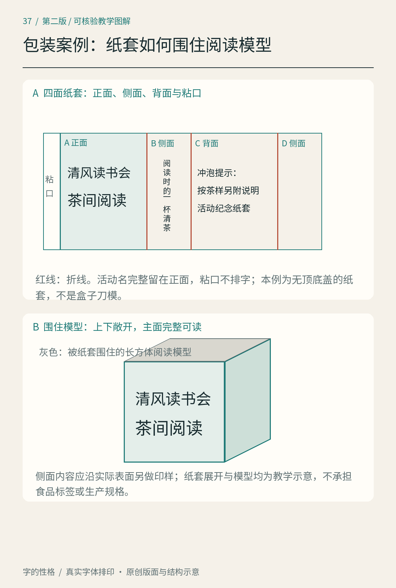

# 第37章　包装：文字必须跟着折线回到立体

清风读书会的第三件练习物，是包在茶样外面的纸套。它让我们遇到一个平面设计中容易忽略的问题：读者看到的并不是全部展开图，而是折起后的一面、转角和被手握住的区域。文字排在文件里，并不意味着实际拿起时仍能读到。

*图37｜原创纸套教学示意，只展示文字分区、折线与阅读关系。它不是生产刀模，也不包含真实食品商品的完整标签信息；折起外形用于解释遮挡，不能据图直接下单生产。*

## 先做一个能折起来的白样

我们选择一个长方体外形作阅读模型，围绕它制作四个连续面和粘合区。先用没有印刷内容的纸条围合，确定四面的相邻关系，再画折线。图中的尺寸和比例仅服务教学；实际纸厚、松紧、粘接和公差，需要通过材料与结构打样另行确定。

这一步的重要成果不是一个漂亮盒子，而是一张可信的面向关系图。把正面标为A，右侧标为B，背面标为C，左侧标为D，末端另设粘口。沿同一方向折起，确认标记能对应到预期位置。若展开次序错误，后续再精细的字距都会排到错误的面上。

## 写明每一面的职责

正面的文字为“清风读书会”和“茶间阅读”，用于识别项目与主题；侧面写“阅读时的一杯清茶”，作为短句过渡；背面写“冲泡提示：按茶样另附说明”，把操作信息交给随样茶类匹配的说明；粘口不放需要阅读的文字。本章没有虚构一种茶的统一冲泡温度，因为茶样尚未定义，排版案例不应制造工艺事实。

纸套与实际茶叶包装不是同一对象。这里不编写净含量、生产者、日期、配料等真实商品标签，也不把装饰性纸套当作具备食品接触或保护性能的包装。读者要学习的是信息面对立体结构时如何安排；商业成品应另有完整、核验过的产品内容，再进入相应设计和生产流程。

## 初稿：平面连续，立体断裂

初稿把“清风读书会”排成一条横跨正面和侧面的长标题。在展开图上，名字完整、留白均匀；折起之后，“会”落到转角后面，从正面看像少了一个字。背面短说明又贴近粘口，围合时部分字被覆盖。它们并不是字体本身难认，而是文字位置没有服从对象的阅读面。

修订将完整活动名收回正面，把主题“茶间阅读”放在同一面的第二层。侧面只放能够独立理解的短句，不承担项目名称的剩余部分；背面说明离开粘口，保持可阅读区域。我们没有把跨面文字一律判为错误：有些设计故意利用转角制造连续效果，但识别信息必须经过实际观看测试。本案例的任务是让人正面拿起就知道它属于什么项目，因此选择完整保留。

## 折线、裁切与留白不能混为一谈

折线决定纸如何转向；裁切边决定成品到哪里结束；出血（bleed）让背景图形越过预定裁切边，降低裁切偏差露白的机会。出血不等于文字安全距离，也不能保护折线附近的字。具体出血和安全区数值应来自实际印制要求，不从教学图中量取一个比例套用。

Adobe 的 InDesign 文档说明了出血与打印输出相关设置，适合进一步理解平面文件和裁切区域的关系；本案例只借用概念，不指定印厂参数。[资料：Adobe，Printer's marks and bleeds](https://helpx.adobe.com/indesign/using/printers-marks-bleeds.html)

文字也需要与材料一起检查。深底细字、烫印小字、压纹和粗糙纸面的效果，不能凭发光屏幕的预览确认。这个练习先使用高对比黑白打印，排除材料特效；如果以后改用其他工艺，再制作对应实物样件，重新检查笔画和小字号信息。

## 最后拿起来读一遍

验收依次看正面、侧面和背面，记录每次转动前能获得什么信息。随后用手握住下半部，再看名称是否仍能辨认；把两只纸套并排，检查识别是否依赖旁边恰好没有别的物品。最后重新展开，核对正反方向和粘合区是否与白样一致。

本章完成的是“展开编排—折起阅读—回到平面修订”的循环。它与[第36章海报](36.md)共享字体角色，但比海报多了一层结构与遮挡约束；这正是跨媒介设计需要重新判断的地方。

## 本章资料

- [Adobe InDesign：Printer's marks and bleeds](https://helpx.adobe.com/indesign/using/printers-marks-bleeds.html)，出血、印刷标记及输出设置的概念说明。
- [W3C：《中文排版需求》](https://www.w3.org/TR/clreq/)，供核查中文段落、标点与文字方向问题；纸套结构为本书原创教学模型。
