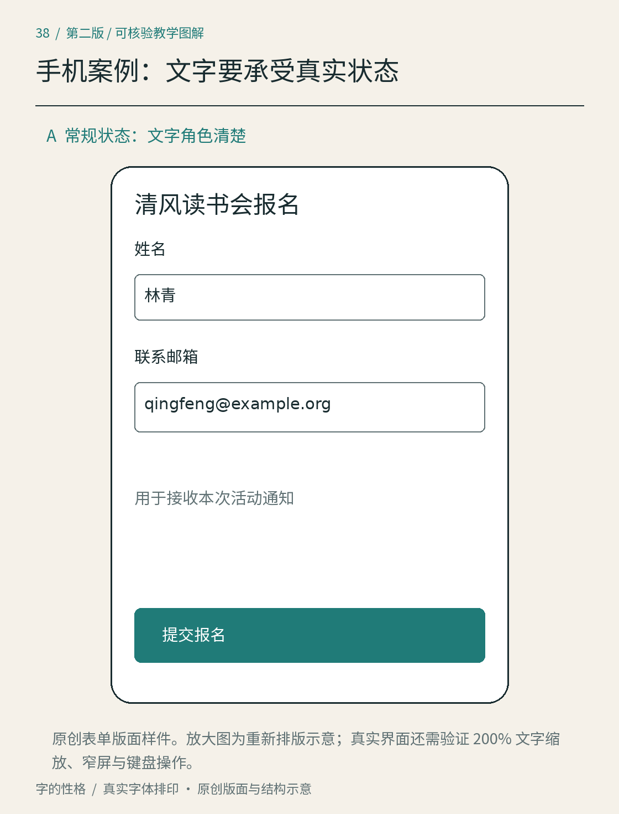
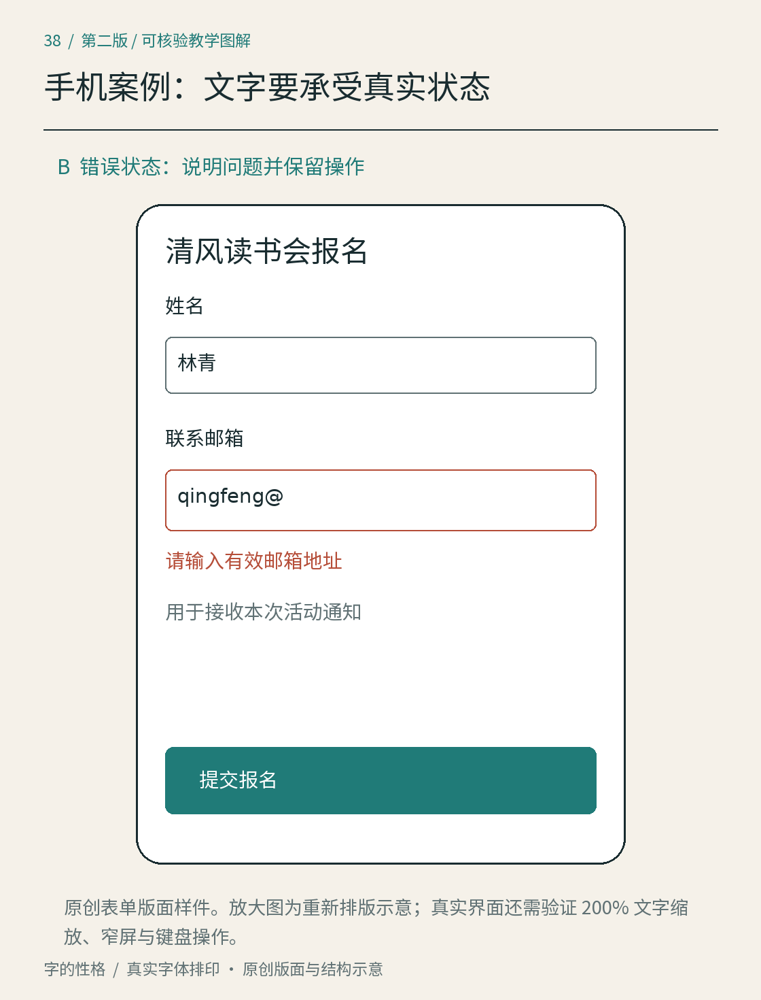
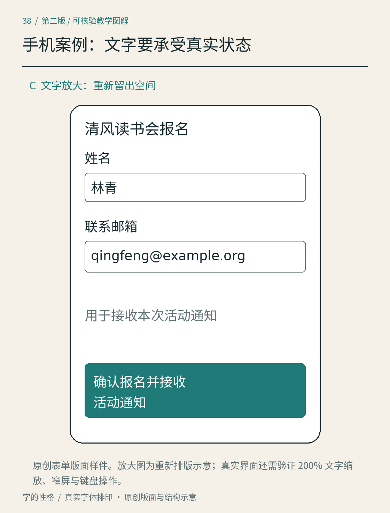

# 第38章　手机报名页：文字要在变化中继续工作

最后把清风读书会做成一张手机报名页。与海报相比，这里不只需要让人知道活动，还要帮助人输入、纠错、确认提交。界面的文字不是固定画面中的装饰物；输入内容、屏幕宽度、系统字号和错误状态都会改变版面。

*图38｜原创界面排版案例，展示修订后的常规状态，不连接真实报名服务。示意图不能代替键盘、辅助技术和实际设备测试；窄屏检查应在真实实现中完成。*

## 内容从完成任务倒推

页面标题是“清风读书会报名”，主体只有“姓名”“联系邮箱”两个字段，再出现“提交报名”按钮。日期、时间和地点应由活动详情页或报名确认信息提供，图中的紧凑表单没有再次绘制日程。活动文案沿用前几章的虚构信息。这一版不收集真实数据，也不加入没有用途的个人信息字段。若未来成为实际服务，应先明确报名所需内容，再决定表单。

我们给练习设定四种文字角色：页面标题、活动说明、字段标签、帮助与状态信息。先用同一黑体字族的少量字重区分角色，正文从18 CSS像素左右的观察起点开始；这是本练习的调试设置，并非所有手机界面的标准。按钮通过位置和边界形成操作入口，不依靠把字号无限放大。

## 初稿：看起来干净，输入后却迷路

先推演一种常见的初稿：把“姓名”和“邮箱”只写在输入框的占位文字里。空白时界面很整齐，输入后这些提示消失，读者回看时无法立即判断当前字段的用途。与此同时，提交按钮使用固定高度；按钮文字换成较长说明后，被裁掉最后几个字。错误只用红色边框表示，没有告诉读者应该改什么。

图38A直接展示修订后的可见标签；上述占位文字消失和按钮裁切属于问题推演，图中没有伪造一次实际失败测试。修订首先把字段标签放到输入框上方；真实实现还应与输入控件建立关联。W3C WAI 的表单教程说明了标签与控件的对应关系；它不仅服务视觉阅读，也帮助辅助技术识别字段。[资料：W3C WAI，Labeling Controls](https://www.w3.org/WAI/tutorials/forms/labels/) GOV.UK 的文本输入指南也明确区分可见标签与占位文字，不用输入后消失的内容承担唯一标签。[资料：GOV.UK，Text input](https://design-system.service.gov.uk/components/text-input/)

## 状态信息要让人知道怎样继续

在“联系邮箱”下面，帮助文字写“用于接收本次活动通知”，解释为什么需要它。若输入格式无法接受，错误状态写“请输入有效邮箱地址”，并保留原输入，方便修改。若当前输入只是一个示意字符串，图中应把它当作测试数据，不暗示真实邮件已经发送。

错误信息要与对应字段邻近，不能只在页面最上方出现一句“失败”。颜色可以帮助寻找，但仍需要可读的文字。GOV.UK 的错误组件说明了保留输入、解释问题与修正方向的做法。[资料：GOV.UK，Error message](https://design-system.service.gov.uk/components/error-message/) 如果错误实际来自服务不可用，就应说明服务状态，而不是指责用户把邮箱填错。

按钮文案使用“提交报名”，让人知道触发的动作。为检验弹性，再换成测试长文案“确认报名并接收活动通知”。修订版允许文字自然换行、容器随内容增高，同时保留足够的内边距；采用固定高度的初稿则可能出现裁切，需要在实现中实际验证。这个实验验证布局能否容纳变化，不表示按钮应长期采用冗长文案。

*图38B｜错误状态应解释问题，并保留用户原有输入；标签与错误不能只靠颜色表达。*

## 窄屏和放大需要分别看

先把内容宽度缩小，检查活动时间、长邮箱和按钮能否在单栏中重排。长字符串需要有适当的断行或滚动策略，不能把整个页面撑得左右移动。再放大文字，查看字段标签、错误说明和按钮是否重叠。只看一张正常尺寸截图，无法发现这类问题。

WCAG 的重排要求关注在规定等效宽度下是否丢失信息或功能，并对确实需要二维布局的内容保留例外；它不等于要求所有页面在任意尺寸都保持原始布局。这里的普通单列表单应优先通过重排适应狭窄空间。[资料：W3C，Understanding Reflow](https://www.w3.org/WAI/WCAG22/Understanding/reflow.html)

*图38C｜增大的文字需要相应版面空间。本图是重新编排示意，真实界面还须接受缩放、窄屏和键盘测试。*

## 从图稿回到真实文字

最终实现应保留可选择、可复制的文本，而不是把整个页面导出成一张大图片。标题使用合适的结构标记，字段使用真正的输入控件，标签、帮助文字和错误提示按需关联；键盘焦点也应有清楚的位置。我们的教学图展示外观关系，不能证明这些代码行为已经正确。

四种媒介做到这里，可以回头比较：小册维持连续阅读，海报组织短时注意，纸套应对转角和遮挡，手机页容纳输入与状态变化。共同的字族和层级关系使它们属于同一个项目；各媒介的阅读条件，则决定了它们必须如何调整。

## 本章资料

- [W3C WAI：Labeling Controls](https://www.w3.org/WAI/tutorials/forms/labels/)，标签与控件的关联。
- [GOV.UK：Text input](https://design-system.service.gov.uk/components/text-input/)，可见标签、帮助信息和输入。
- [GOV.UK：Error message](https://design-system.service.gov.uk/components/error-message/)，错误状态与保留输入。
- [W3C：Understanding Reflow](https://www.w3.org/WAI/WCAG22/Understanding/reflow.html)，内容放大和单向阅读条件。
