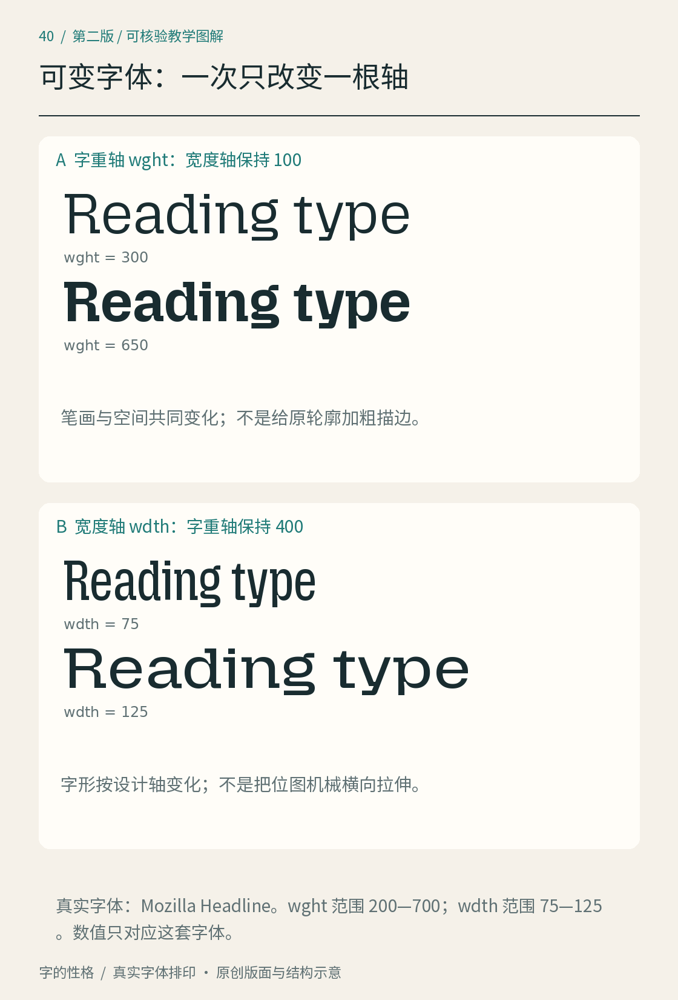
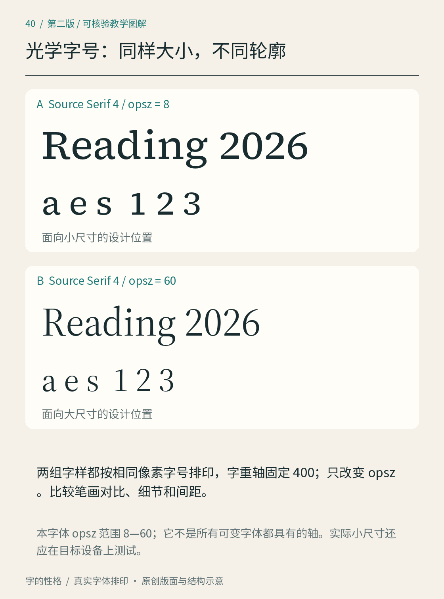

# 第40章　可变字体与屏幕上的真实阅读

把字体菜单里的字重从 Regular 换成 Bold，读者容易理解；面对一根可以连续拖动的滑杆，问题就多了：它是在拉伸字形，还是在调用设计过的变化？如果软件允许输入任意数值，是否代表字体具备所有变化？本章用真实文件检查三种常见设计轴，再把观察放回小字号、窄屏和文字放大的阅读环境。

*图40｜Mozilla Headline 的字重与宽度分别改变，每组保持另一轴不变；文字大小与测试文案在同组内一致。图中比较字体实例；页面重排另见第38章案例。字体来源见 [Mozilla 官方项目](https://github.com/mozilla/mozilla-headline-type)。*

## 先查文件，再谈滑杆

工程中的 Mozilla Headline 文件提供 `wght` 与 `wdth` 两个轴。读取实际 fvar 记录可知，前者范围为200—700、默认200，后者为75—125、默认100；这是随书使用版本的记录，其他字体或后续版本需要另查。Mozilla Text 文件则仅提供 `wght`。它们都没有 `opsz`，不能因为软件里有“光学字号”选项，就认定这两个文件会发生对应的轮廓变化。

可变字体（variable font）用设计轴描述经过设计的变化空间，并不意味着所有轴都必须出现。即使两款字体都提供字重轴，数值相同也不保证视觉黑度相同；同一字体在不同语言、字母组合和显示条件下，也需要放回实际文本检查。OpenType 的[可变字体概览](https://learn.microsoft.com/en-us/typography/opentype/spec/otvaroverview)解释了这一机制。对读者来说，最有用的第一步是记下文件、版本、轴标签、最小值、默认值和最大值，而不是盲目照抄滑杆数值。

## 字重、宽度、光学字号各改什么

字重轴 `wght`（weight）主要改变笔画厚度与相关设计细节。观察图40的字重组：保持宽度为100，只改变字重，再看笔画、字内留白与整词长度。不要预设加粗时字宽必须完全不变；设计者可能为了协调形状同步调整其他细节。[OpenType 字重轴说明](https://learn.microsoft.com/en-us/typography/opentype/spec/dvaraxistag_wght)给出定义与数值约定。

宽度轴 `wdth`（width）沿字体设计的窄宽空间变化，数值以设计者定义的正常宽度100为参照。它不是把已经画好的文字图片横向压扁。图40的宽度组固定字重再比较，注意竖画粗细、曲线转折和字腔是否一起得到处理。一段标题在窄体实例中可能少换一行，但不应因此无限压窄正文；如果字号、行长或信息量有问题，字形变窄只能处理其中一部分。[OpenType 宽度轴说明](https://learn.microsoft.com/en-us/typography/opentype/spec/dvaraxistag_wdth)也指出，这个百分比基于该字体的设计参照，而非不同字族之间的绝对尺子。

*图40B｜Adobe Source Serif 4 的真实光学字号实例：字重固定400，分别取 opsz=8与60，再以相同显示尺寸排印，便于放大观察轮廓差别。这样的并置用于研究设计，不表示大字号实例适合小字。来源：[Adobe Source Serif 项目](https://github.com/adobe-fonts/source-serif)。*

光学字号轴 `opsz`（optical size）为不同文字尺寸调整设计。图40B使用的 Source Serif 4 文件实际提供8—60的光学字号范围，默认20，字重范围200—900、默认400。小字号与大字号的设计可能在细节、比例、笔画与间距上不同；具体改变什么，要看这款字体实际轮廓，不能把某一种处理写成所有字体的通则。[OpenType 光学字号说明](https://learn.microsoft.com/en-us/typography/opentype/spec/dvaraxistag_opsz)明确把它定义为适应不同文字尺寸的设计变化。最终应分别按预期小字和大字尺寸再看一次，而不只停留在放大比较。

## 小字要看显示结果，不能只看轮廓

矢量轮廓经过屏幕渲染才成为像素。同一字号在不同屏幕密度、缩放比例和系统中，边缘与细节可能不同。把字放大十倍检查曲线很必要，却不能证明它在手机注释里好读。准备包含“清风读书会 2026”、日期、括号和英文名称的短段，先用目标字号显示，回到正常观看距离检查，再放大定位问题。注意中文是否换了回退字体、数字是否过轻、标点是否挤进相邻文字。

若某一字缺失，回退字体（font fallback）可能让它突然变宽、变粗或改变行高。不要马上用单字缩放来掩盖差别；先检查字符覆盖和语言标记，再选择合适的字体组合。字体加载失败也应当测试：网页文字应继续可读，操作按钮仍须能容纳后备字体的长度。把自定义字体当作唯一成功条件，会漏掉真实用户可能遇到的状态。

## 放大以后，信息必须还在

在第38章的报名界面中，把文字从正常大小逐步放大到200%，每一步都检查标题、标签、错误说明和按钮。文字变大以后，文本框应增加高度或自然换行；不能用固定高度把第二行截掉，也不应让按钮文字覆盖相邻控件。WCAG 2.2 的文字缩放准则要求，在其适用范围内，文字能放大至200%且不丢失内容与功能；其适用例外和解释见 [W3C Resize Text](https://www.w3.org/WAI/WCAG22/Understanding/resize-text.html)。通过这一步并不等于完成全部无障碍评估。

再缩窄视口，检查主要正文是否能够在窄幅内重新排成多行，而不是要求读者阅读每一行都左右拖动。W3C 的[重排说明](https://www.w3.org/WAI/WCAG22/Understanding/reflow.html)以等效320 CSS像素宽等条件讨论这一要求，并保留确实需要二维布局的内容例外。可变宽度轴可以参与视觉设计，却不能代替容器重排；把所有字压窄以保住一行，会把布局问题转移给读者辨认。

## 留下一张真实环境记录

为自己的页面记录字体文件、轴值、系统、浏览器、视口、文字缩放和检查结果，保留正常、放大、缺字与加载失败四种状态。每次只改一个变量：先固定字体调整字号，再固定字号调整宽度轴，最后检查排版。这样你能分清“字体实例更适合了”和“页面终于给文字留出了空间”。屏幕阅读的质量，来自字形、排版与使用环境共同配合；滑杆提供选择，实际阅读决定它是否合适。

本章资料：[Microsoft：可变字体概览](https://learn.microsoft.com/en-us/typography/opentype/spec/otvaroverview)及 [wght](https://learn.microsoft.com/en-us/typography/opentype/spec/dvaraxistag_wght)、[wdth](https://learn.microsoft.com/en-us/typography/opentype/spec/dvaraxistag_wdth)、[opsz](https://learn.microsoft.com/en-us/typography/opentype/spec/dvaraxistag_opsz)；[Mozilla Headline 官方项目](https://github.com/mozilla/mozilla-headline-type)；[Adobe Source Serif](https://github.com/adobe-fonts/source-serif)；[W3C：Resize Text](https://www.w3.org/WAI/WCAG22/Understanding/resize-text.html)、[Reflow](https://www.w3.org/WAI/WCAG22/Understanding/reflow.html)。

在线版可使用[字体实验台](https://yzyexp.github.io/Learn-Font/type-lab/)重复字重、宽度与段落重排实验。它随本次扩充版合并发布；EPUB中保留相同知识的静态对照图。
